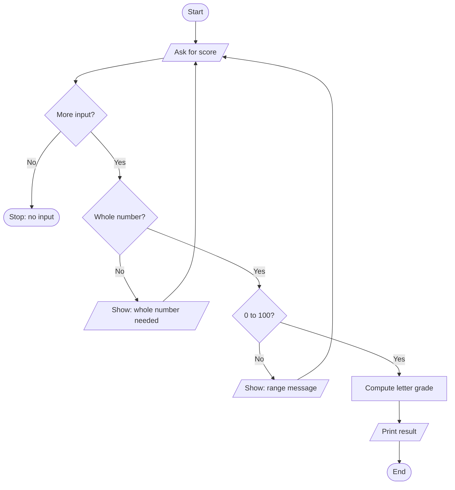
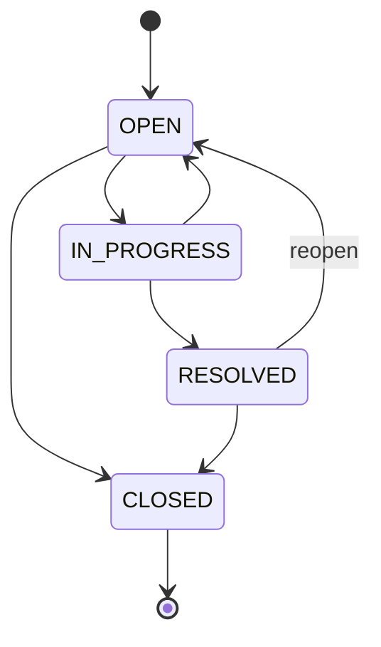

# Java Super Fundamentals: From Logic Design to Professional Java Swing Applications

A single-file, step-by-step handbook for learning Java by building real programs: console tools, input validation, text and array processing, classes, files, `JOptionPane` dialogs, Swing desktop applications, and the testing and security habits that make programs trustworthy.

**Teaching baseline: Java 21 (LTS).** Core examples compile with Java 21. Where a feature needs a different version, the text says so. Everything uses standard Java and Swing; optional third-party tools (for example JUnit or a database driver) are in clearly labeled optional sections.

> **How to study:** read one section, type the example yourself (do not paste), *predict the output before you run it*, run it, then change values and try invalid input. If you cannot explain why a line exists, you are not done with it yet.

> **Honesty note about the code.** Every complete program in this guide starts with a `// File: ...` comment. Those programs were extracted from this document and compiled together with JDK 21 (`javac --release 21 -Xlint:all`) while the guide was prepared. **Compiling is not the same as testing.** The "Expected output" blocks for console programs were produced by actually running those programs (they are inserted from real runs), but not every input listed in a test table was executed by hand. Swing programs were also *launched* on a virtual display to confirm they start without exceptions. For the Chapter 24 capstone I additionally looked at a screenshot of the running window and confirmed with simulated mouse clicks that the buttons enable and disable as described. Most other window descriptions ("You should see...") state what the code is designed to do; run them and compare. The `JdbcSketch` and the JUnit snippet were not run against a database or JUnit. Nothing here has been security-audited, and no checklist guarantees that a system is secure.

## Table of Contents

- **[How to Use This Guide](#how-to-use-this-guide)**
  - [Prerequisites](#prerequisites)
  - [Four kinds of code in this guide](#four-kinds-of-code-in-this-guide)
  - [Running a complete program](#running-a-complete-program)
  - [The lesson template used in this guide](#the-lesson-template-used-in-this-guide)
  - [Conventions used throughout](#conventions-used-throughout)
  - [Learning roadmap and progress checklist](#learning-roadmap-and-progress-checklist)
- **[PART 1: Getting Started and Thinking Like a Programmer](#part-1-getting-started-and-thinking-like-a-programmer)**
  - [Chapter 1. How Java Works and Setting Up Your Tools](#chapter-1-how-java-works-and-setting-up-your-tools)
  - [Chapter 2. The Programmer's Thinking Process](#chapter-2-the-programmers-thinking-process)
- **[PART 2: Core Language Fundamentals](#part-2-core-language-fundamentals)**
  - [Chapter 3. Variables, Types, and Expressions](#chapter-3-variables-types-and-expressions)
  - [Chapter 4. Input and Output](#chapter-4-input-and-output)
  - [Chapter 5. Decisions: `if`, `switch`, and Boolean Logic](#chapter-5-decisions-if-switch-and-boolean-logic)
  - [Chapter 6. Loops](#chapter-6-loops)
- **[PART 3: Data and Text](#part-3-data-and-text)**
  - [Chapter 7. Strings: Text Done Right](#chapter-7-strings-text-done-right)
  - [Chapter 8. Arrays](#chapter-8-arrays)
  - [Chapter 9. Collections and Generics](#chapter-9-collections-and-generics)
- **[PART 4: Reusable Code, Objects, and Resilience](#part-4-reusable-code-objects-and-resilience)**
  - [Chapter 10. Methods and Reusable Logic](#chapter-10-methods-and-reusable-logic)
  - [Chapter 11. Classes, Objects, and Access Control](#chapter-11-classes-objects-and-access-control)
  - [Chapter 12. Inheritance, Interfaces, Polymorphism, and Modern Types](#chapter-12-inheritance-interfaces-polymorphism-and-modern-types)
  - [Chapter 13. Exceptions, Files, Dates, and Standard APIs](#chapter-13-exceptions-files-dates-and-standard-apis)
  - [Chapter 14. Lambdas, Streams, `Optional`, Concurrency, and Complexity](#chapter-14-lambdas-streams-optional-concurrency-and-complexity)
- **[PART 5: Dialogs](#part-5-dialogs)**
  - [Chapter 15. JOptionPane: From First Dialog to Custom Desktop Forms](#chapter-15-joptionpane-from-first-dialog-to-custom-desktop-forms)
- **[PART 6: Java Swing and JFrame: Build Desktop Applications Step by Step](#part-6-java-swing-and-jframe-build-desktop-applications-step-by-step)**
  - [Chapter 16. The First Window, Components, and Layout Managers](#chapter-16-the-first-window-components-and-layout-managers)
  - [Chapter 17. Events, Forms, Validation, Navigation, and Tables](#chapter-17-events-forms-validation-navigation-and-tables)
  - [Chapter 18. Threading, Appearance, Architecture, and Persistence](#chapter-18-threading-appearance-architecture-and-persistence)
- **[PART 7: Professional Practice](#part-7-professional-practice)**
  - [Chapter 19. Professional Coding Standards](#chapter-19-professional-coding-standards)
  - [Chapter 20. Testing, Debugging, and Quality Assurance](#chapter-20-testing-debugging-and-quality-assurance)
  - [Chapter 21. Secure Coding, Digital Safety, and Resisting Social Engineering](#chapter-21-secure-coding-digital-safety-and-resisting-social-engineering)
  - [Chapter 22. Review Toolkit: Refactoring, Secure Development Process, and Checklists](#chapter-22-review-toolkit-refactoring-secure-development-process-and-checklists)
- **[PART 8: Projects](#part-8-projects)**
  - [Chapter 23. The Progressive Project Pathway](#chapter-23-the-progressive-project-pathway)
  - [Chapter 24. Capstone: Helpdesk Ticket Tracker](#chapter-24-capstone-helpdesk-ticket-tracker)
- **[PART 9: Reference and Next Steps](#part-9-reference-and-next-steps)**
  - [Chapter 25. Quick Reference, Glossary, and Where to Go Next](#chapter-25-quick-reference-glossary-and-where-to-go-next)

## How to Use This Guide

### Prerequisites

You need a computer where you can install software, a text editor or IDE, and patience for typing and re-reading. You do **not** need prior programming experience. Object-oriented programming, GUI event handling, databases, and cybersecurity are all taught from first principles in order.

### Four kinds of code in this guide

| Label | What it means | How to recognize it |
|---|---|---|
| **Complete program** | Compiles and runs as-is, with imports and an entry point | First line is `// File: Name.java` |
| **Snippet** | A fragment that shows one idea; it needs surrounding code | No `// File:` line |
| **Pseudocode** | Plain-language steps for planning; not Java | Fenced as `text` |
| **Optional extension** | Needs extra tools or goes beyond the core path | Marked **(Optional)** in the heading |

### Running a complete program

1. Create a folder, for example `java-lab`.
2. Save the program using the file name in its `// File:` comment (the name must match the `public class`). If the path contains folders such as `com/example/...`, create those folders.
3. Compile and run (details in [Chapter 1](#chapter-1-how-java-works-and-setting-up-your-tools)):

```bash
javac HelloJava.java
java HelloJava
```

### The lesson template used in this guide

Important topics follow this shape (very small topics skip steps that do not apply):

1. **Learning goal**: what you should be able to do afterward.
2. **Why it matters**: where this appears in real programs.
3. **Concept**: a simple mental model and the vocabulary.
4. **Syntax and example**: runnable code, then a line-by-line walkthrough.
5. **Expected result**: sample output or a description of the window.
6. **Common mistakes**: why they happen and how to fix them.
7. **Edge cases and test plan**: empty, invalid, boundary, and cancel cases.
8. **Practice with hints**: try first; hints come before solutions.
9. **Review checklist and next step**: what to confirm and what comes next.

### Conventions used throughout

- **Classes and interfaces:** `UpperCamelCase`, for example `StudentRecord`.
- **Methods, variables, parameters:** `lowerCamelCase`, for example `readStaffCount()`.
- **Constants:** `UPPER_SNAKE_CASE`, for example `MAX_CAPACITY`.
- **Packages:** all lowercase, for example `com.example.helpdesk`.
- **Indentation:** four spaces; braces on the same line as the statement.
- **Validation:** reject bad data clearly and ask again; never silently ignore it.
- **Exceptions:** catch the specific failure you expect, not everything.

### Learning roadmap and progress checklist

| Phase | Chapters | You are ready to move on when you can... |
|---|---|---|
| 1. Setup and thinking | 1-2 | compile and run a program; plan one with IPO and pseudocode |
| 2. Core language | 3-6 | write programs with variables, decisions, loops, and validated input |
| 3. Data and text | 7-9 | process Strings, arrays, and collections without index mistakes |
| 4. Reusable code and objects | 10-14 | split a program into methods and classes; handle exceptions and files |
| 5. Dialogs and Swing | 15-18 | build a validated Swing form and a `JTable` application |
| 6. Professional practice | 19-22 | review code for quality, test it, and apply secure habits |
| 7. Projects | 23-25 | finish the staged capstone and publish it safely |

- [ ] Phase 1 done: I ran a program from the command line and wrote pseudocode for a small task.
- [ ] Phase 2 done: I wrote a menu program that survives bad input.
- [ ] Phase 3 done: I computed array statistics and handled the empty-array case.
- [ ] Phase 4 done: I built a small class with a validated constructor and saved data to a file.
- [ ] Phase 5 done: I built a Swing form with layout managers and cancel handling.
- [ ] Phase 6 done: I wrote a test plan and a security checklist for my own code.
- [ ] Phase 7 done: I finished the capstone and removed all secrets before publishing.

---

## PART 1: Getting Started and Thinking Like a Programmer

### Chapter 1. How Java Works and Setting Up Your Tools

**Learning goal:** explain what the JDK, compiler, bytecode, and JVM do; install and verify a JDK; compile and run a program; read the most common error messages; and set up a clean project folder with Git.

**Why it matters:** if you cannot compile, run, and read errors, you cannot learn anything else. Most beginner frustration here is tooling, not intelligence.

#### 1.1 What Java is used for

Java is a general-purpose, statically typed, object-oriented language. You will find it in server back ends, Android apps, enterprise systems, desktop tools, build systems, and big-data software. In this guide you will use it for console programs and for desktop windows built with **Swing**, a GUI toolkit that ships with the JDK. Swing is *desktop* software; it is separate from web front-end development (HTML/CSS/JavaScript in a browser).

#### 1.2 From source code to a running program

```text
HelloJava.java  --javac-->  HelloJava.class  --java (JVM)-->  program output
 source code        compiler     bytecode         runtime
```

- **Source code** is the text you write in `.java` files.
- The **compiler** (`javac`) checks syntax and types, and translates source into **bytecode** stored in `.class` files. Compile errors stop here, before the program runs.
- **Bytecode** is an instruction set for a virtual machine, not for a specific processor.
- The **JVM** (Java Virtual Machine) loads bytecode and runs it. The same `.class` file can run on any operating system that has a compatible JVM.
- The **JRE** is the runtime environment (JVM plus libraries). The **JDK** (Java Development Kit) includes the JRE **plus** the compiler and tools. You need the JDK to develop.

#### 1.3 Install and verify a JDK

Install a current JDK (this guide uses **JDK 21**) from a trusted vendor: for example an OpenJDK build such as Eclipse Temurin, or Oracle's download page. Follow the vendor's official instructions for your operating system, because installer steps change between versions. Then verify:

```bash
java -version
javac -version
```

Both commands should print a version beginning with `21` (or newer). If `javac` is "not found" but `java` works, you have a runtime only; install the JDK. If neither is found, the install directory is not on your `PATH` (check your vendor's instructions; the exact steps are operating-system dependent).

#### 1.4 Your first program

```java
// File: HelloJava.java
public class HelloJava {
    public static void main(String[] args) {
        String name = "Java learner";
        int practiceHours = 1;

        System.out.println("Hello, " + name + "!");
        System.out.printf("Today's practice: %d hour(s).%n", practiceHours);
    }
}
```

Compile and run from the folder that contains the file:

```bash
javac HelloJava.java
java HelloJava
```

**Expected output**

```text
Hello, Java learner!
Today's practice: 1 hour(s).
```

`javac` created `HelloJava.class` next to your source. Note that you run `java HelloJava` (the **class name**, no `.class`, no `.java`).

> **Shortcut:** since Java 11 you can run a single source file directly with `java HelloJava.java`. It compiles in memory and runs. This is convenient for experiments, but real projects use `javac` or an IDE/build tool.

#### 1.5 Anatomy of the `main` method

```java
public static void main(String[] args)
```

| Part | Meaning | Why it is written this way |
|---|---|---|
| `public` | Accessible from anywhere | The JVM must be able to call it from outside your class |
| `static` | Belongs to the class, not to an object | The JVM starts the program *before any object exists*, so it cannot call an instance method |
| `void` | Returns nothing | The JVM does not use a return value; use `System.exit(code)` to signal status |
| `main` | The agreed entry-point name | The launcher looks for this exact name |
| `String[] args` | Command-line arguments | `java Tool one two` gives `args = {"one", "two"}` |

> Java 21 includes a *preview* feature that allows a simpler `void main()`. Preview features need extra flags and may change, so this guide uses the classic signature everywhere.

#### 1.6 Files, class names, packages, and imports

- A file may contain only **one `public` top-level class**, and the file name must match it exactly (`Student` lives in `Student.java`; Java is case-sensitive).
- A **package** groups related classes and is declared on the first line: `package com.example.hello;`. The folder structure must match: `com/example/hello/`.
- An **import** lets you write `Scanner` instead of `java.util.Scanner`. Classes in `java.lang` (such as `String`, `Math`, `System`) are imported automatically.

```java
// File: com/example/hello/HelloPackage.java
package com.example.hello;

import java.time.LocalDate;

public class HelloPackage {
    public static void main(String[] args) {
        System.out.println("Today is " + LocalDate.now());
    }
}
```

Compile into an output folder and run using the **fully qualified** class name:

```bash
javac -d out com/example/hello/HelloPackage.java
java -cp out com.example.hello.HelloPackage
```

`-d out` tells `javac` where to put `.class` files; `-cp out` (classpath) tells `java` where to look for compiled classes. At beginner level, think of the classpath as "the list of folders where Java searches for classes."

#### 1.7 Syntax basics

- `{ }` mark a **block** (a class body, method body, or loop body). Every `{` needs a matching `}`.
- A `;` ends most **statements**. Forgetting it is the most common first compile error.
- Java is **case-sensitive**: `String` is a type, `string` is not.
- Comments:

```java
// A single-line comment

/* A block comment can
   span several lines. */

/** A JavaDoc comment documents the class or method that follows it. */
```

Write comments that explain **why**, not what the next line obviously does. Use consistent four-space indentation; it makes missing braces visible.

#### 1.8 Reading compiler and runtime errors

A **compile-time error** appears when you run `javac`; no `.class` file is produced. A **runtime error** (an exception) happens while the program runs. Always read the **first** error first; later ones are often side effects.

| Message (shortened) | Usual cause | Fix |
|---|---|---|
| `class X is public, should be declared in a file named X.java` | File name differs from the public class | Rename the file or class |
| `';' expected` | Missing semicolon (error points near the *end* of the previous line) | Add `;` |
| `cannot find symbol` | Typo, missing import, or variable out of scope | Check spelling, case, imports |
| `incompatible types: possible lossy conversion from double to int` | Assigning a decimal to an `int` | Cast deliberately or use `double` |
| `variable x might not have been initialized` | A local variable is read before it is assigned | Give it a value first |
| `missing return statement` | A non-void method has a path with no `return` | Return on every path |
| `Error: Could not find or load main class X` | Wrong class name, package, or classpath | Run from the right folder; use the full package name |
| `NoSuchMethodError: main` / `main method not found` | Wrong `main` signature | Use `public static void main(String[] args)` |
| `Exception in thread "main" java.lang.NullPointerException` | A `null` reference was used | See the stack trace line that is in *your* code |

A **stack trace** lists the chain of method calls at the moment of failure. Find the topmost line that names *your* file and line number; that is where to start.

#### 1.9 Common mistakes in this chapter

- Naming the file differently from the public class.
- Running `java HelloJava.class` instead of `java HelloJava`.
- Compiling in one folder and running from another.
- Having an old `.class` file and thinking your change did not work (recompile after every edit).
- Ignoring the first error and chasing the last one.

#### 1.10 Test plan and practice

| Action | Expected result |
|---|---|
| Compile `HelloJava.java` unchanged | No output; `HelloJava.class` appears |
| Delete the `;` after `int practiceHours = 1` and recompile | `';' expected` with a line number |
| Rename the class to `Hello` without renaming the file | `class Hello is public, should be declared in a file named Hello.java` |
| Change `main` to `Main` and run | `main method not found` style error |

**Practice:** (1) print your name, your goal for this course, and today's date on three lines; (2) use `printf` to print a price with two decimal places; (3) intentionally create each error in the table and fix it. *Hint for (2):* `%.2f` formats a decimal with two digits after the point.

#### 1.11 Choosing an IDE and project layout

You can use the command line, or an IDE: **IntelliJ IDEA Community**, **Eclipse**, **NetBeans**, or **VS Code with the Java extensions**. Pick one; do not install all of them. IDE menus and screens change between versions, so follow the vendor's current documentation for "create a new Java project." In any IDE, confirm the project uses **JDK 21**, find where your source files live, and learn how to run a class and read the console.

A small multi-class project can use this layout:

```text
java-lab/
  src/
    com/example/lab/
      Main.java
      ConsoleInput.java
      Student.java
  out/              (compiled classes; do not commit)
  README.md
  .gitignore
```

Build tools such as Maven or Gradle expect `src/main/java/...` and are worth learning later; they are not required for this guide.

#### 1.12 Git and GitHub basics

**Git** records snapshots of your project so you can undo mistakes and see history. **GitHub** hosts a Git repository online.

| Term | Meaning |
|---|---|
| Repository (repo) | A project folder tracked by Git |
| Commit | A saved snapshot with a message |
| Branch | A parallel line of work (usually `main` plus feature branches) |
| `.gitignore` | A file listing paths Git must not track |
| README | The front page of your project |

```bash
git init
git add .
git commit -m "Add HelloJava example"
```

A starter `.gitignore` for these projects:

```text
# Compiled output and IDE folders
out/
bin/
*.class
.idea/
.vscode/
*.iml

# Secrets and local configuration: NEVER commit these
.env
*.pem
*.key
config.local.properties
```

**Safe public-repository practices.** Before every `git push`: (1) search the changes for passwords, API keys, tokens, and private files; (2) use fictional data in examples, never real student, customer, or personal records; (3) keep a `.env.example` containing placeholders only. If a real secret is ever committed, assume it is already copied: **revoke or rotate it immediately**; deleting it in a later commit does not remove it from history.

**Review checklist for Chapter 1**

- [ ] `java -version` and `javac -version` both report 21 or newer.
- [ ] I can explain source, bytecode, JVM, JRE, and JDK in one sentence each.
- [ ] I can explain every word in `public static void main(String[] args)`.
- [ ] I can compile and run a class in a package.
- [ ] I read the first error before the others.
- [ ] My project has a `.gitignore` and contains no secrets.

**Next step:** knowing how to run code is not the same as knowing how to solve problems. Chapter 2 teaches the thinking process that comes *before* you type.

Official references: [Dev.java: Learn](https://dev.java/learn/), [The `javac` tool](https://docs.oracle.com/en/java/javase/21/docs/specs/man/javac.html), [Java SE 21 API](https://docs.oracle.com/en/java/javase/21/docs/api/).

### Chapter 2. The Programmer's Thinking Process

**Learning goal:** turn a vague request into a tested program using a repeatable 14-step workflow: requirements, IPO, decomposition, pseudocode, flowcharts, trace tables, test cases, debugging, and review.

**Why it matters:** programming is mostly *deciding what to do*; typing Java is the smaller part. Beginners who skip planning write code, get stuck, and patch symptoms. Beginners who plan first debug less and learn faster.

#### 2.1 The 14-step workflow at a glance

| # | Step | The question it answers |
|---:|---|---|
| 1 | Understand the problem | What is actually being asked, and for whom? |
| 2 | Gather requirements | What must it do, how well, and under what limits? |
| 3 | Define IPO | What goes in, what happens, what comes out? |
| 4 | Break the problem down | What small jobs make up the big job? |
| 5 | Identify data | What values, types, ranges, and homes do I need? |
| 6 | Design the algorithm | In what numbered steps is it solved? |
| 7 | Design conditions | Which decisions exist, and are they correct at the edges? |
| 8 | Trace the logic | Does my design work on paper with real numbers? |
| 9 | Choose the program structure | Which methods, classes, and data structures fit? |
| 10 | Implement in small increments | What is the smallest piece I can compile and run now? |
| 11 | Test systematically | Does it survive normal, boundary, and bad input? |
| 12 | Debug methodically | Where did the first wrong value appear, and why? |
| 13 | Review quality and security | Is it readable, validated, and safe with data? |
| 14 | Document and maintain | Will I (or someone else) understand this in a month? |

We will walk all 14 steps using one running example: **a grade calculator**.

> *Problem statement:* "A teacher wants a program that takes a student's score and tells them their letter grade."

#### 2.2 Steps 1-2: Understand the problem and gather requirements

**Step 1: restate it in simple language.** *"The program asks for one score, checks it is sensible, and prints a letter grade."* Identify the **user** (a teacher at a keyboard), the **goal** (a letter grade), the **current problem** (grading by hand is slow and error-prone), and the **desired result** (a correct grade, quickly).

**Step 2: separate requirements.**

| Type | Meaning | Grade-calculator examples |
|---|---|---|
| **Functional** | What the program *does* | Accept a whole-number score 0-100; map it to A-F; repeat the prompt on bad input |
| **Non-functional** | *How well* it does it | Never crash on typing mistakes; messages are understandable; code is testable |
| **Constraints** | Limits you must respect | Console only; Java 21; no external libraries |
| **Assumptions** | Things you decided without being told | Scores are whole numbers; 90+ is A, 80+ is B, 70+ is C, 60+ is D, else F |
| **Privacy** | Data handling | Do not store student names; nothing is saved to disk |
| **Success criteria** | How you know you are done | All test cases in the test plan pass |

> **What goes wrong when you skip this step:** you build a program that accepts `101`, or one that crashes on `abc`, because nobody decided what "valid" means. Ask the awkward questions *now*: Can the score have decimals? What about `-5`? What does Cancel mean? Write the answers down; those are your assumptions.

#### 2.3 Step 3: Input, Process, Output (IPO)

An **IPO table** forces you to name every input and output before you code.

| Part | Grade calculator |
|---|---|
| **Input** | One line of text typed by the user (the score) |
| **Validation** | Must parse as an integer; must be between 0 and 100 inclusive |
| **Process** | Compare the score against the thresholds 90, 80, 70, 60 |
| **Output** | `Score 85 -> grade B` |
| **Failure handling** | Non-number or out-of-range: show a specific message and ask again; no more input: stop politely |

A real example makes the table concrete: input `85` produces output `B`; input `abc` produces the message `Please enter a whole number.`

#### 2.4 Step 4: Decomposition

**Decomposition** means splitting a big task into small, named jobs. Each job should do one thing.

```text
GradeCalculator
  |- readScore()   ask repeatedly until a valid score (0-100) is typed
  |- gradeFor()    pure logic: score in, letter out (no printing, no input)
  `- main()        connect the pieces and print the result
```

The key move is separating **pure logic** (`gradeFor`: depends only on its parameter) from **input/output** (`readScore`, `main`). Pure logic is easy to test without a keyboard.

#### 2.5 Step 5: Identify data

| Value | Type | Valid range | Lives in |
|---|---|---|---|
| `raw` | `String` | any text | local variable in `readScore` |
| `score` | `int` | 0-100 | returned by `readScore`, passed to `gradeFor` |
| letter grade | `char` or `String` | `A` `B` `C` `D` `F` | returned by `gradeFor` |

Choosing the type is part of the design. A score of `85` is a whole number, so `int`. Money would need `BigDecimal` or whole cents (see [Chapter 3](#chapter-3-variables-types-and-expressions)).

#### 2.6 Step 6: Design the algorithm (pseudocode)

An **algorithm** is a finite, ordered list of unambiguous steps that solves a problem. **Pseudocode** states the algorithm in plain language so you can check the *logic* before worrying about Java *syntax*.

```text
READ-SCORE
  REPEAT
    ASK "Enter score (0-100): "
    IF there is no more input THEN stop and report "no input"
    TRY to convert the text to an integer
      IF conversion fails THEN show "Please enter a whole number."
      ELSE IF value < 0 OR value > 100 THEN show "Score must be from 0 to 100."
      ELSE return the value
  UNTIL a value was returned

GRADE-FOR(score)
  IF score >= 90 THEN return A
  ELSE IF score >= 80 THEN return B
  ELSE IF score >= 70 THEN return C
  ELSE IF score >= 60 THEN return D
  ELSE return F
```

A flowchart shows the same logic as shapes and arrows. Common symbols: oval = start/end, rectangle = process step, parallelogram = input/output, diamond = decision, arrows = flow. GitHub renders Mermaid diagrams:



*Text equivalent:* ask for a score; if input has ended, stop; if the text is not a whole number, explain and ask again; if outside 0-100, explain and ask again; otherwise compute the grade, print it, and finish.

Every decision branch must lead *somewhere*. A retry branch must return to the right step, not skip validation.

#### 2.7 Step 7: Conditions, truth tables, and decision tables

A **Boolean expression** evaluates to `true` or `false`. Combine them with AND (`&&`), OR (`||`), and NOT (`!`).

| A | B | `A && B` | `A \|\| B` | `!A` |
|---|---|---|---|---|
| false | false | false | false | true |
| false | true | false | true | true |
| true | false | false | true | false |
| true | true | true | true | false |

For the valid range, you want *both* limits satisfied; for the **invalid** range, *either* limit broken:

```java
boolean valid   = score >= 0 && score <= 100;
boolean invalid = score < 0 || score > 100;
```

**De Morgan's laws** relate the two: `!(a && b)` equals `!a || !b`, and `!(a || b)` equals `!a && !b`. So `!(score >= 0 && score <= 100)` is the same as `score < 0 || score > 100`.

A **decision table** lists every combination of conditions and the action for each. It is excellent for business rules:

| Rule | Score >= 90 | Score >= 80 | Score >= 70 | Score >= 60 | Result |
|---|:---:|:---:|:---:|:---:|:---:|
| 1 | yes | - | - | - | A |
| 2 | no | yes | - | - | B |
| 3 | no | no | yes | - | C |
| 4 | no | no | no | yes | D |
| 5 | no | no | no | no | F |

("-" means "not checked": the rows above already ruled it out.) This is why the order of an `if / else if` chain matters: **check the highest threshold first**.

**Boundary values** are where bugs live. For this program the boundaries are `0`, `59`, `60`, `89`, `90`, `100`, plus the invalid neighbors `-1` and `101`.

#### 2.8 Step 8: Trace the logic with a trace table

A **trace table** tracks variable values step by step. Use it *before* running code, and when code misbehaves. Trace `gradeFor(85)`:

| Step | Condition checked | Result | Action |
|---:|---|---|---|
| 1 | `85 >= 90` | false | go to next |
| 2 | `85 >= 80` | true | return `B` |

Trace a loop too. This code sums 1 to 3:

```java
int total = 0;
for (int i = 1; i <= 3; i++) {
    total += i;
}
```

| Iteration | `i` at start | `total` before | `total` after |
|---:|---:|---:|---:|
| 1 | 1 | 0 | 1 |
| 2 | 2 | 1 | 3 |
| 3 | 3 | 3 | 6 |

After iteration 3, `i` becomes 4, `4 <= 3` is false, and the loop ends with `total` = 6. Tracing reveals off-by-one errors, counters that never change, and branches that never run.

**Correctness thinking (introduction).** Ask three questions about any loop: *What is true before the loop starts?* *What stays true after every iteration* (the **loop invariant**)? *Why does the loop stop?* For the sum loop: the invariant is "`total` equals the sum of the numbers already visited," and it stops because `i` increases toward the limit.

#### 2.9 Steps 9-10: Program structure and incremental implementation

Choose structure from the data and jobs you found: single values become variables, fixed lists become arrays, changing lists become `ArrayList`, and "a thing with data and behavior" becomes a class. For this small program, three static methods are enough. Do not invent classes you do not need yet.

**Implement in small increments:** write one piece, compile, run, verify, then add the next. A good order here: (1) write `gradeFor` and test it by hand; (2) write `readScore`; (3) connect them in `main`.

```java
// File: GradeCalculator.java
import java.util.Scanner;

/** Reads one score (0-100) and prints the matching letter grade. */
public class GradeCalculator {

    public static void main(String[] args) {
        Scanner input = new Scanner(System.in);
        int score = readScore(input);
        if (score < 0) {
            System.out.println("No input received. Goodbye.");
            return;
        }
        System.out.println("Score " + score + " -> grade " + gradeFor(score));
    }

    /** Asks until a valid score is typed. Returns -1 if the input ends. */
    static int readScore(Scanner input) {
        while (true) {
            System.out.print("Enter score (0-100): ");
            if (!input.hasNextLine()) {
                return -1;
            }
            String raw = input.nextLine().strip();
            try {
                int value = Integer.parseInt(raw);
                if (value >= 0 && value <= 100) {
                    return value;
                }
                System.out.println("Score must be from 0 to 100.");
            } catch (NumberFormatException e) {
                System.out.println("Please enter a whole number.");
            }
        }
    }

    /** Pure logic: no input, no output. Assumes 0 <= score <= 100. */
    static char gradeFor(int score) {
        if (score >= 90) {
            return 'A';
        } else if (score >= 80) {
            return 'B';
        } else if (score >= 70) {
            return 'C';
        } else if (score >= 60) {
            return 'D';
        }
        return 'F';
    }
}
```

**Walkthrough.** `hasNextLine()` protects against the input ending (for example Ctrl+D). `strip()` removes spaces around the typed text. `Integer.parseInt` throws `NumberFormatException` for `abc`, `4.5`, or an empty string; the `catch` turns that into a friendly message and the `while (true)` loop asks again. `gradeFor` has no `Scanner` and no `System.out`, which is what makes it testable.

**Sample session** (user input in `<>`):

```text
Enter score (0-100): <abc>
Please enter a whole number.
Enter score (0-100): <101>
Score must be from 0 to 100.
Enter score (0-100): <85>
Score 85 -> grade B
```

#### 2.10 Step 11: Test systematically

A **test plan** lists inputs and the expected result *before* you run the program. Always include these categories:

| Category | Example for the grade calculator | Expected |
|---|---|---|
| Normal | `85` | `B` |
| Lower boundary | `0` | `F` |
| Upper boundary | `100` | `A` |
| Boundary between grades | `89` / `90` | `B` / `A` |
| Just outside range | `-1` / `101` | range message, ask again |
| Wrong type | `abc`, `4.5` | whole-number message, ask again |
| Empty / blank | `` or spaces | whole-number message, ask again |
| End of input | Ctrl+D (Ctrl+Z then Enter on Windows) | stops politely |
| Cancellation (GUI) | press Cancel | no result; follow the documented behavior |

Because `gradeFor` is pure, you can test it without typing. This plain-Java checker needs no libraries:

```java
// File: GradeCheck.java
public class GradeCheck {
    private static int failures = 0;

    public static void main(String[] args) {
        expect(0, 'F');
        expect(59, 'F');
        expect(60, 'D');
        expect(69, 'D');
        expect(70, 'C');
        expect(79, 'C');
        expect(80, 'B');
        expect(89, 'B');
        expect(90, 'A');
        expect(100, 'A');

        if (failures == 0) {
            System.out.println("All grade checks passed.");
        } else {
            System.out.println(failures + " check(s) FAILED.");
            System.exit(1);
        }
    }

    private static void expect(int score, char expected) {
        char actual = GradeCalculator.gradeFor(score);
        if (actual != expected) {
            failures++;
            System.out.println("FAIL: score " + score + " expected " + expected + " but got " + actual);
        }
    }
}
```

**Test coverage basics.** *Coverage* is the share of your code that your tests actually execute. Every branch of `gradeFor` (five outcomes) is exercised above. High coverage does not prove correctness, but **low coverage guarantees untested behavior**. Chapter 20 introduces JUnit and manual test checklists.

#### 2.11 Step 12: Debug methodically

1. **Reproduce**: write down the exact input that fails.
2. **Read** the error type and the first line in *your* code in the stack trace.
3. **Locate the earliest wrong value**: print or inspect variables at checkpoints; use the IDE debugger and set a breakpoint just before the suspicious line.
4. **Form one hypothesis** and test it. Change one thing at a time.
5. **Fix the cause**, not the symptom (a broad `catch (Exception e)` that hides the error is not a fix).
6. **Retest** the failing case *and* the earlier test plan, because fixes can break other things.

#### 2.12 Step 13: Review quality and security

Before calling a program done, reread it as if someone else wrote it:

- **Readability:** meaningful names; methods that do one job; no duplicated logic.
- **Validation:** every external value is checked for type, range, and emptiness.
- **Errors:** messages help the user and reveal no internals.
- **Data handling:** nothing sensitive is printed, logged, or saved without a reason.
- **Permissions and secrets:** none hard-coded; none committed.
- **Dependencies:** nothing added that you do not need.

#### 2.13 Step 14: Document and maintain

Add JavaDoc to public methods (as in the example), keep a short README that says how to build and run, and keep a **change log** of what you changed and why. When you fix a bug, add the failing input to your test plan so it can never silently return.

#### 2.14 Gentle introduction to complexity and Big-O

**Complexity** describes how the work grows as the input grows. It is not a stopwatch measurement.

| Notation | Name | Example | Intuition |
|---|---|---|---|
| O(1) | constant | `values[4]` | same effort for any array size |
| O(log n) | logarithmic | binary search on sorted data | each step discards about half the range |
| O(n) | linear | looking at every item once | double the items, roughly double the work |
| O(n log n) | linearithmic | efficient sorting (`Arrays.sort`) | slightly worse than linear |
| O(n²) | quadratic | comparing every pair with nested loops | double the items, roughly *four times* the work |

*Space complexity* is the same idea for memory used. Do not optimize prematurely: write correct, readable code first, then measure the real bottleneck. Chapter 14 returns to this with collections.

#### 2.15 More worked mini-designs

**Validating a menu choice.** *IPO:* input = one line of text; process = parse and check it is one of the listed options; output = a valid option number, or an error and a re-prompt. *Edge cases:* blank, letters, `0`, a number one larger than the last option. *Pseudocode:* `REPEAT ask; parse; IF not a number OR not in 1..N THEN show allowed range UNTIL valid`.

**A student-record feature.** *Requirements:* store a student ID, name, and score; reject blank names and scores outside 0-100; list all students. *Data:* an ID `String`, a name `String`, a score `int`; many students means a collection. *Decomposition:* a `Student` class that validates itself; a list that holds students; a menu that calls `add` and `list`. Notice that this plan already points to classes (Chapter 11) and collections (Chapter 9); good design tells you which tools to learn next.

#### 2.16 Common mistakes, practice, and checklist

**Common mistakes:** coding before understanding the problem; mixing input/output with logic so nothing can be tested; testing only "happy" inputs; fixing a symptom with a broad `catch`; changing several things at once while debugging; not writing down assumptions.

**Practice (with hints before solutions)**

1. *Number checker:* classify an integer as positive, negative, or zero, and even or odd. *Hint:* `%` gives the remainder; zero is neither positive nor negative.
2. *Leap year:* a year is a leap year if divisible by 4, except centuries, unless divisible by 400. *Hint:* write a truth table for the three conditions; test `1900`, `2000`, `2024`, `2100`.
3. *Plan before code:* choose any program from the project list in Chapter 23 and produce its requirements list, IPO table, pseudocode, and test plan **without writing Java**.

**Review checklist**

- [ ] I restated the problem and listed assumptions.
- [ ] I wrote an IPO table with a real example.
- [ ] I separated pure logic from input/output.
- [ ] I wrote pseudocode and traced it on paper.
- [ ] My test plan has normal, boundary, invalid, empty, and cancel cases.
- [ ] I can state a loop's invariant and why it stops.

**Next step:** with a plan in hand, Part 2 teaches the Java building blocks: variables and types, input and output, decisions, and loops.

---

## PART 2: Core Language Fundamentals

### Chapter 3. Variables, Types, and Expressions

**Learning goal:** declare and use variables of the right type, convert between types safely, and write correct expressions, including knowing where integer division, overflow, and floating-point rounding can surprise you.

**Why it matters:** nearly every bug in beginner programs is a wrong value or a wrong type. Types are Java's first line of defense: the compiler refuses many mistakes before the program runs.

#### 3.1 Variables: declaration, initialization, assignment

A **variable** is a named place that holds a value of a declared type.

```java
int age = 18;          // declaration + initialization
int score;             // declaration only (no value yet)
score = 92;            // assignment
final double TAX_RATE = 0.12;  // constant: can be assigned only once
```

- `final` means the variable can be assigned only once. If it refers to an object, the *reference* cannot change, but the object itself may still be mutable.
- **Scope** is the region where a name is usable. A local variable exists from its declaration to the end of its `{ }` block.
- **Lifetime** is how long the value exists: a local variable lives while its block runs; an object lives while something can still reach it.

```java
int x = 10;
if (x > 0) {
    int y = 20;            // y exists only inside this block
    System.out.println(y);
}
// System.out.println(y);  // compile error: cannot find symbol (out of scope)
```

#### 3.2 Local, instance, and static variables

| Kind | Declared | Belongs to | Default value? |
|---|---|---|---|
| **Local** | inside a method or block | that one call | **No.** You must assign it before reading it |
| **Instance field** | in a class, no `static` | each object | Yes: `0`, `0.0`, `false`, `'\u0000'`, or `null` |
| **Static field** | in a class, with `static` | the class (shared) | Yes (same defaults) |

Defaults for fields are a convenience, not a design: initialize fields explicitly when the starting value matters. Classes are covered in [Chapter 11](#chapter-11-classes-objects-and-access-control).

#### 3.3 The eight primitive types

| Type | Size / range | Example | Typical use |
|---|---|---|---|
| `byte` | 8-bit, -128 to 127 | `byte level = 3;` | compact data, raw bytes |
| `short` | 16-bit, -32,768 to 32,767 | `short year = 2026;` | rarely used |
| `int` | 32-bit, about ±2.1 billion | `int count = 50;` | **default for whole numbers** |
| `long` | 64-bit, about ±9.2 × 10¹⁸ | `long views = 9_000_000_000L;` | large whole numbers; needs suffix `L` |
| `float` | 32-bit floating point | `float ratio = 0.5f;` | rarely used; suffix `f` |
| `double` | 64-bit floating point | `double price = 19.95;` | **default for decimals** |
| `char` | one UTF-16 code unit | `char grade = 'A';` | one character; single quotes |
| `boolean` | `true` / `false` | `boolean passed = true;` | conditions and flags |

**Reference types** (everything else) store a *reference* to an object: `String`, arrays, `ArrayList`, and your own classes. Text uses double quotes (`"Carl"`), a single character uses single quotes (`'C'`).

```java
String name = "Carl";
int[] numbers = {2, 4, 6};
```

Underscores improve readability in number literals: `1_000_000`.

#### 3.4 `var`: local type inference

Since Java 10 you may write `var` for a **local** variable when the type is obvious from the right-hand side. The type is still fixed at compile time; it is not dynamic typing.

```java
var count = 5;                 // int
var label = "items";           // String
var names = new java.util.ArrayList<String>();  // ArrayList<String>
```

**Limits:** `var` needs an initializer (`var x;` is an error), cannot be `null`-initialized (`var x = null;`), and is only for locals (not fields, parameters, or return types). Prefer an explicit type when the right-hand side is not obviously typed, because readers should not have to guess.

#### 3.5 Type conversion and casting

```java
int whole = 12;
double decimal = whole;          // widening: automatic and safe

double exact = 7.9;
int truncated = (int) exact;     // narrowing: explicit cast; becomes 7

long rounded = Math.round(7.9);  // 8: use this when you mean "round"
```

Casting a `double` to `int` **truncates toward zero**; it does not round. Narrowing can lose information, so Java forces you to write the cast yourself.

**Parsing** converts text to numbers and can fail:

```java
int parsed = Integer.parseInt("42");
double d = Double.parseDouble("19.95");
String text = String.valueOf(parsed);
// Integer.parseInt("abc") throws NumberFormatException
```

`parseInt` rejects empty text, spaces inside the text, and decimals such as `"4.5"`. Strip surrounding whitespace first (`raw.strip()`).

#### 3.6 Operators

| Group | Operators | Notes |
|---|---|---|
| Arithmetic | `+ - * / %` | `+` also concatenates Strings |
| Assignment | `= += -= *= /= %=` | `count += 2` means `count = count + 2` |
| Relational | `== != < > <= >=` | produce `boolean`; use `.equals()` for String content |
| Logical | `&& \|\| !` | `&&` and `\|\|` **short-circuit** |
| Unary | `+x -x ++x x++ --x x-- !b` | `x++` yields the old value, then increments; `++x` increments first |
| Ternary | `cond ? a : b` | a compact if/else *expression* |
| Bitwise (intro) | `& \| ^ ~ << >> >>>` | work on individual bits; used for flags, masks, low-level code |

**Short-circuit evaluation** skips the right side when the left side already decides the result, which makes null-safe checks work:

```java
if (name != null && !name.isBlank()) {   // isBlank() is never called when name is null
    System.out.println(name.strip());
}
```

**Precedence** (highest first, simplified): postfix `x++`, unary `! - ++x`, multiplicative `* / %`, additive `+ -`, shifts, relational `< > <= >=`, equality `== !=`, `&`, `^`, `|`, `&&`, `||`, ternary, assignment. **Use parentheses** instead of relying on memory: `(isAdmin || isOwner) && recordIsActive`.

**Ternary** is for small choices: `String status = score >= 75 ? "Passed" : "Failed";`. If the condition or the alternatives are long, use `if/else`.

#### 3.7 Integer division, overflow, and floating-point precision

These three behaviors cause a large share of surprising results. This program demonstrates all of them plus `BigDecimal`:

```java
// File: TypesLab.java
import java.math.BigDecimal;
import java.math.RoundingMode;

public class TypesLab {
    public static void main(String[] args) {
        int a = 10;
        int b = 4;
        System.out.println("10 / 4 = " + (a / b));
        System.out.println("10 % 4 = " + (a % b));
        System.out.println("10.0 / 4 = " + (10.0 / b));
        System.out.println("(double) a / b = " + ((double) a / b));

        double exact = 7.9;
        System.out.println("(int) 7.9 = " + (int) exact);
        System.out.println("Math.round(7.9) = " + Math.round(exact));

        int big = Integer.MAX_VALUE;
        System.out.println("MAX_VALUE + 1 = " + (big + 1));
        try {
            Math.addExact(big, 1);
        } catch (ArithmeticException e) {
            System.out.println("addExact detected: " + e.getMessage());
        }

        System.out.println("0.1 + 0.2 = " + (0.1 + 0.2));
        BigDecimal sum = new BigDecimal("0.10").add(new BigDecimal("0.20"));
        System.out.println("BigDecimal 0.10 + 0.20 = " + sum);

        BigDecimal price = new BigDecimal("19.99");
        BigDecimal total = price.multiply(BigDecimal.valueOf(3)).setScale(2, RoundingMode.HALF_UP);
        System.out.println("3 x 19.99 = " + total);

        var count = 5;
        var label = "items";
        System.out.println(count + " " + label);

        char letter = 'A';
        letter++;
        System.out.println("Next letter: " + letter);
        System.out.println("Ternary: " + (count >= 5 ? "enough" : "too few"));
        System.out.println("Bits: " + (6 & 3) + " " + (6 | 3) + " " + (6 ^ 3) + " " + (1 << 4));
    }
}
```

**Expected output**

```text
10 / 4 = 2
10 % 4 = 2
10.0 / 4 = 2.5
(double) a / b = 2.5
(int) 7.9 = 7
Math.round(7.9) = 8
MAX_VALUE + 1 = -2147483648
addExact detected: integer overflow
0.1 + 0.2 = 0.30000000000000004
BigDecimal 0.10 + 0.20 = 0.30
3 x 19.99 = 59.97
5 items
Next letter: B
Ternary: enough
Bits: 2 7 5 16
```

**What to learn from it.**

- **Integer division** discards the fraction: `10 / 4` is `2`. Make *one operand* a `double` (or cast it) when you want `2.5`. Cast **before** dividing: `(double) sum / count`, not `(double) (sum / count)`.
- **Overflow** is silent: `Integer.MAX_VALUE + 1` wraps to a negative number. Use `long`, or `Math.addExact` / `multiplyExact`, when overflow would be a bug.
- **Floating-point** numbers are binary approximations; `0.1 + 0.2` is not exactly `0.3`. Never compare `double` values with `==`; compare within a tolerance.
- **Money:** create `BigDecimal` from **text** (`new BigDecimal("19.99")`), not from a `double`, and choose a rounding mode on purpose. An alternative is to store whole cents in a `long`. Using `double` for money is acceptable only in throwaway exercises.

#### 3.8 `null` and the empty string

`null` means "this reference points to no object." Calling a method on `null` throws `NullPointerException`. An empty string `""` is a real object with length zero, and `"   "` is a real object containing spaces. `isEmpty()` tests for length zero; `isBlank()` (Java 11+) tests for empty-or-only-whitespace. Validate in this order: **null first, then blank, then format, then business rule**.

#### 3.9 Common mistakes, practice, and checklist

| Mistake | Why it fails | Better |
|---|---|---|
| `int r = 5 / 2;` expecting `2.5` | integer division | `5.0 / 2` or `(double) 5 / 2` |
| `String s = 'Carl';` | single quotes are for `char` | `"Carl"` |
| Reading a local before assigning it | compile error | initialize it |
| `double` for money | binary rounding errors | `BigDecimal` from text, or cents in `long` |
| `if (x == 0.1 + 0.2)` | floating-point approximation | compare with a tolerance |
| Using `==` on Strings | compares references | `.equals()` |
| Casting to `int` expecting rounding | cast truncates | `Math.round` |

**Practice.** (1) Convert Celsius to Fahrenheit and print with one decimal (`F = C * 9 / 5 + 32`; careful with integer division). (2) Compute the average of three integer scores as a `double`. (3) Show that `(int) 3.99` is `3` and `(int) -3.99` is `-3`. *Hint for (3):* "toward zero" means the sign is kept. (4) Add two `BigDecimal` prices and print the total with two decimals.

- [ ] I can declare, initialize, and scope a variable.
- [ ] I can explain integer division, overflow, and `0.1 + 0.2`.
- [ ] I know when to use `int`, `long`, `double`, and `BigDecimal`.
- [ ] I can cast and parse, and I know what each can lose or throw.
- [ ] I use parentheses to make precedence obvious.

**Next step:** values come from somewhere. Chapter 4 reads them from the keyboard reliably.

---

### Chapter 4. Input and Output

**Learning goal:** print formatted output; read input with `Scanner` and `BufferedReader`; know the limits of `Console`; parse text safely; and write input loops that recover from bad input instead of crashing.

**Why it matters:** user input is untrusted and unpredictable. Real programs spend a lot of code deciding what to do with input that is blank, misspelled, or out of range.

#### 4.1 Output: `print`, `println`, `printf`

```java
System.out.print("Same line ");
System.out.print("continues\n");
System.out.println("New line");
System.out.printf("Name: %s | Age: %d | Score: %.2f%n", "Carl", 18, 91.25);
```

| Format | Meaning | Example → result |
|---|---|---|
| `%s` | any value as text | `"%s"`, "Ana" → `Ana` |
| `%d` | integer | `"%d"`, 42 → `42` |
| `%,d` | integer with separators | `"%,d"`, 1234567 → `1,234,567` |
| `%5d` | right-aligned, width 5 | `"%5d"`, 42 → `   42` |
| `%-8s` | left-aligned, width 8 | `"%-8s|"`, "Ana" → `Ana     |` |
| `%f` / `%.2f` | decimal / two places | `"%.2f"`, 3.14159 → `3.14` |
| `%b` | boolean | `true` |
| `%c` | char | `A` |
| `%n` | platform line separator | newline |

The values you pass must match the tokens (`%d` with a `double` throws `IllegalFormatConversionException`). `String.format(...)` builds the same text without printing it. `System.err` is a separate stream for error messages.

#### 4.2 Choosing an input tool

| Tool | Best for | Returns | Remember |
|---|---|---|---|
| `Scanner` | beginner console programs; tokens and lines | tokens, lines, numbers | `nextInt()` leaves the newline behind; still validate |
| `BufferedReader` + `InputStreamReader` | efficient line reading, files, streams | one full line as `String` or `null` at end | you parse numbers yourself; `readLine()` throws `IOException` |
| `Console` (`System.console()`) | masked password entry on a real terminal | lines; `char[]` for passwords | returns **`null`** inside most IDE consoles and when input/output is redirected |
| `JOptionPane` | simple GUI dialogs | `String` (or option index) | `null` on Cancel/close; needs a graphical environment (Chapter 15) |

**Critical rule:** do not mix `Scanner` and `BufferedReader` on the same `System.in`. Both buffer ahead, so one can swallow input meant for the other. Pick one console strategy per program.

#### 4.3 `Scanner`, and the `nextInt()` / `nextLine()` trap

`nextInt()` reads the digits but **leaves the line break** in the buffer. A following `nextLine()` then returns the rest of that *same* line, which is an empty string, so it looks like your input was skipped.

```java
// File: ScannerTrapDemo.java
import java.util.Scanner;

public class ScannerTrapDemo {
    public static void main(String[] args) {
        Scanner in = new Scanner(System.in);

        System.out.print("Age: ");
        int age = in.nextInt();
        in.nextLine();               // consume the rest of the numeric line
        System.out.print("Full name: ");
        String name = in.nextLine();

        System.out.println(name + " will be " + (age + 1) + " next year.");
    }
}
```

Remove the extra `in.nextLine()` and run it: the name prompt is skipped. The more robust habit is to **read every value with `nextLine()` and then parse it yourself**, which also gives you the raw text to validate.

> **Closing a `Scanner` that wraps `System.in`** also closes `System.in`. In a small program, try-with-resources is fine. In a larger program, create one `Scanner`, share it, and close it only when all input is finished.

#### 4.4 `BufferedReader`

```java
// File: BufferedReaderDemo.java
import java.io.BufferedReader;
import java.io.IOException;
import java.io.InputStreamReader;
import java.nio.charset.StandardCharsets;

public class BufferedReaderDemo {
    public static void main(String[] args) {
        try (BufferedReader reader = new BufferedReader(
                new InputStreamReader(System.in, StandardCharsets.UTF_8))) {
            System.out.print("Your name: ");
            String line = reader.readLine();       // null means end of input
            if (line == null) {
                System.out.println("No input received.");
                return;
            }
            System.out.println("Hello, " + line.strip() + "!");
        } catch (IOException e) {
            System.err.println("Input error: " + e.getMessage());
        }
    }
}
```

`readLine()` returns `null` at end of input, **not** an empty string. Always check for `null` before calling methods on the result.

#### 4.5 Parsing input and handling bad text

| Method | Example | Failure |
|---|---|---|
| `Integer.parseInt(s)` | `"42"` → 42 | `NumberFormatException` for `"abc"`, `""`, `"4.5"`, `"1 2"` |
| `Double.parseDouble(s)` | `"19.95"` → 19.95 | `NumberFormatException`; also accepts `"NaN"` and `"Infinity"`, so check with `Double.isFinite` |
| `Long.parseLong(s)` | `"9000000000"` | `NumberFormatException` when too large for `long` |
| `Boolean.parseBoolean(s)` | `"true"` → true | never throws; **anything not "true" is false**, so validate yes/no yourself |

Whitespace is part of the text: `" 42"` fails `parseInt`. Strip first. An empty line is `""`, not `null`.

#### 4.6 A reusable validated-input toolkit

Instead of repeating the same loop everywhere, put the pattern in one class. The next program is used again in later chapters. It takes a `Scanner` as a parameter so the whole program shares **one** input object.

```java
// File: ConsoleInput.java
import java.util.NoSuchElementException;
import java.util.Scanner;

/** Small helpers that keep asking until the user gives valid input. */
public final class ConsoleInput {

    private ConsoleInput() { }   // utility class: no objects needed

    /** Reads a non-blank line. Throws NoSuchElementException if input ends. */
    public static String readNonBlank(Scanner in, String prompt) {
        while (true) {
            String line = readLine(in, prompt).strip();
            if (!line.isEmpty()) {
                return line;
            }
            System.out.println("This value cannot be blank.");
        }
    }

    /** Reads a whole number from min to max (inclusive). */
    public static int readIntInRange(Scanner in, String prompt, int min, int max) {
        while (true) {
            String raw = readLine(in, prompt).strip();
            try {
                int value = Integer.parseInt(raw);
                if (value >= min && value <= max) {
                    return value;
                }
                System.out.println("Enter a value from " + min + " through " + max + ".");
            } catch (NumberFormatException e) {
                System.out.println("Not a whole number. Try again.");
            }
        }
    }

    /** Reads yes/no (y, yes, n, no; case-insensitive). */
    public static boolean readYesNo(Scanner in, String prompt) {
        while (true) {
            String raw = readLine(in, prompt + " (y/n): ").strip();
            if (raw.equalsIgnoreCase("y") || raw.equalsIgnoreCase("yes")) {
                return true;
            }
            if (raw.equalsIgnoreCase("n") || raw.equalsIgnoreCase("no")) {
                return false;
            }
            System.out.println("Please answer y or n.");
        }
    }

    private static String readLine(Scanner in, String prompt) {
        System.out.print(prompt);
        if (!in.hasNextLine()) {
            throw new NoSuchElementException("Input ended");
        }
        return in.nextLine();
    }
}
```

```java
// File: InputToolkitDemo.java
import java.util.NoSuchElementException;
import java.util.Scanner;

public class InputToolkitDemo {
    public static void main(String[] args) {
        Scanner in = new Scanner(System.in);
        try {
            String name = ConsoleInput.readNonBlank(in, "Name: ");
            int age = ConsoleInput.readIntInRange(in, "Age (1-120): ", 1, 120);
            boolean subscribe = ConsoleInput.readYesNo(in, "Subscribe to updates?");
            System.out.printf("%s, age %d, subscribed: %b%n", name, age, subscribe);
        } catch (NoSuchElementException e) {
            System.out.println();
            System.out.println("Input ended before the form was complete.");
        }
    }
}
```

**Test it:** valid values; blank name; `abc`, `0`, `121`, and `120` for age; `maybe` then `Y`; and end-of-input (Ctrl+D; on Windows press Ctrl+Z then Enter) in the middle.

#### 4.7 Worked review: the capacity-validation pattern (preserved from the original training-lab review)

Earlier versions of this guide reviewed a training-lab file (`String_methods.java`) that asks for a room or staff capacity between 1 and 50 using `BufferedReader`. The review points apply to *any* input loop and are kept here:

1. **Blank-line path.** If code detects a blank line, then reads *another* line and continues, the second line is thrown away unvalidated. Print the error and `continue` immediately so the loop asks again from the top.
2. **Invalid digits.** `Integer.parseInt` throws `NumberFormatException` for `abc`. Catch it **inside** the loop so one typo does not end the feature.
3. **Range clarity.** If capacity must be 1-50, say exactly that. A number over 50 deserves a message, not a silent `continue`.
4. **Specific catches.** Catch `NumberFormatException` for parsing and `IOException` for `readLine()`; avoid `catch (Exception e)`.
5. **Array meaning.** `new String[count]` creates *empty slots* (`null`); it does not collect names. A separate loop must fill them.
6. **Names.** Prefer `StringMethods`, `clearConsole()`, `staffCount` over `String_methods`, `clean()`, and inconsistent variable names. Java allows many names; conventions make code readable.
7. **Console clearing** depends on the terminal. Treat it as optional polish; do not swallow every exception silently while debugging.

Fix the logic first; refactor names and polish second. Here is the corrected loop as a complete program:

```java
// File: CapacityReader.java
import java.io.BufferedReader;
import java.io.IOException;
import java.io.InputStreamReader;
import java.nio.charset.StandardCharsets;

public class CapacityReader {
    private static final int MIN_CAPACITY = 1;
    private static final int MAX_CAPACITY = 50;

    public static void main(String[] args) {
        try (BufferedReader reader = new BufferedReader(
                new InputStreamReader(System.in, StandardCharsets.UTF_8))) {

            int capacity = readCapacity(reader);
            if (capacity < 0) {
                System.out.println("No input received.");
                return;
            }

            String[] people = new String[capacity];      // capacity empty (null) slots
            for (int i = 0; i < people.length; i++) {
                System.out.print("Name " + (i + 1) + ": ");
                String line = reader.readLine();
                if (line == null) {
                    System.out.println("Input ended early.");
                    return;
                }
                if (line.isBlank()) {
                    System.out.println("Name cannot be blank.");
                    i--;                                  // ask for the same slot again
                    continue;
                }
                people[i] = line.strip();
            }
            System.out.println("Stored " + people.length + " name(s): " + String.join(", ", people));
        } catch (IOException e) {
            System.err.println("Input error: " + e.getMessage());
        }
    }

    /** Returns a valid capacity, or -1 when input ends. */
    private static int readCapacity(BufferedReader reader) throws IOException {
        while (true) {
            System.out.print("Enter capacity (" + MIN_CAPACITY + "-" + MAX_CAPACITY + "): ");
            String raw = reader.readLine();
            if (raw == null) {
                return -1;
            }
            raw = raw.strip();
            if (raw.isEmpty()) {
                System.out.println("Capacity cannot be blank.");
                continue;
            }
            int value;
            try {
                value = Integer.parseInt(raw);
            } catch (NumberFormatException e) {
                System.out.println("Use digits only, such as 25.");
                continue;
            }
            if (value < MIN_CAPACITY || value > MAX_CAPACITY) {
                System.out.println("Capacity must be between " + MIN_CAPACITY + " and " + MAX_CAPACITY + ".");
                continue;
            }
            return value;
        }
    }
}
```

**Test matrix for any 1-50 input:**

| Test | Input | Expected |
|---|---|---|
| Normal | `20` | accepted |
| Lower boundary | `1` | accepted |
| Upper boundary | `50` | accepted |
| Below / above | `0` / `51` | range message, ask again |
| Wrong type | `abc`, `4.5` | digits message, ask again |
| Blank | empty or spaces | blank message, ask again |
| End of input | Ctrl+D | stops without crashing |

#### 4.8 Common mistakes, practice, and checklist

| Mistake | Better |
|---|---|
| `nextInt()` then `nextLine()` returns an empty string | read lines and parse, or consume the newline |
| Mixing `Scanner` and `BufferedReader` on `System.in` | choose one |
| `Integer.parseInt(raw)` with no `try/catch` | catch `NumberFormatException` in a loop |
| Calling `raw.strip()` when `raw` may be `null` | check for `null` first |
| Assuming `System.console()` works | it is `null` in most IDEs; have a fallback |
| Closing a shared `Scanner` early | close it once, at the very end |

**Practice.** (1) Write `readDouble` for `ConsoleInput` that rejects `NaN` and infinity. *Hint:* `Double.isFinite(value)`. (2) Build a program that reads three scores and prints the average with two decimals. (3) Write `readChoice(Scanner, String, String...)` that accepts only one of the given words, ignoring case.

- [ ] I can format output with `printf`.
- [ ] I can explain the `nextInt()` / `nextLine()` trap and avoid it.
- [ ] I check for `null` (end of input) before using a line.
- [ ] My input loops catch `NumberFormatException` and re-prompt.
- [ ] I use one input strategy per program.

**Next step:** with reliable input you can make decisions on it. Chapter 5 covers `if` and `switch`.

---

### Chapter 5. Decisions: `if`, `switch`, and Boolean Logic

**Learning goal:** choose between branches correctly, write readable compound conditions, pick between `if/else` and `switch`, and use truth tables and De Morgan's laws to check your logic.

**Why it matters:** decisions are where business rules live. A wrong comparison (`>` instead of `>=`) is invisible to the compiler but visible to every user.

#### 5.1 `if`, `else if`, `else`

```java
if (score >= 90) {
    System.out.println("Excellent");
} else if (score >= 75) {
    System.out.println("Passed");
} else {
    System.out.println("Needs improvement");
}
```

Conditions are checked **top to bottom**; the first true branch runs and the rest are skipped. Order matters: put the most restrictive or highest threshold first. Always use braces, even for one statement; omitting them is a classic source of bugs when someone later adds a second line.

**Nested conditions** are `if` statements inside `if` statements. Two levels are fine; deeper nesting is a sign to restructure.

#### 5.2 Guard clauses: avoid deep nesting

A **guard clause** handles an invalid or special case early and returns, so the main path stays un-indented.

```java
// Nested (harder to read)
static void greet(String name) {
    if (name != null) {
        if (!name.isBlank()) {
            System.out.println("Hello, " + name.strip());
        }
    }
}

// Guard clauses (flat)
static void greetBetter(String name) {
    if (name == null || name.isBlank()) {
        System.out.println("Name is required.");
        return;
    }
    System.out.println("Hello, " + name.strip());
}
```

`return;` exits a `void` method immediately. A method with a return type must return a compatible value on *every* path.

#### 5.3 Boolean expressions and truth tables

Revisit the truth table from Chapter 2 and apply it. Name complicated parts with Boolean variables so the condition reads like a sentence:

```java
boolean hasRole = isAdmin || isOwner;
boolean canEdit = hasRole && recordIsActive;
if (canEdit) {
    // ...
}
```

**Common range mistake.** "Outside the range" needs `||`, not `&&`:

```java
if (score < 0 && score > 100) { }   // BUG: no number is both below 0 and above 100
if (score < 0 || score > 100) { }   // correct
```

**De Morgan's laws:** `!(a && b)` ≡ `!a || !b` and `!(a || b)` ≡ `!a && !b`. They help simplify negated conditions:

```java
// Hard to read
if (!(age >= 18 && hasId)) { deny(); }
// Equivalent and clearer
if (age < 18 || !hasId) { deny(); }
```

**Short-circuiting** guarantees the right side is evaluated only when needed: `index >= 0 && index < list.size() && list.get(index) != null` is safe because each check protects the next.

**Comparing values.** Use `==` for primitives. For Strings, use `.equals()` or `.equalsIgnoreCase()`, and put a **literal first** to be null-safe: `"yes".equalsIgnoreCase(answer)`.

#### 5.4 Classic `switch`

Use `switch` for **discrete values** (menu choices, commands); use `if/else` for ranges.

```java
switch (choice) {
    case 1:
        System.out.println("Create");
        break;                       // without break, execution falls through to case 2
    case 2:
        System.out.println("Display");
        break;
    case 3:
    case 4:                          // deliberate fall-through: 3 and 4 share code
        System.out.println("Update or delete");
        break;
    default:
        System.out.println("Unknown choice");
}
```

A classic `switch` works with `int`, `char`, `byte`, `short`, their wrappers, `String`, and enums. `default` handles everything not listed. **Forgetting `break` is the number-one `switch` bug.**

#### 5.5 Modern switch expressions (Java 14+; standard in Java 21)

The arrow form does not fall through and can **produce a value**:

```java
// File: SwitchDemo.java
public class SwitchDemo {
    public static void main(String[] args) {
        for (int option = 0; option <= 4; option++) {
            String action = switch (option) {
                case 1 -> "Create";
                case 2 -> "Display";
                case 3, 4 -> "Update or delete";
                default -> "Unknown choice";
            };
            System.out.println(option + " -> " + action);
        }

        // A block can compute a value with yield
        int day = 6;
        String type = switch (day) {
            case 6, 7 -> "weekend";
            default -> {
                String result = "weekday";
                yield result;
            }
        };
        System.out.println("Day " + day + " is a " + type);
    }
}
```

**Expected output**

```text
0 -> Unknown choice
1 -> Create
2 -> Display
3 -> Update or delete
4 -> Update or delete
Day 6 is a weekend
```

A switch **expression** must cover every possible value (hence `default`, or all enum constants). Because switch expressions are standard from Java 14 onward, **they will not compile on JDK 11**; use the classic form there. Java 21 also adds *pattern matching for switch* (matching on types and records); you will meet it in Chapter 12 after classes are taught.

| Use | When it is clearer |
|---|---|
| `if / else if` | ranges, compound conditions, different variables per branch |
| classic `switch` | legacy code or deliberate fall-through |
| switch expression | one variable chooses among several discrete results |

#### 5.6 Common mistakes, tests, and practice

| Mistake | Why | Fix |
|---|---|---|
| `if (x = 5)` | assignment, not comparison (usually a compile error for `int`) | `==` |
| `if (name == "Carl")` | reference comparison | `"Carl".equals(name)` |
| Missing `break` | fall-through | add `break` or use `->` |
| `score >= 75 && score < 90` written as `75 <= score < 90` | not valid Java | combine two comparisons |
| Wrong order: `>= 60` before `>= 90` | the first true branch wins | test highest first |
| Dangling `else` confusion | `else` binds to the nearest `if` | always use braces |

**Test plan for a threshold ladder:** test each threshold, one below, and one above (`59, 60, 61, 89, 90, 91`), plus the extremes.

**Practice.** (1) Write `classifyTriangle(a, b, c)` returning "equilateral", "isosceles", "scalene", or "not a triangle". *Hint:* the triangle inequality: each side must be less than the sum of the other two; check validity first (guard clause). (2) Convert a nested `if` ladder of your own into a switch expression. (3) Simplify `!(a || b) && !c` with De Morgan, then verify with a truth table.

- [ ] I use braces, guard clauses, and named Boolean variables.
- [ ] I can state De Morgan's laws and apply them.
- [ ] I choose between `if/else`, classic `switch`, and switch expressions deliberately.
- [ ] I test boundary values for every threshold.

**Next step:** decisions run once. Loops repeat them.

---

### Chapter 6. Loops

**Learning goal:** choose the right loop, track what changes each iteration, avoid infinite loops and off-by-one errors, and use counters, accumulators, and sentinels correctly.

**Why it matters:** menus, validation, and every array or list operation use loops. A loop is a decision plus a repeat; it needs a **start**, a **condition**, and **progress** toward ending.

#### 6.1 `while`

```java
int remaining = 3;
while (remaining > 0) {
    System.out.println(remaining);
    remaining--;                // progress toward ending
}
```

The condition is checked **before** the body, so the body can run zero times. Use `while` when you do not know in advance how many repetitions you need.

#### 6.2 `do-while`

```java
int choice;
do {
    System.out.println("1. Continue");
    System.out.println("0. Exit");
    choice = ConsoleInput.readIntInRange(in, "Choose: ", 0, 1);
} while (choice != 0);
```

The body runs **at least once**, because the condition is checked afterward. Ideal for "show the menu, then decide whether to repeat."

#### 6.3 `for`

```java
for (int i = 0; i < 5; i++) {
    System.out.println("Index: " + i);
}
```

Three parts: initialization (`int i = 0`), continuation condition (`i < 5`), and update (`i++`). This prints `0` through `4`, **not** `5`. Use `for` when you know the count or need an index.

#### 6.4 Enhanced `for` (for-each)

```java
String[] names = {"Carl", "Light", "L"};
for (String name : names) {
    System.out.println(name);
}
```

Use it when you need every element but not its index. It cannot replace elements in an array (the loop variable is a copy of the element or reference) and it should not be used to add or remove items from the collection being traversed.

#### 6.5 Nested loops, `break`, and `continue`

```java
// File: LoopsDemo.java
public class LoopsDemo {
    public static void main(String[] args) {
        // Nested loops: a multiplication table
        for (int row = 1; row <= 3; row++) {
            for (int col = 1; col <= 4; col++) {
                System.out.printf("%4d", row * col);
            }
            System.out.println();
        }

        // continue skips the rest of this iteration; break leaves the loop
        for (int i = 1; i <= 10; i++) {
            if (i % 2 == 0) {
                continue;               // skip even numbers
            }
            if (i > 7) {
                break;                  // stop completely
            }
            System.out.print(i + " ");
        }
        System.out.println();

        // Accumulator and counter
        int[] scores = {80, 90, 75, 60};
        int total = 0;
        int passed = 0;
        for (int s : scores) {
            total += s;
            if (s >= 75) {
                passed++;
            }
        }
        System.out.println("Total=" + total + ", passed=" + passed
                + ", average=" + (double) total / scores.length);
    }
}
```

**Expected output**

```text
   1   2   3   4
   2   4   6   8
   3   6   9  12
1 3 5 7 
Total=305, passed=3, average=76.25
```

- `break` leaves the **nearest** loop or switch; `continue` jumps to the next iteration of the nearest loop.
- A **counter** counts how many items match; an **accumulator** adds up a running total. Initialize both **before** the loop.
- Labeled `break outer;` exists for leaving nested loops, but needing it often suggests the loop should be a separate method with a `return`.

#### 6.6 Sentinel-controlled loops and menu loops

A **sentinel** is a special value that means "stop," such as `done`. Make sure it cannot be confused with real data.

```java
// File: SentinelDemo.java
import java.util.Scanner;

public class SentinelDemo {
    public static void main(String[] args) {
        Scanner in = new Scanner(System.in);
        int count = 0;
        int sum = 0;
        while (true) {
            System.out.print("Enter a number (or 'done'): ");
            if (!in.hasNextLine()) {
                break;                              // input ended
            }
            String line = in.nextLine().strip();
            if (line.equalsIgnoreCase("done")) {
                break;
            }
            try {
                sum += Integer.parseInt(line);
                count++;
            } catch (NumberFormatException e) {
                System.out.println("Not a whole number; ignored.");
            }
        }
        if (count == 0) {
            System.out.println("No numbers entered.");
        } else {
            System.out.printf("Count=%d, sum=%d, average=%.2f%n", count, sum, (double) sum / count);
        }
    }
}
```

The `count == 0` check prevents division by zero. `while (true)` with a reachable `break` is a valid, common pattern.

#### 6.7 Infinite loops and off-by-one errors

An **infinite loop** never ends. For every loop ask: *What changes each iteration? How does that change make the condition false?*

```java
int i = 0;
while (i < 5) {
    System.out.println(i);
    // BUG: nothing changes i, so this runs forever
}
```

**Off-by-one errors** come from `<=` versus `<`, or starting at 1 instead of 0. For an array of length `n`, valid indexes are `0` to `n - 1`, so loop with `i < array.length`. Trace the first and last iteration on paper to check.

Loops can also be hard to *read*; keep the body short and move complicated work into a named method.

#### 6.8 Common mistakes, practice, and checklist

| Mistake | Fix |
|---|---|
| `i <= array.length` | use `i < array.length` |
| Forgetting the update (`i++`) | identify the progress step |
| Modifying a collection while for-each iterating | iterate a copy, use an `Iterator`, or `removeIf` |
| Not initializing the accumulator before the loop | `int total = 0;` outside |
| Dividing by `count` when `count` can be zero | guard it |
| Using `do-while` where the first pass should be skipped | use `while` |

**Practice.** (1) Print a right triangle of stars with nested loops. (2) Number-guessing game with attempt counter and replay (use `ThreadLocalRandom.current().nextInt(1, 101)`). (3) Sum the digits of a positive integer using `% 10` and `/ 10`. *Hint:* the last digit is `n % 10`; remove it with `n /= 10`. (4) Find the largest of numbers typed until `done`.

- [ ] I can pick `while`, `do-while`, `for`, or for-each and say why.
- [ ] For every loop I can say what changes and why it ends.
- [ ] I initialize accumulators before the loop and guard division by zero.
- [ ] I loop arrays with `i < array.length`.

**Next step:** Part 3 stores and processes data: first text (Strings), then arrays, then collections.

---

## PART 3: Data and Text

### Chapter 7. Strings: Text Done Right

**Learning goal:** use the String API confidently, explain immutability, compare text correctly, use `StringBuilder` for repeated edits, and handle input text (whitespace, case, Unicode, secrets) safely.

**Why it matters:** most input is text, and most validation is text processing. String mistakes (`==`, wrong index, wrong delimiter) are among the most common beginner bugs.

#### 7.1 Strings are immutable

A `String` never changes after it is created. Methods such as `toUpperCase()` return a **new** String; the original is untouched. If you do not store the result, nothing appears to happen.

```java
String name = "carl";
name.toUpperCase();              // result thrown away: name is still "carl"
name = name.toUpperCase();       // now name refers to "CARL"
```

Immutability makes Strings safe to share and cache, but it means repeated edits create many temporary objects (see `StringBuilder`).

#### 7.2 The essential String methods

| Method | Purpose | Notes |
|---|---|---|
| `length()` | number of UTF-16 code units | arrays use `.length` (no parentheses) |
| `isEmpty()` | length is 0 | `"".isEmpty()` is true |
| `isBlank()` | empty or only whitespace (Java 11+) | `"   ".isBlank()` is true |
| `charAt(i)` | char at index `i` | first index is 0; invalid index throws `StringIndexOutOfBoundsException` |
| `substring(begin)` / `substring(begin, end)` | part of the text | `end` is **exclusive** |
| `contains(s)` | includes the text | case-sensitive |
| `startsWith(s)` / `endsWith(s)` | prefix / suffix test | case-sensitive |
| `indexOf(s)` / `lastIndexOf(s)` | first / last position | **-1** when not found |
| `equals(s)` / `equalsIgnoreCase(s)` | content equality | never use `==` for content |
| `compareTo(s)` | lexicographic order | 0 equal; negative/positive means before/after |
| `toUpperCase()` / `toLowerCase()` | case conversion | locale-sensitive; use `Locale.ROOT` for internal comparisons |
| `trim()` | removes chars `<= U+0020` at both ends | older; misses some Unicode spaces |
| `strip()` | removes **Unicode whitespace** at both ends (Java 11+) | **preferred** |
| `replace(a, b)` | **literal** replacement of all occurrences | no regex |
| `replaceAll(regex, r)` | regex replacement of all matches | `.` means "any character" |
| `replaceFirst(regex, r)` | regex replacement of the first match | |
| `split(regex)` | split into a `String[]` | the delimiter is a **regular expression** |
| `String.join(sep, parts...)` | join with a separator | opposite of `split` |
| `toCharArray()` | `char[]` copy | for character-level work |
| `String.valueOf(x)` | convert a value to text | |
| `String.format(fmt, args...)` / `fmt.formatted(args...)` | build formatted text | same tokens as `printf` |
| `repeat(n)` | repeat n times (Java 11+) | `"=".repeat(20)` |
| `lines()`, `chars()` | stream of lines / chars | see Chapter 14 |

#### 7.3 A tour in code

```java
// File: StringLab.java
import java.util.Arrays;
import java.util.Locale;

public class StringLab {
    public static void main(String[] args) {
        String original = "  Hello Java  ";
        String cleaned = original.strip();
        System.out.println("[" + original + "] -> [" + cleaned + "]");
        System.out.println("upper: " + cleaned.toUpperCase(Locale.ROOT));
        System.out.println("original unchanged: [" + original + "]");

        String text = "Java is useful";
        System.out.println("length: " + text.length());
        System.out.println("charAt(0): " + text.charAt(0));
        System.out.println("substring(5): " + text.substring(5));
        System.out.println("substring(0, 4): " + text.substring(0, 4));
        System.out.println("contains useful: " + text.contains("useful"));
        System.out.println("indexOf is: " + text.indexOf("is"));
        System.out.println("indexOf xyz: " + text.indexOf("xyz"));
        System.out.println("lastIndexOf a: " + text.lastIndexOf('a'));
        System.out.println("starts/ends: " + text.startsWith("Java") + " " + text.endsWith("ful"));
        System.out.println(text.replace("useful", "powerful"));
        System.out.println(Arrays.toString(text.split(" ")));
        System.out.println(String.join("-", "HTML", "CSS", "JavaScript"));
        System.out.println("apple before banana: " + ("apple".compareTo("banana") < 0));

        // == versus equals
        String first = new String("Light");
        String second = new String("Light");
        System.out.println("== : " + (first == second) + ", equals: " + first.equals(second));
        String answer = "YES";
        System.out.println("equalsIgnoreCase: " + "yes".equalsIgnoreCase(answer));

        // trim versus strip with a Unicode em space (U+2003)
        String spaced = "\u2003Hi\u2003";
        System.out.println("trim length: " + spaced.trim().length()
                + ", strip length: " + spaced.strip().length());

        // regex surprises
        System.out.println("replace  : " + "a.b.c".replace(".", "!"));
        System.out.println("replaceAll: " + "a.b.c".replaceAll(".", "!"));
        System.out.println("split(\".\") length: " + "a.b.c".split(".").length);
        System.out.println("split(\"\\\\.\"): " + Arrays.toString("a.b.c".split("\\.")));
        System.out.println("replaceFirst: " + "ab12cd34".replaceFirst("\\d+", "#"));

        // Unicode: length counts UTF-16 units, not visible symbols
        String smile = "\uD83D\uDE00";
        System.out.println("smile length: " + smile.length()
                + ", code points: " + smile.codePointCount(0, smile.length()));

        // Formatting and repeat
        System.out.println("Name: %s, score: %.1f".formatted("Ana", 91.25));
        System.out.println("=".repeat(12));
    }
}
```

**Expected output (generated by running the program)**

```text
[  Hello Java  ] -> [Hello Java]
upper: HELLO JAVA
original unchanged: [  Hello Java  ]
length: 14
charAt(0): J
substring(5): is useful
substring(0, 4): Java
contains useful: true
indexOf is: 5
indexOf xyz: -1
lastIndexOf a: 3
starts/ends: true true
Java is powerful
[Java, is, useful]
HTML-CSS-JavaScript
apple before banana: true
== : false, equals: true
equalsIgnoreCase: true
trim length: 4, strip length: 2
replace  : a!b!c
replaceAll: !!!!!
split(".") length: 0
split("\\."): [a, b, c]
replaceFirst: ab#cd34
smile length: 2, code points: 1
Name: Ana, score: 91.3
============
```

Read each line against the code. Three results deserve attention: `==` is `false` for two separately created Strings with equal text; `split(".")` returns **zero** parts because `.` as a regex matches every character (so every piece is empty and trailing empties are dropped); and an emoji has length 2 because it needs two UTF-16 code units.

#### 7.4 `==` versus `.equals()`

`==` compares **references** (are these the same object?). `.equals()` compares **content**. String literals may happen to be shared, which makes `==` look like it works in small tests, then fail with input read from a user. Always use `.equals()` or `.equalsIgnoreCase()`; put the literal first to be null-safe: `"yes".equals(answer)`.

#### 7.5 Regular expressions: the basics

A **regular expression** (regex) is a pattern language for text. `replace` treats its arguments literally; `replaceAll`, `replaceFirst`, `split`, and `matches` treat the first argument as a regex.

| Pattern | Matches |
|---|---|
| `.` | any one character (to match a literal dot, write `\\.` in Java source) |
| `\\d` / `\\D` | a digit / a non-digit |
| `\\s` / `\\S` | whitespace / non-whitespace |
| `\\w` | letter, digit, or underscore |
| `+` / `*` / `?` | one or more / zero or more / zero or one of the previous item |
| `[abc]` / `[^abc]` | one of a, b, c / anything except a, b, c |
| `^` / `$` | start / end of the text |
| `{2,4}` | between 2 and 4 repetitions |

```java
boolean looksLikeId = "IT-01".matches("[A-Z]{2}-\\d{2}");   // true
String[] words = "one,  two;three".split("[,;]\\s*");         // one, two, three
```

Inside a Java string, a backslash must be doubled (`"\\d"`). `matches` tests the **whole** string. For heavy use, compile a `java.util.regex.Pattern` once. Regex is powerful but can be hard to read; use it for patterns (formats), not for every small job. Never apply a user-supplied regex to large untrusted text without limits (some patterns can run extremely slowly).

#### 7.6 `StringBuilder` for repeated edits

Concatenating in a loop creates a new String each iteration. `StringBuilder` is a **mutable** buffer.

```java
// File: BuilderDemo.java
public class BuilderDemo {
    public static void main(String[] args) {
        StringBuilder out = new StringBuilder();
        for (int i = 1; i <= 3; i++) {
            out.append("Item ").append(i).append(System.lineSeparator());
        }
        System.out.print(out);

        String reversed = new StringBuilder("stressed").reverse().toString();
        System.out.println(reversed);
        System.out.println(isPalindrome("A man, a plan, a canal: Panama"));
    }

    /** Ignores case, spaces, and punctuation. */
    static boolean isPalindrome(String text) {
        String cleaned = text.toLowerCase(java.util.Locale.ROOT).replaceAll("[^a-z0-9]", "");
        return new StringBuilder(cleaned).reverse().toString().equals(cleaned);
    }
}
```

```text
Item 1
Item 2
Item 3
desserts
true
```

Useful methods: `append`, `insert`, `delete`, `deleteCharAt`, `reverse`, `setLength`, `toString`. Use `+` for simple one-off joins; use `StringBuilder` when building text inside a loop.

#### 7.7 Input text: trimming, case, and Unicode

- **Trim input first** (`strip()`), then check `isEmpty()`. Whitespace-only input is a common "blank" case.
- **Normalize case on purpose.** `toLowerCase(Locale.ROOT)` gives predictable results for comparisons; display text can use the user's locale.
- **Names are not simple.** Different languages use apostrophes, hyphens, spaces, accents, and non-Latin letters. Do not reject characters without a reason that matches the field's purpose. Prefer length limits and "allowed pattern" checks that fit the field.
- **`length()` counts UTF-16 units**, not what a person sees as characters. For visible symbols, use code points (`codePointCount`) or text-segmentation APIs.
- **Parse numbers from stripped text** and catch `NumberFormatException`.

#### 7.8 Handling sensitive text

Strings are immutable and may linger in memory until garbage-collected, so a password in a `String` cannot be reliably erased. Prefer `char[]` for password input (`Console.readPassword()`, `JPasswordField.getPassword()`) and clear it with `Arrays.fill(chars, '\0')` when done. This is **defense in depth, not a guarantee** (copies may exist elsewhere). The more important rules: never print, log, or store raw secrets, and never put them in source code or error messages.

#### 7.9 Common mistakes, tests, and practice

| Mistake | Fix |
|---|---|
| `name.toUpperCase();` without assigning | assign the result |
| `if (s == "yes")` | `"yes".equals(s)` |
| `s.substring(0, s.length() + 1)` | check bounds; `end <= length()` |
| `"a.b".split(".")` | `split("\\.")` |
| `replaceAll("(", "")` throws a regex error | `replace("(", "")` |
| Calling `length()` on `null` | check `null` first |
| Building a big String with `+` in a loop | `StringBuilder` |

**Test plan for a String utility:** empty string, one character, leading/trailing spaces, only spaces, mixed case, punctuation, a very long string, and `null` (if allowed).

**Practice.** (1) Count vowels, digits, and spaces in a line. *Hint:* loop over `toCharArray()` and use `Character.isDigit`, `Character.isWhitespace`. (2) Reverse the words of a sentence. (3) Validate IDs like `IT-01` with `matches`. (4) Title-case a name (`"jOHN smith"` → `"John Smith"`). (5) Build the menu-driven String toolbox (Project 3, Chapter 23).

- [ ] I can explain immutability and always keep returned Strings.
- [ ] I compare content with `.equals()`, and I know `split`/`replaceAll` use regex.
- [ ] I use `strip()`, `isBlank()`, and `Locale.ROOT` where appropriate.
- [ ] I use `StringBuilder` for loops.
- [ ] I never print or store raw secrets.

**Next step:** one String holds one piece of text; arrays hold many values of one type.

---

### Chapter 8. Arrays

**Learning goal:** create, fill, traverse, copy, search, and sort arrays; use `java.util.Arrays`; compute statistics safely; and know when to switch to `ArrayList`.

**Why it matters:** arrays are the simplest way to hold many values and the foundation for lists, strings, and tables.

#### 8.1 Concept: a fixed row of same-typed slots

An array holds a **fixed number** of values of **one** type. Its length is set at creation and never changes. Indexes start at `0`; an array of length 3 uses indexes `0`, `1`, `2`. Using any other index throws `ArrayIndexOutOfBoundsException`.

```java
int[] numbers = {10, 20, 30};
System.out.println(numbers[0]);        // 10
numbers[1] = 25;
System.out.println(numbers.length);    // 3 (a field: no parentheses)
```

```java
int[] scores = new int[5];             // five slots, each 0
String[] names = new String[3];        // three slots, each null (not "")
boolean[] flags = new boolean[2];      // false, false
```

`new String[count]` reserves slots; it does **not** read any names. Assign each slot yourself. Remember: arrays use `.length`, Strings use `.length()`, collections use `.size()`.

An array variable holds a **reference**. `int[] b = a;` does not copy the data: both names point to the same array. Use `Arrays.copyOf` for a real copy.

#### 8.2 Traversing, summing, and finding the largest

```java
// File: ArrayStats.java
import java.util.Arrays;

public class ArrayStats {
    public static void main(String[] args) {
        int[] scores = {88, 65, 92, 74};
        System.out.println("Scores: " + Arrays.toString(scores));
        System.out.printf("Sum=%d, max=%d, min=%d, average=%.2f%n",
                sum(scores), max(scores), min(scores), average(scores));

        int[] copy = Arrays.copyOf(scores, scores.length);
        Arrays.sort(copy);
        System.out.println("Sorted copy: " + Arrays.toString(copy));
        System.out.println("Original unchanged: " + Arrays.toString(scores));
        System.out.println("Index of 88 in sorted copy: " + Arrays.binarySearch(copy, 88));
        System.out.println("Linear search for 74: index " + indexOf(scores, 74));
        System.out.println("Linear search for 50: index " + indexOf(scores, 50));

        int[] empty = {};
        System.out.println("Average of empty array: " + average(empty));
    }

    static int sum(int[] values) {
        int total = 0;
        for (int v : values) {
            total += v;
        }
        return total;
    }

    /** Requires a non-empty array. */
    static int max(int[] values) {
        int best = values[0];                 // never start at 0: all values might be negative
        for (int i = 1; i < values.length; i++) {
            if (values[i] > best) {
                best = values[i];
            }
        }
        return best;
    }

    /** Requires a non-empty array. */
    static int min(int[] values) {
        int best = values[0];
        for (int i = 1; i < values.length; i++) {
            if (values[i] < best) {
                best = values[i];
            }
        }
        return best;
    }

    /** Returns 0.0 for an empty array to avoid dividing by zero. */
    static double average(int[] values) {
        if (values.length == 0) {
            return 0.0;
        }
        return (double) sum(values) / values.length;
    }

    /** Linear search: returns the index, or -1 if the value is not present. */
    static int indexOf(int[] values, int target) {
        for (int i = 0; i < values.length; i++) {
            if (values[i] == target) {
                return i;
            }
        }
        return -1;
    }
}
```

```text
Scores: [88, 65, 92, 74]
Sum=319, max=92, min=65, average=79.75
Sorted copy: [65, 74, 88, 92]
Original unchanged: [88, 65, 92, 74]
Index of 88 in sorted copy: 2
Linear search for 74: index 3
Linear search for 50: index -1
Average of empty array: 0.0
```

**Edge cases that matter:** an empty array (no `values[0]`, division by zero), one element, all equal values, negative numbers, and duplicates. The `max`/`min` methods above state a precondition (non-empty); a production version would throw `IllegalArgumentException` when it is violated.

#### 8.3 `java.util.Arrays` essentials

| Method | Purpose | Detail |
|---|---|---|
| `Arrays.toString(a)` | readable text | does not change the array |
| `Arrays.deepToString(a)` | nested (2D) arrays | |
| `Arrays.sort(a)` | sorts **in place** | changes the array you pass |
| `Arrays.binarySearch(a, key)` | fast search | **array must be sorted**; negative result means not found (it encodes the insertion point: `-(insertionPoint) - 1`) |
| `Arrays.equals(a, b)` | same length and same elements in order | for nested arrays use `deepEquals` |
| `Arrays.copyOf(a, n)` | new array of length `n` | truncates or pads with defaults |
| `Arrays.copyOfRange(a, from, to)` | copy a slice | `to` is exclusive |
| `Arrays.fill(a, v)` | set every slot | |
| `Arrays.asList(...)` | fixed-size list view | cannot add/remove; only for object arrays |
| `Arrays.stream(a)` | stream of values | Chapter 14 |

`binarySearch` on an **unsorted** array gives unreliable results: sort first (or use linear search).

#### 8.4 Two-dimensional arrays

A 2D array is an **array of arrays**; rows may even have different lengths, so use `matrix[row].length`.

```java
int[][] matrix = {
    {1, 2, 3},
    {4, 5, 6}
};
System.out.println(matrix[1][2]);                  // 6
for (int row = 0; row < matrix.length; row++) {
    for (int col = 0; col < matrix[row].length; col++) {
        System.out.print(matrix[row][col] + " ");
    }
    System.out.println();
}
System.out.println(java.util.Arrays.deepToString(matrix));
```

#### 8.5 Other common array tasks

- **Finding duplicates:** compare each element with those after it (two nested loops, O(n²)), or sort then compare neighbors, or use a `HashSet` (Chapter 9).
- **Reversing in place:** swap `a[i]` and `a[a.length - 1 - i]` for `i` up to the middle.
- **Removing an element** means shifting later elements left; if you do this often, use `ArrayList`.
- **Mutation by index** needs a classic `for`, not for-each.

#### 8.6 Array versus `ArrayList`

| | Array | `ArrayList` |
|---|---|---|
| Size | fixed at creation | grows and shrinks |
| Element types | primitives or objects | objects only (`Integer`, not `int`) |
| Length | `a.length` | `list.size()` |
| Access | `a[i]` | `list.get(i)` |
| Best for | fixed-size data, performance-sensitive code | most application data |

#### 8.7 Common mistakes, tests, and practice

| Mistake | Fix |
|---|---|
| `i <= a.length` | `i < a.length` |
| `a.length()` | `a.length` |
| Assuming `new String[n]` holds names | assign each slot |
| `int[] b = a;` expecting a copy | `Arrays.copyOf(a, a.length)` |
| `binarySearch` on unsorted data | sort first |
| Starting `max` at `0` | start at `a[0]` (for non-empty arrays) |
| Averaging an empty array | check `length == 0` |

**Test plan:** empty, one element, all negatives, duplicates, target at the first/last/middle/missing position, and an invalid index.

**Practice.** (1) Count how many scores are at or above the average. (2) Remove duplicates from a sorted array. *Hint:* keep a write-index; copy a value only when it differs from the previous one. (3) Rotate an array by one position. (4) Build the array statistics utility with a menu (Project 4).

- [ ] I stay inside `0` to `length - 1`.
- [ ] I handle empty arrays.
- [ ] I know sort-in-place, copy, and sorted-before-binarySearch.
- [ ] I choose `ArrayList` when the size changes.

**Next step:** Chapter 9 introduces collections that grow, deduplicate, and look things up by key.

---

### Chapter 9. Collections and Generics

**Learning goal:** choose between `List`, `Set`, `Map`, `Queue`, and `Deque` based on requirements; use generics correctly; iterate and modify collections safely; and handle empty collections and duplicates.

**Why it matters:** real programs hold changing groups of data: students, tickets, products. Arrays are fixed-size; collections solve different problems and are the everyday tool.

#### 9.1 Generics: why `List<String>` and not just `List`

A **generic** type has a type parameter: `List<String>` is "a list of Strings." The compiler then rejects `list.add(42)` and removes the need for casts. A **raw type** (`List` with no `<...>`) turns this checking off and invites runtime `ClassCastException`s; avoid raw types.

```java
List<String> names = new ArrayList<>();   // "diamond" <> lets the compiler infer String
names.add("Ana");
String first = names.get(0);              // no cast needed
```

Generic collections hold **objects**, so primitives are wrapped: `List<Integer>`, not `List<int>`. Java converts automatically (*autoboxing*): `list.add(5)` boxes `5` into an `Integer`. Two traps: compare wrapper objects with `.equals()` (not `==`), and note that on a `List<Integer>`, `remove(int index)` and `remove(Object o)` are different methods: `list.remove(1)` removes **index** 1, while `list.remove(Integer.valueOf(1))` removes the **value** 1.

#### 9.2 The main collection types

| Type | Idea | Order | Duplicates | Typical implementation |
|---|---|---|---|---|
| `List` | ordered sequence, access by index | insertion order | allowed | `ArrayList`, `LinkedList` |
| `Set` | a group of unique values | depends | **not** allowed | `HashSet`, `LinkedHashSet`, `TreeSet` |
| `Map` | key → value lookup | depends | keys unique; values may repeat | `HashMap`, `LinkedHashMap`, `TreeMap` |
| `Queue` | first-in, first-out waiting line | FIFO | allowed | `ArrayDeque`, `LinkedList` |
| `Deque` | add/remove at both ends (also a stack) | | allowed | `ArrayDeque` |

| Implementation | Behavior | Use it when |
|---|---|---|
| `ArrayList` | resizable array; fast `get(i)`; adding at the end is fast; inserting in the middle shifts items | default list |
| `LinkedList` | node chain; fast add/remove at the ends | rarely better than `ArrayList` or `ArrayDeque` in practice; know it for comparisons |
| `HashSet` / `HashMap` | hash table; very fast lookup; **no guaranteed order** | uniqueness or lookup is the goal |
| `LinkedHashSet` / `LinkedHashMap` | hash table that remembers insertion order | you need uniqueness **and** predictable order |
| `TreeSet` / `TreeMap` | sorted (red-black tree); slower than hash but always sorted | you need sorted iteration |
| `ArrayDeque` | fast at both ends | stack (`push`/`pop`) or queue (`offer`/`poll`) |

Typical costs: `ArrayList.get` O(1); `ArrayList.contains` O(n); `HashSet.contains` and `HashMap.get` O(1) on average; `TreeMap.get` O(log n). Prefer the **interface** type in variable declarations (`List<String> names = new ArrayList<>();`) so you can change the implementation later.

#### 9.3 A tour in code

```java
// File: CollectionsLab.java
import java.util.ArrayDeque;
import java.util.ArrayList;
import java.util.Deque;
import java.util.HashMap;
import java.util.LinkedHashSet;
import java.util.List;
import java.util.Map;
import java.util.Queue;
import java.util.Set;
import java.util.TreeMap;
import java.util.TreeSet;

public class CollectionsLab {
    public static void main(String[] args) {
        List<String> tasks = new ArrayList<>();
        tasks.add("Study strings");
        tasks.add("Practice arrays");
        tasks.add("Study strings");
        System.out.println("List (ordered, duplicates allowed): " + tasks);

        Set<String> unique = new LinkedHashSet<>(tasks);
        System.out.println("LinkedHashSet (unique, insertion order): " + unique);
        System.out.println("TreeSet (unique, sorted): " + new TreeSet<>(tasks));

        Map<String, Integer> counts = new TreeMap<>();
        String text = "the cat and the hat and the bat";
        for (String word : text.split(" ")) {
            counts.merge(word, 1, Integer::sum);       // add 1, or start at 1
        }
        System.out.println("Word counts: " + counts);

        Map<String, Integer> stock = new HashMap<>();
        stock.put("Mouse", 5);
        System.out.println("Mouse: " + stock.get("Mouse")
                + ", Keyboard: " + stock.getOrDefault("Keyboard", 0)
                + ", has Mouse? " + stock.containsKey("Mouse"));

        Deque<String> stack = new ArrayDeque<>();      // last in, first out
        stack.push("a");
        stack.push("b");
        stack.push("c");
        System.out.println("pop: " + stack.pop());

        Queue<String> line = new ArrayDeque<>();       // first in, first out
        line.offer("first");
        line.offer("second");
        System.out.println("poll: " + line.poll() + ", then " + line.poll() + ", then " + line.poll());

        List<Integer> nums = new ArrayList<>(List.of(10, 20, 30));
        nums.remove(Integer.valueOf(20));              // removes the VALUE 20
        nums.remove(0);                                // removes the item at INDEX 0
        System.out.println("After removes: " + nums);

        List<Integer> scores = new ArrayList<>(List.of(55, 80, 42, 91));
        scores.removeIf(s -> s < 60);                  // safe removal while "iterating"
        System.out.println("Scores >= 60: " + scores);

        try {
            List<String> names = new ArrayList<>(List.of("a", "b", "c"));
            for (String n : names) {
                if (n.equals("a")) {
                    names.remove(n);                   // modifying during for-each: BUG
                }
            }
        } catch (java.util.ConcurrentModificationException e) {
            System.out.println("ConcurrentModificationException caught");
        }

        try {
            List.of("x", "y").add("z");
        } catch (UnsupportedOperationException e) {
            System.out.println("List.of(...) is immutable");
        }
    }
}
```

**Expected output (generated by running the program)**

```text
List (ordered, duplicates allowed): [Study strings, Practice arrays, Study strings]
LinkedHashSet (unique, insertion order): [Study strings, Practice arrays]
TreeSet (unique, sorted): [Practice arrays, Study strings]
Word counts: {and=2, bat=1, cat=1, hat=1, the=3}
Mouse: 5, Keyboard: 0, has Mouse? true
pop: c
poll: first, then second, then null
After removes: [30]
Scores >= 60: [80, 91]
ConcurrentModificationException caught
List.of(...) is immutable
```

#### 9.4 Safe iteration and modification

- **Never add or remove items from a collection while you are iterating over it with for-each**; it throws `ConcurrentModificationException` (the failure can be unpredictable depending on position). Use `removeIf(...)`, an explicit `Iterator` with `iterator.remove()`, or iterate a copy.
- `List.of(...)`, `Set.of(...)`, and `Map.of(...)` create **immutable** collections: they throw `UnsupportedOperationException` on change and reject `null`. `Collections.unmodifiableList(list)` is a read-only *view* of a list that others can still change through the original.
- Prefer returning an unmodifiable view or a copy from a class so callers cannot break its internal state (defensive copying; Chapter 11).

#### 9.5 Empty collections, duplicates, and `null`

- **Empty:** `list.get(0)` on an empty list throws `IndexOutOfBoundsException`; `isEmpty()` first. Return an **empty list**, not `null`, from methods.
- **Duplicates:** if uniqueness matters, use a `Set` or check `contains` before adding. For objects you define, `Set` and `Map` keys need correct `equals` and `hashCode` (Chapter 12).
- **Missing keys:** `map.get(key)` returns `null` when absent; use `getOrDefault`, `containsKey`, or `computeIfAbsent`.
- **Sorting:** `Collections.sort(list)` or `list.sort(null)` for natural order; `list.sort(Comparator.comparing(...))` for custom order (Chapter 14).

#### 9.6 Choosing a structure from requirements

| Requirement | Choose |
|---|---|
| Keep items in the order added, allow repeats | `ArrayList` |
| Remove duplicates | `HashSet` (or `LinkedHashSet` to keep order) |
| Always-sorted unique values | `TreeSet` |
| Look up by ID or name | `HashMap` (or `TreeMap` if sorted keys matter) |
| Count occurrences | `Map<String, Integer>` with `merge` |
| Process in arrival order (waiting line) | `Queue`/`ArrayDeque` |
| Undo history (most recent first) | `Deque` used as a stack |

#### 9.7 Common mistakes, tests, and practice

| Mistake | Fix |
|---|---|
| Raw `List` | `List<String>` |
| `list.remove(1)` meaning "remove value 1" | `remove(Integer.valueOf(1))` |
| Removing in for-each | `removeIf` / `Iterator` |
| `map.get(k) + 1` when `k` is missing (`NullPointerException`) | `getOrDefault`, `merge` |
| Comparing `Integer` objects with `==` | `.equals()` |
| Using `HashMap` and expecting sorted output | `TreeMap` |

**Test plan:** empty collection, one element, duplicates, missing key, remove during iteration, and very large size.

**Practice.** (1) Read words and print each unique word once, sorted. (2) Count letter frequency in a sentence. (3) Build a simple "recent searches" list that keeps the last 5 entries (hint: `ArrayDeque`, remove from the other end when size exceeds 5). (4) Invert a `Map<String, Integer>`. *Hint:* decide what happens when two keys share a value.

- [ ] I can pick `List`, `Set`, `Map`, or `Deque` from a requirement.
- [ ] I never use raw types and I never modify a collection inside for-each.
- [ ] I handle empty collections and missing keys.

**Next step:** you now have data; Chapter 10 packages repeated logic into methods.

---

## PART 4: Reusable Code, Objects, and Resilience

### Chapter 10. Methods and Reusable Logic

**Learning goal:** design methods with one clear job; use parameters, return values, overloading, varargs, and recursion; explain pass-by-value; and write method contracts.

**Why it matters:** methods are how you avoid duplication, name ideas, and test pieces separately. A program made of small, well-named methods can be read like an outline.

#### 10.1 Anatomy of a method

```text
accessModifier  [static]  returnType  methodName ( parameters )  {  body  }
public          static    int         add        ( int a, int b ) { return a + b; }
```

- **Access modifier:** `public`, `private`, `protected`, or none (package-private) (Chapter 11).
- **`static`:** the method belongs to the class and is called as `ClassName.method()`; without it, the method needs an object.
- **Return type:** the kind of value handed back; `void` means nothing is returned.
- **Parameters:** local variables that receive values from the caller. A **parameter** is in the definition; an **argument** is the value you pass in the call.
- **`return`** ends the method and delivers the value. Every path of a non-void method must return.

Four common shapes:

```java
static void printWelcome() { System.out.println("Welcome!"); }          // no params, no result
static void greet(String name) { System.out.println("Hello, " + name); } // params, no result
static String appName() { return "Java Lab"; }                           // no params, result
static int add(int a, int b) { return a + b; }                           // params and result
```

`void` does not mean "does nothing"; it means "returns nothing to the caller." A `void` method can still print, change an object, or write a file.

#### 10.2 Pass-by-value (including references)

Java **always passes a copy of the argument's value**. For a primitive, the copy is the number itself; for an object or array, the copy is **the reference**. So a method can change *the object the reference points to*, but it cannot make the caller's variable point somewhere else.

```java
// File: MethodsLab.java
import java.util.Arrays;

public class MethodsLab {
    public static void main(String[] args) {
        int n = 5;
        increment(n);
        System.out.println("n after increment(n): " + n);

        int[] data = {1, 2, 3};
        doubleAll(data);
        System.out.println("after doubleAll: " + Arrays.toString(data));
        replaceArray(data);
        System.out.println("after replaceArray: " + Arrays.toString(data));

        System.out.println(add(2, 3) + " | " + add(2.5, 3.5) + " | " + add(1, 2, 3, 4));
        System.out.println("5! = " + factorial(5));
        System.out.println("digit sum of 1234 = " + sumDigits(1234));
        System.out.println("valid percent 101? " + isValidPercent(101));
        System.out.println("area of 3 x 4: " + area(3, 4));
    }

    static void increment(int x) {
        x++;                                  // changes only the local copy
    }

    static void doubleAll(int[] values) {
        for (int i = 0; i < values.length; i++) {
            values[i] *= 2;                   // changes the shared array object
        }
    }

    static void replaceArray(int[] values) {
        values = new int[]{9, 9, 9};          // reassigns only the local reference
    }

    // Overloading: same name, different parameter lists
    static int add(int a, int b) { return a + b; }
    static double add(double a, double b) { return a + b; }

    // Varargs: any number of ints (treated as an int[] inside)
    static int add(int... values) {
        int total = 0;
        for (int v : values) {
            total += v;
        }
        return total;
    }

    /** Recursion: a method that calls itself on a smaller problem. */
    static long factorial(int n) {
        if (n < 0) {
            throw new IllegalArgumentException("n must be >= 0");
        }
        if (n <= 1) {
            return 1;                         // base case: stops the recursion
        }
        return n * factorial(n - 1);          // recursive case
    }

    static int sumDigits(int number) {
        number = Math.abs(number);
        return number < 10 ? number : (number % 10) + sumDigits(number / 10);
    }

    /** A small validation method: pure, reusable, easy to test. */
    static boolean isValidPercent(int value) {
        return value >= 0 && value <= 100;
    }

    /** A tiny pure method: area of a rectangle. */
    static int area(int width, int height) { return width * height; }
}
```

```text
n after increment(n): 5
after doubleAll: [2, 4, 6]
after replaceArray: [2, 4, 6]
5 | 6.0 | 10
5! = 120
digit sum of 1234 = 10
valid percent 101? false
area of 3 x 4: 12
```

#### 10.3 Overloading, varargs, and recursion

- **Overloading** means several methods share a name but differ in the **parameter list** (count or types). A different *return type alone* does not make a valid overload. Java picks the best match by argument types; an exact match beats varargs.
- **Varargs** (`int... values`) lets a caller pass zero or more values; inside, it is an array. It must be the last parameter.
- **Recursion** needs a **base case** (stops) and a **recursive case** that moves toward it. Without a reachable base case you get `StackOverflowError`. Many recursive problems are also solvable with a loop; use recursion when the problem is naturally self-similar (trees, directories, divide and conquer). A naive recursive Fibonacci is exponentially slow; know that cost before using it.

#### 10.4 Good method design

| Principle | Meaning | Example |
|---|---|---|
| **Single responsibility** | one coherent job | `readScore` reads; `gradeFor` computes |
| **Meaningful name** | verb phrase that says what it does | `calculateTotal`, `isValidEmail` |
| **Small** | fits on a screen; few parameters (about 3 or fewer) | extract helpers |
| **No duplication** | the same logic lives in one place (DRY) | shared `readIntInRange` |
| **Pure when possible** | result depends only on parameters; no hidden changes | `gradeFor` |
| **Side effects are visible** | printing, writing files, mutating state belong in clearly named methods | `saveRecord`, `printMenu` |

A **pure function** has no side effects and returns the same result for the same input, which makes it trivial to test. Keep input/output at the edges and logic in the middle.

**Method contracts.** State what the method **requires** (preconditions) and **guarantees** (postconditions), ideally in JavaDoc:

```java
/**
 * Calculates the average of a non-empty array.
 *
 * @param values the scores; must not be null or empty
 * @return the arithmetic mean
 * @throws IllegalArgumentException if values is null or empty
 */
static double average(int[] values) {
    if (values == null || values.length == 0) {
        throw new IllegalArgumentException("values must not be empty");
    }
    double sum = 0;
    for (int v : values) {
        sum += v;
    }
    return sum / values.length;
}
```

Choose a deliberate error strategy for invalid arguments: throw `IllegalArgumentException` for programmer errors, return an `Optional` or special value (documented) when "no result" is a normal outcome.

#### 10.5 Scope and local variables

Variables declared in a method are local to it. Keep them near first use and give them the smallest scope. Avoid global mutable `static` fields just to avoid passing a parameter; passing data explicitly makes methods easier to reason about and test.

#### 10.6 Common mistakes, tests, and practice

| Mistake | Fix |
|---|---|
| Expecting a method to change the caller's `int` | return the new value |
| Expecting `values = new int[...]` to replace the caller's array | return the new array |
| Missing `return` on some path | return on every path |
| One 200-line `main` | extract focused methods |
| Recursion with no base case | add and test the base case first |
| A method that both validates input *and* prints a menu *and* saves files | split by responsibility |

**Test plan:** call each method with normal, boundary, and invalid values; for recursion test the base case, one step above, and a bad input.

**Practice.** (1) Write `isPrime(int)`, then `printPrimesUpTo(int)`. *Hint:* test divisors up to the square root. (2) Write overloaded `max` for two ints, two doubles, and an int array. (3) Recursively compute `power(base, exponent)`; then rewrite it with a loop. (4) Refactor an old long `main` into five methods.

- [ ] I explain parameters vs arguments and pass-by-value.
- [ ] My methods have one job and a verb name.
- [ ] I separate pure logic from input/output.
- [ ] I state preconditions and handle violations deliberately.

**Next step:** methods operate on data; classes bundle data and methods together.

---

### Chapter 11. Classes, Objects, and Access Control

**Learning goal:** model a real thing as a class with private fields, a validating constructor, and public methods; explain `this`, `static`, `final`, and the four access levels; and keep object state valid.

**Why it matters:** once a program has more than a few related values (a student's ID, name, and score), loose variables and parallel arrays become fragile. A class keeps data and the rules for that data in one place.

#### 11.1 Class versus object

A **class** is a blueprint: it describes **fields** (data) and **methods** (behavior). An **object** (instance) is one thing built from that blueprint with `new`. Each object has its **own** copy of the instance fields.

```text
Student (class)                   s1 (object)         s2 (object)
  id, name, score  ---- new --->  S-01, Ana, 90       S-02, Ben, 75
```

A variable of a class type holds a **reference** (or `null`). `Student a = b;` makes two names for the **same** object, it does not copy it.

#### 11.2 Constructors, `this`, and validation

A **constructor** has the class's name, **no return type**, and runs when you call `new`. Use it to establish a valid initial state. If you write no constructor, Java supplies an empty default one; once you declare any constructor, the default disappears. `this` refers to the current object: `this.name = name;` assigns the parameter to the field. `this(...)` calls another constructor of the same class (constructor chaining).

#### 11.3 Access modifiers: who can see what

| Modifier | Same class | Same package | Subclass in a different package | Everywhere else |
|---|:---:|:---:|:---:|:---:|
| `private` | yes | no | no | no |
| *(none)*: package-private | yes | yes | no | no |
| `protected` | yes | yes | yes (through inheritance) | no |
| `public` | yes | yes | yes | yes |

Use the **narrowest** access that works. In model classes keep **fields `private`** and expose behavior through methods. Top-level classes are `public` or package-private (never `private` or `protected`).

#### 11.4 Encapsulation, getters, and setters

**Encapsulation** means hiding an object's internal state and allowing changes only through methods that enforce the rules. A getter returns state; a setter changes it **after validating**. Not every field needs a setter: an ID that must never change should be `final` with no setter, and a field that is always derived can have only a getter.

An **invariant** is a condition that must always hold (score between 0 and 100, name not blank). Enforce it in *every* path that can change the data: the constructor and the setter must share the same check.

#### 11.5 `static` versus instance, and `final`

| | Instance member | `static` member |
|---|---|---|
| Belongs to | each object | the class (shared) |
| Called through | `student.getName()` | `Student.getCreatedCount()` |
| Can use instance fields? | yes | **no** (no `this`; it has no object) |

`final` on a variable: assigned once (a `final` field must be set in the constructor). `final` on a method: cannot be overridden. `final` on a class: cannot be subclassed (`String` is final). Constants are `static final` with `UPPER_SNAKE_CASE` names.

#### 11.6 Packages and multiple files

Put each public class in its own file, in a folder matching its package. Classes in the same package can see package-private members of one another. The next example uses package `com.example.school`; compile and run it like this (from the folder containing `com`):

```bash
javac -d out com/example/school/*.java
java -cp out com.example.school.SchoolDemo
```

```java
// File: com/example/school/Student.java
package com.example.school;

import java.util.Objects;

/** A student record. The id never changes; the score is always from 0 to 100. */
public class Student {
    public static final int MIN_SCORE = 0;
    public static final int MAX_SCORE = 100;

    private static int createdCount = 0;     // shared by all Student objects

    private final String id;                 // set once, never reassigned
    private String name;
    private int score;

    public Student(String id, String name, int score) {
        this.id = requireText(id, "id");
        this.name = requireText(name, "name");
        this.score = requireScore(score);    // same validation as the setter
        createdCount++;
    }

    public Student(String id, String name) {
        this(id, name, MIN_SCORE);           // constructor chaining
    }

    public String getId() { return id; }

    public String getName() { return name; }

    public void setName(String name) {
        this.name = requireText(name, "name");
    }

    public int getScore() { return score; }

    public void setScore(int score) {
        this.score = requireScore(score);
    }

    public static int getCreatedCount() { return createdCount; }

    private static int requireScore(int score) {
        if (score < MIN_SCORE || score > MAX_SCORE) {
            throw new IllegalArgumentException(
                    "Score must be from " + MIN_SCORE + " to " + MAX_SCORE + ": " + score);
        }
        return score;
    }

    private static String requireText(String value, String field) {
        Objects.requireNonNull(value, field + " is required");
        String cleaned = value.strip();
        if (cleaned.isEmpty()) {
            throw new IllegalArgumentException(field + " cannot be blank");
        }
        return cleaned;
    }

    @Override
    public String toString() {
        return id + " " + name + " (" + score + ")";
    }
}
```

```java
// File: com/example/school/Roster.java
package com.example.school;

import java.util.ArrayList;
import java.util.List;

/** Holds students. Returns copies so callers cannot damage the internal list. */
public class Roster {
    private final List<Student> students = new ArrayList<>();

    public void add(Student student) {
        for (Student existing : students) {
            if (existing.getId().equals(student.getId())) {
                throw new IllegalArgumentException("Duplicate id: " + student.getId());
            }
        }
        students.add(student);
    }

    /** Defensive copy: the caller gets a read-only snapshot. */
    public List<Student> all() {
        return List.copyOf(students);
    }

    public double averageScore() {
        if (students.isEmpty()) {
            return 0.0;
        }
        int total = 0;
        for (Student s : students) {
            total += s.getScore();
        }
        return (double) total / students.size();
    }
}
```

```java
// File: com/example/school/SchoolDemo.java
package com.example.school;

public class SchoolDemo {
    public static void main(String[] args) {
        Roster roster = new Roster();
        roster.add(new Student("S-01", "  Ana  ", 90));
        roster.add(new Student("S-02", "Ben"));         // score defaults to 0
        roster.all().get(1).setScore(75);               // changes the Student object itself

        for (Student s : roster.all()) {
            System.out.println(s);
        }
        System.out.printf("Average: %.1f, students created: %d%n",
                roster.averageScore(), Student.getCreatedCount());

        try {
            roster.add(new Student("S-03", "Cy", 101));
        } catch (IllegalArgumentException e) {
            System.out.println("Rejected: " + e.getMessage());
        }
        try {
            roster.add(new Student("S-01", "Dup", 50));
        } catch (IllegalArgumentException e) {
            System.out.println("Rejected: " + e.getMessage());
        }
        try {
            roster.all().add(new Student("S-09", "Sneaky", 10));
        } catch (UnsupportedOperationException e) {
            System.out.println("Cannot modify the roster through the copy.");
        }
    }
}
```

**Expected output (generated by running the program)**

```text
S-01 Ana (90)
S-02 Ben (75)
Average: 82.5, students created: 2
Rejected: Score must be from 0 to 100: 101
Rejected: Duplicate id: S-01
Cannot modify the roster through the copy.
```

**Walkthrough.** The constructor and the setters call the same private `require...` helpers, so an invalid `Student` can **never exist**. (The constructor deliberately calls these *private static* helpers rather than the overridable `setScore`; calling overridable methods from a constructor is a known trap.) `createdCount` is `static`, so one count is shared by all students; a constructor that throws never reaches `createdCount++`, so rejected students are not counted. `Roster.all()` returns `List.copyOf(...)`, so callers cannot add or remove students; they can still change a `Student`'s score through its setter, which is validated.

> **Immutability.** An **immutable** object cannot change after construction (all fields `final`, no setters, no leaked mutable parts). Immutable objects are simpler and thread-safe. Make a class immutable when it represents a *value* (a date, an amount of money, a point); make it mutable when it is an *entity* whose state legitimately changes (a ticket moving through statuses).

#### 11.7 Common mistakes, tests, and practice

| Mistake | Fix |
|---|---|
| `public` fields everywhere | `private` fields + methods |
| Setter validates but the constructor does not | call the setter's check from the constructor |
| Returning an internal mutable list | return a copy or an unmodifiable view |
| Using `static` for per-object data | make it an instance field |
| Calling an instance method from `static main` with no object | create an object first |
| Forgetting `this.` when a parameter shadows a field | `this.name = name;` |
| Printing an object and seeing `Student@1b6d3586` | override `toString()` |

**Test plan:** valid construction; each invalid input (null, blank, out of range); boundary scores `0` and `100`; setter after construction; duplicate IDs; defensive-copy behavior.

**Practice.** (1) Write a `BankAccount` with a private balance, `deposit`, and `withdraw` that rejects overdrafts. (2) Make a `Rectangle` class immutable. (3) Add `findById` to `Roster` returning `Optional<Student>` (see Chapter 14). (4) Add a `static` counter that never decreases and explain why a *shared mutable* static is risky in bigger programs.

- [ ] I can explain class vs object and what a reference is.
- [ ] My fields are private; constructors and setters enforce invariants.
- [ ] I can explain every access level and `static`/`final`.
- [ ] I return copies of internal mutable state.

**Next step:** objects can relate to one another by *is-a* (inheritance) and *can-do* (interfaces). That is Chapter 12.

---

### Chapter 12. Inheritance, Interfaces, Polymorphism, and Modern Types

**Learning goal:** use `extends`, `abstract`, and `interface` appropriately; explain polymorphism and overriding vs overloading; implement `toString`, `equals`, and `hashCode`; use `enum`, `record`, nested classes, and generics; and apply SOLID, DRY, KISS, and YAGNI sensibly.

**Why it matters:** these tools let you write code that works with *kinds of things* instead of one specific thing, which is how larger programs stay flexible.

#### 12.1 Inheritance, `super`, and overriding

`class Dog extends Animal` makes `Dog` a **subclass** that inherits the accessible members of `Animal` (the **superclass**). Use inheritance only for a true **is-a** relationship (a `Dog` *is an* `Animal`). `super(...)` calls the superclass constructor; `super.method()` calls the overridden version.

- **Overriding:** a subclass supplies its own version of an inherited method (same signature). Always add `@Override` so the compiler catches typos.
- **Overloading:** the *same class* has several methods with the same name and different parameters. Different concept, similar name.

#### 12.2 Abstract classes and interfaces

| | Abstract class | Interface |
|---|---|---|
| Purpose | shared state and behavior for related classes | a **contract**: what a type can do |
| State (fields) | yes | constants only |
| Constructors | yes | no |
| Inheritance | a class extends **one** | a class may implement **many** |
| Methods | abstract and concrete | abstract, plus `default`, `static`, and `private` helper methods |

An `abstract` method has no body; subclasses must implement it. You cannot instantiate an abstract class. Prefer **composition over inheritance**: if class A needs B's behavior, give A a *field* of type B rather than extending B, unless "A is a B" is truly correct. Deep inheritance trees are hard to change.

#### 12.3 Polymorphism

**Polymorphism** means one reference type can hold many actual types, and the *actual* object's method runs. The code that uses the interface does not need to know the concrete class.

```java
// File: PolymorphismDemo.java
import java.util.List;

public class PolymorphismDemo {
    public static void main(String[] args) {
        List<Animal> animals = List.of(new Dog("Rex"), new Cat("Tom"));
        for (Animal a : animals) {
            System.out.println(a.describe());     // the real object's version runs
        }

        Payable invoice = () -> 250.0;            // an interface with one method can be a lambda
        System.out.println("Invoice total: " + invoice.amount());
    }
}

abstract class Animal {
    private final String name;

    protected Animal(String name) {
        this.name = name;
    }

    public String getName() { return name; }

    protected abstract String sound();            // each subclass must supply this

    public String describe() {
        return name + " says " + sound();
    }
}

class Dog extends Animal {
    Dog(String name) { super(name); }

    @Override
    protected String sound() { return "Woof"; }
}

class Cat extends Animal {
    Cat(String name) { super(name); }

    @Override
    protected String sound() { return "Meow"; }

    @Override
    public String describe() {
        return super.describe() + " (and ignores you)";
    }
}

interface Payable {
    double amount();
}
```

```text
Rex says Woof
Tom says Meow (and ignores you)
Invoice total: 250.0
```

(For a small demo these classes share one file. In real projects each top-level class gets its own file.)

#### 12.4 The `Object` methods: `toString`, `equals`, `hashCode`

Every class extends `Object`, which provides three methods you should understand:

- **`toString()`** returns text for debugging and display. Override it, or you get `ClassName@hash`.
- **`equals(Object)`** decides when two objects count as "the same." The default compares **identity** (same object). Override it for value-like classes.
- **`hashCode()`** returns an int used by `HashSet` and `HashMap`. **Contract:** equal objects **must** have equal hash codes. If you override `equals`, override `hashCode` too, using the same fields.

```java
// File: EqualityDemo.java
import java.util.HashSet;
import java.util.Objects;
import java.util.Set;

public class EqualityDemo {
    public static void main(String[] args) {
        Set<Point> set = new HashSet<>();
        set.add(new Point(1, 2));
        set.add(new Point(1, 2));                       // equal to the first: not added
        System.out.println("Set size with equal points: " + set.size());
        System.out.println(new Point(3, 4));

        Set<BrokenPoint> broken = new HashSet<>();
        broken.add(new BrokenPoint(1, 2));
        broken.add(new BrokenPoint(1, 2));
        System.out.println("Set size without equals/hashCode: " + broken.size());
    }
}

final class Point {
    private final int x;
    private final int y;

    Point(int x, int y) {
        this.x = x;
        this.y = y;
    }

    @Override
    public boolean equals(Object other) {
        if (this == other) return true;
        if (!(other instanceof Point)) return false;
        Point p = (Point) other;
        return x == p.x && y == p.y;
    }

    @Override
    public int hashCode() {
        return Objects.hash(x, y);
    }

    @Override
    public String toString() {
        return "Point(" + x + ", " + y + ")";
    }
}

class BrokenPoint {
    final int x;
    final int y;

    BrokenPoint(int x, int y) {
        this.x = x;
        this.y = y;
    }
}
```

```text
Set size with equal points: 1
Point(3, 4)
Set size without equals/hashCode: 2
```

#### 12.5 Enums

An **enum** is a fixed set of named constants, safer than "magic" strings or numbers. Enums can have fields, constructors, and methods.

```java
// File: EnumDemo.java
public class EnumDemo {
    enum Priority {
        LOW(1), MEDIUM(2), HIGH(3);

        private final int weight;

        Priority(int weight) { this.weight = weight; }

        int weight() { return weight; }
    }

    public static void main(String[] args) {
        Priority p = Priority.valueOf("HIGH");            // throws if the name is unknown
        System.out.println(p + " weight " + p.weight() + " ordinal " + p.ordinal());

        for (Priority each : Priority.values()) {
            String label = switch (each) {
                case LOW -> "can wait";
                case MEDIUM -> "this week";
                case HIGH -> "now";
            };
            System.out.println(each + ": " + label);
        }
    }
}
```

```text
HIGH weight 3 ordinal 2
LOW: can wait
MEDIUM: this week
HIGH: now
```

A `switch` expression over an enum with every constant listed needs no `default`; adding a constant later makes the compiler flag every switch that forgot it.

#### 12.6 Records, sealed types, and pattern matching (Java 16 / 17 / 21)

A **record** is a compact immutable data carrier: the compiler generates the constructor, getters (named like the fields, `radius()`), `equals`, `hashCode`, and `toString`. A **sealed** interface limits which classes may implement it. **Pattern matching for `switch`** (standard in Java 21) matches on the actual type, and the compiler checks that you covered every permitted type.

```java
// File: ShapesDemo.java
public class ShapesDemo {
    sealed interface Shape permits Circle, Rectangle { }

    record Circle(double radius) implements Shape { }

    record Rectangle(double width, double height) implements Shape {
        Rectangle {                                       // compact constructor: validation
            if (width <= 0 || height <= 0) {
                throw new IllegalArgumentException("Sides must be positive");
            }
        }
    }

    static double area(Shape shape) {
        return switch (shape) {
            case Circle c -> Math.PI * c.radius() * c.radius();
            case Rectangle r -> r.width() * r.height();
        };                                                // no default needed: all cases covered
    }

    public static void main(String[] args) {
        Shape[] shapes = { new Circle(1.0), new Rectangle(3, 4) };
        for (Shape s : shapes) {
            System.out.printf("%s -> area %.2f%n", s, area(s));
        }
        System.out.println(new Rectangle(3, 4).equals(new Rectangle(3, 4)));
    }
}
```

```text
Circle[radius=1.0] -> area 3.14
Rectangle[width=3.0, height=4.0] -> area 12.00
true
```

Use records for data you do not mutate (results, coordinates, DTOs). Use normal classes when the object has changing state or behavior beyond holding values.

#### 12.7 Nested classes

A class can be declared inside another. A **static nested** class is just a namespaced class (used above for `Priority`, `Shape`). An **inner** (non-static) class holds a reference to an outer instance and is used for helpers tied to an object, for example Swing listeners. An **anonymous class** is a one-off unnamed implementation; today a **lambda** (Chapter 14) is usually simpler for single-method interfaces. Prefer top-level or static nested classes unless you truly need the outer instance.

#### 12.8 Generics: writing your own

```java
// File: GenericsDemo.java
import java.util.List;

public class GenericsDemo {
    /** A generic holder of two values of possibly different types. */
    record Pair<A, B>(A first, B second) { }

    /** A generic method: T must be comparable with itself. */
    static <T extends Comparable<T>> T maxOf(List<T> items) {
        if (items.isEmpty()) {
            throw new IllegalArgumentException("items must not be empty");
        }
        T best = items.get(0);
        for (T item : items) {
            if (item.compareTo(best) > 0) {
                best = item;
            }
        }
        return best;
    }

    public static void main(String[] args) {
        Pair<String, Integer> entry = new Pair<>("Ana", 90);
        System.out.println(entry + " -> " + entry.first() + " scored " + entry.second());
        System.out.println(maxOf(List.of(3, 9, 4)));
        System.out.println(maxOf(List.of("pear", "apple", "zebra")));
    }
}
```

```text
Pair[first=Ana, second=90] -> Ana scored 90
9
zebra
```

The type parameter (`T`, `A`, `B`) is a placeholder the compiler fills in. `T extends Comparable<T>` is a **bound**: it promises `compareTo` exists. Generics are checked at compile time and erased at runtime, so you cannot do `new T()`.

#### 12.9 Design principles (introductory and practical)

| Principle | Meaning | Beginner-level example |
|---|---|---|
| **S**ingle Responsibility | a class has one reason to change | `Student` holds data; `StudentRepository` saves it; the UI shows it |
| **O**pen/Closed | add behavior by adding code, not by editing working code | add a new `Shape` type rather than another `if` in every method |
| **L**iskov Substitution | a subclass must work wherever its superclass works | a `Square` that breaks `Rectangle`'s rules is a bad subclass |
| **I**nterface Segregation | small, focused interfaces | `Printable` and `Saveable` instead of one giant `Everything` |
| **D**ependency Inversion | depend on interfaces, not concrete classes | a service uses a `Repository` interface, not `FileRepository` directly |
| **DRY** | do not repeat knowledge | one validation method, many callers |
| **KISS** | keep it simple | a plain `if` beats a clever pattern |
| **YAGNI** | do not build what you do not yet need | no interface for a class that will only ever have one implementation *yet* |

These are **guidelines, not laws**. DRY applied blindly can couple unrelated code; "design for the future" can bury a small program in classes. When principles conflict, choose the simplest design that keeps the code understandable and testable.

#### 12.10 Common mistakes, tests, and practice

| Mistake | Fix |
|---|---|
| Overriding `equals` without `hashCode` | override both, same fields |
| Inheritance for code reuse only | use composition |
| Missing `@Override` (typo creates a new method) | always annotate |
| Calling an overridable method from a constructor | avoid; the subclass is not ready |
| Raw `Comparable` | `Comparable<T>` |
| Switching on a string where an enum belongs | create an enum |

**Practice.** (1) Create `Employee` (abstract) with `HourlyEmployee` and `SalariedEmployee` that compute `monthlyPay()`; store them in a `List<Employee>`. (2) Turn `Priority` into an enum with a `fromString` method that rejects unknown values with a clear message. (3) Add a `Triangle` to `ShapesDemo` and let the compiler tell you which `switch` needs updating. (4) Write `equals`/`hashCode` for `Student` based on `id` only; explain why.

- [ ] I can explain is-a vs has-a and prefer composition.
- [ ] I override `equals`/`hashCode`/`toString` correctly.
- [ ] I use enums and records where they fit.
- [ ] I know SOLID/DRY/KISS/YAGNI are guidelines.

**Next step:** objects can fail in many ways. Chapter 13 teaches exceptions, files, and dates.

---

### Chapter 13. Exceptions, Files, Dates, and Standard APIs

**Learning goal:** handle errors with specific `try/catch`, `finally`, and try-with-resources; write custom exceptions; read and write UTF-8 files safely with `Path` and `Files`; use the date/time API; and avoid serialization pitfalls.

**Why it matters:** files go missing, users type nonsense, networks fail. A program is judged by what it does when things go wrong.

#### 13.1 What an exception is

An **exception** is an object that represents a problem and interrupts normal flow. If nothing catches it, it travels up the call stack (**propagation**) until the program ends with a stack trace.

```text
Throwable
 |- Error                    serious JVM problems (OutOfMemoryError); do not catch
 `- Exception
     |- RuntimeException     UNCHECKED: programming errors and invalid arguments
     |     IllegalArgumentException, NullPointerException, IndexOutOfBoundsException,
     |     NumberFormatException, ArithmeticException, IllegalStateException
     `- (others)             CHECKED: the compiler forces you to handle or declare them
           IOException, SQLException, your own "extends Exception"
```

| | Checked | Unchecked |
|---|---|---|
| Compiler enforces handling? | **Yes** (`catch` or `throws`) | No |
| Typical meaning | an outside failure the caller might recover from (file missing) | a bug or invalid argument (null, bad index) |
| Example | `IOException` | `IllegalArgumentException` |

#### 13.2 `try`, `catch`, `finally`, `throw`, `throws`

- `try` wraps risky code. `catch (Type e)` handles that type; list **specific** types before general ones. **Multi-catch** (`catch (A | B e)`) shares one handler for unrelated types.
- `finally` runs whether or not an exception happened (cleanup). Prefer **try-with-resources** for anything that must be closed.
- `throw new X("message")` **creates and throws** an exception. `throws X` in a method signature **declares** that a checked exception may escape.
- **Chaining:** pass the original exception as the *cause* (`new IllegalStateException("msg", e)`) so you keep the root problem.

```java
// File: ExceptionsDemo.java
public class ExceptionsDemo {

    /** A custom checked exception that carries extra data. */
    static class InsufficientFundsException extends Exception {
        private static final long serialVersionUID = 1L;   // only matters if serialized
        private final double shortfall;

        InsufficientFundsException(String message, double shortfall) {
            super(message);
            this.shortfall = shortfall;
        }

        double getShortfall() { return shortfall; }
    }

    /** A resource that must always be closed. */
    static class Connection implements AutoCloseable {
        private final String name;

        Connection(String name) {
            this.name = name;
            System.out.println("open " + name);
        }

        void use(boolean fail) {
            if (fail) {
                throw new IllegalStateException(name + " failed");
            }
            System.out.println("using " + name);
        }

        @Override
        public void close() {
            System.out.println("close " + name);
        }
    }

    static void withdraw(double balance, double amount) throws InsufficientFundsException {
        if (amount <= 0) {
            throw new IllegalArgumentException("Amount must be positive");
        }
        if (amount > balance) {
            throw new InsufficientFundsException("Insufficient funds", amount - balance);
        }
        System.out.println("Withdrew " + amount);
    }

    static int parseOrDefault(String text, int fallback) {
        try {
            return Integer.parseInt(text.strip());
        } catch (NumberFormatException e) {
            return fallback;
        } finally {
            System.out.println("parse attempted for \"" + text + "\"");
        }
    }

    static void loadConfig() {
        try {
            Integer.parseInt("not-a-number");
        } catch (NumberFormatException e) {
            throw new IllegalStateException("Config is invalid", e);   // keep the cause
        }
    }

    public static void main(String[] args) {
        try {
            withdraw(100, 30);
            withdraw(100, 150);
        } catch (InsufficientFundsException e) {
            System.out.printf("%s (short by %.2f)%n", e.getMessage(), e.getShortfall());
        }

        try {
            withdraw(100, -5);
        } catch (IllegalArgumentException | InsufficientFundsException e) {
            System.out.println("Caught: " + e.getMessage());
        }

        System.out.println(parseOrDefault("42", 0));
        System.out.println(parseOrDefault("abc", -1));

        try (Connection a = new Connection("A"); Connection b = new Connection("B")) {
            a.use(false);
            b.use(true);
        } catch (IllegalStateException e) {
            System.out.println("Handled: " + e.getMessage());
        }

        try {
            loadConfig();
        } catch (RuntimeException e) {
            System.out.println("Top-level: " + e.getMessage() + " | cause: " + e.getCause().getMessage());
        }
    }
}
```

**Expected output (generated by running the program)**

```text
Withdrew 30.0
Insufficient funds (short by 50.00)
Caught: Amount must be positive
parse attempted for "42"
42
parse attempted for "abc"
-1
open A
open B
using A
close B
close A
Handled: B failed
Top-level: Config is invalid | cause: For input string: "not-a-number"
```

Notice that try-with-resources closes resources in **reverse** order (`B` before `A`) and does so even though `b.use(true)` threw, *before* the `catch` block runs.

#### 13.3 Exception best practices

- **Catch specific exceptions** you know how to handle. Avoid `catch (Exception e)` as a default for everything; it hides different causes and can swallow bugs.
- **Never leave an empty `catch`.** Either recover, translate (wrap and rethrow with context), or report.
- **Validate expected bad input with `if`**, and reserve exceptions for exceptional situations. A user typing `abc` is *expected*; check or catch narrowly and re-prompt. An impossible state (`null` where a value is mandatory) is exceptional.
- **Messages:** show users friendly, actionable text; keep stack traces and internal details in logs, and keep secrets, personal data, and file-system paths out of both.
- **Do not use exceptions for ordinary control flow** (looping until one is thrown).
- **Close resources with try-with-resources.** Keep one consistent exception strategy across a project: where you validate, what you throw, where you finally catch and report.

#### 13.4 Files with `Path` and `Files`

`java.nio.file.Path` represents a location; `Files` reads, writes, copies, lists, and deletes. **Always specify UTF-8** explicitly so behavior does not depend on the machine's default charset. File operations throw the checked `IOException`.

```java
// File: FilesDemo.java
import java.io.BufferedReader;
import java.io.IOException;
import java.nio.charset.StandardCharsets;
import java.nio.file.DirectoryStream;
import java.nio.file.Files;
import java.nio.file.Path;
import java.nio.file.StandardOpenOption;
import java.util.List;

public class FilesDemo {

    public static void main(String[] args) throws IOException {
        Path dir = Files.createTempDirectory("java-lab-");     // a throwaway folder
        Path notes = dir.resolve("notes.txt");
        try {
            System.out.println("exists before writing: " + Files.exists(notes));

            Files.writeString(notes, "First note\nSecond note\n", StandardCharsets.UTF_8);
            Files.writeString(notes, "Third note\n", StandardCharsets.UTF_8,
                    StandardOpenOption.APPEND);

            List<String> lines = Files.readAllLines(notes, StandardCharsets.UTF_8);
            System.out.println("line count: " + lines.size());
            for (String line : lines) {
                System.out.println(" - " + line);
            }

            try (BufferedReader reader = Files.newBufferedReader(notes, StandardCharsets.UTF_8)) {
                System.out.println("first line via BufferedReader: " + reader.readLine());
            }

            try (DirectoryStream<Path> entries = Files.newDirectoryStream(dir)) {
                for (Path entry : entries) {
                    System.out.println("in folder: " + entry.getFileName()
                            + " (" + Files.size(entry) + " bytes)");
                }
            }

            for (String name : new String[]{"report.txt", "../secret.txt", "a/b.txt", ".hidden", ""}) {
                System.out.println("safe file name \"" + name + "\"? " + isSafeFileName(name));
            }

            try {
                resolveInside(dir, "../outside.txt");
            } catch (SecurityException e) {
                System.out.println("Blocked: " + e.getMessage());
            }
            System.out.println("Inside is fine: "
                    + resolveInside(dir, "ok.txt").getFileName());
        } finally {
            Files.deleteIfExists(notes);                       // clean up the demo files
            Files.deleteIfExists(dir);
        }
    }

    /** Allowlist: letters, digits, dot, underscore, hyphen; 1-64 chars; no leading dot. */
    static boolean isSafeFileName(String name) {
        return name.matches("[A-Za-z0-9._-]{1,64}") && !name.startsWith(".");
    }

    /** Resolves a user-supplied name and refuses anything that escapes the base folder. */
    static Path resolveInside(Path baseDir, String name) {
        Path base = baseDir.toAbsolutePath().normalize();
        Path target = base.resolve(name).normalize();
        if (target.equals(base) || !target.startsWith(base)) {
            throw new SecurityException("Path escapes the allowed folder");
        }
        return target;
    }
}
```

```text
exists before writing: false
line count: 3
 - First note
 - Second note
 - Third note
first line via BufferedReader: First note
in folder: notes.txt (34 bytes)
safe file name "report.txt"? true
safe file name "../secret.txt"? false
safe file name "a/b.txt"? false
safe file name ".hidden"? false
safe file name ""? false
Blocked: Path escapes the allowed folder
Inside is fine: ok.txt
```

**Safety notes.** The two helpers are *illustrations*, not a complete defense: symbolic links, race conditions, and file permissions add further risks. For untrusted users, prefer server-generated IDs mapped to files instead of accepting names. Use relative paths deliberately and know your working directory; check `Files.exists`, `Files.isReadable`, and `Files.isWritable` for friendly messages, but still handle `IOException` because conditions can change between check and use. Do not store passwords or other secrets in plain text files. `Files.readAllLines` and `readString` load everything into memory; for large files, read line by line with a `BufferedReader`.

**Other formats.** `CSV` is easy but has pitfalls: commas, quotes, and line breaks inside values need quoting rules, so use a real CSV parser for anything beyond fixed, simple data. `java.util.Properties` suits simple `key=value` settings. Chapter 18 builds a small persistence layer.

#### 13.5 Dates and times

Use `java.time`; avoid the old `Date` and `Calendar`. Its types are **immutable**.

| Type | Holds | Example |
|---|---|---|
| `LocalDate` | a date, no time zone | `LocalDate.of(2026, 3, 15)` |
| `LocalTime` | a time of day | `LocalTime.of(14, 30)` |
| `LocalDateTime` | date and time, no zone | `LocalDateTime.of(date, time)` |
| `Duration` | an amount of time in seconds/nanos | `Duration.ofMinutes(90)` |
| `Period` | an amount of time in years/months/days | `Period.between(a, b)` |
| `DateTimeFormatter` | parse and format text | `ofPattern("dd/MM/uuuu")` |

```java
// File: DateTimeDemo.java
import java.time.DayOfWeek;
import java.time.Duration;
import java.time.LocalDate;
import java.time.LocalDateTime;
import java.time.LocalTime;
import java.time.Period;
import java.time.format.DateTimeFormatter;
import java.time.format.DateTimeParseException;
import java.time.format.ResolverStyle;

public class DateTimeDemo {
    public static void main(String[] args) {
        LocalDate date = LocalDate.of(2026, 3, 15);
        LocalDateTime meeting = LocalDateTime.of(date, LocalTime.of(14, 30));
        System.out.println("Date: " + date + ", weekday: " + date.getDayOfWeek());
        System.out.println("20 days later: " + date.plusDays(20));
        System.out.println("Meeting: " + meeting);
        System.out.println("Is Sunday? " + (date.getDayOfWeek() == DayOfWeek.SUNDAY));

        Period gap = Period.between(LocalDate.of(2026, 1, 31), date);
        System.out.println("Period: " + gap.getMonths() + " month(s), " + gap.getDays() + " day(s)");
        Duration length = Duration.between(LocalTime.of(9, 15), LocalTime.of(11, 45));
        System.out.println("Duration: " + length.toMinutes() + " minutes");

        DateTimeFormatter strict = DateTimeFormatter.ofPattern("dd/MM/uuuu")
                .withResolverStyle(ResolverStyle.STRICT);
        System.out.println("Formatted: " + date.format(strict));
        for (String text : new String[]{"15/03/2026", "31/02/2026", "2026-03-15"}) {
            try {
                System.out.println(text + " -> " + LocalDate.parse(text, strict));
            } catch (DateTimeParseException e) {
                System.out.println(text + " -> invalid date");
            }
        }
    }
}
```

```text
Date: 2026-03-15, weekday: SUNDAY
20 days later: 2026-04-04
Meeting: 2026-03-15T14:30
Is Sunday? true
Period: 1 month(s), 15 day(s)
Duration: 150 minutes
Formatted: 15/03/2026
15/03/2026 -> 2026-03-15
31/02/2026 -> invalid date
2026-03-15 -> invalid date
```

`LocalDate.now()` reads the system clock, so it is not repeatable; examples here use fixed dates so the output is stable. With `ResolverStyle.STRICT` and the year-of-era-free letter `uuuu`, impossible dates such as `31/02/2026` are rejected rather than silently adjusted. For instants shared across time zones use `Instant` or `ZonedDateTime`.

#### 13.6 Serialization cautions

Java's built-in object serialization (`ObjectInputStream`) can be exploited when it reads data from an **untrusted** source: deserializing attacker-controlled bytes can run unexpected code paths. **Do not deserialize untrusted Java-serialized data.** Safer alternatives for common needs: write simple text formats (properties, a carefully parsed CSV), use a well-maintained JSON library (optional, third party) with a fixed schema, validate everything you read (types, ranges, sizes), and never let imported data choose class names, file paths, or commands.

#### 13.7 Documentation, annotations, and handy APIs

- **JavaDoc** (`/** ... */`) documents public classes and methods with `@param`, `@return`, `@throws`. Run the `javadoc` tool to produce HTML.
- **Annotations** such as `@Override`, `@Deprecated`, `@FunctionalInterface`, and `@SuppressWarnings` give the compiler and tools extra information.
- `Objects.requireNonNull(x, "message")`, `Objects.equals(a, b)`, `Objects.hash(...)`, `Math.*`, `Collections.*`, `Character.isDigit/isLetter`, and `String.join` are everyday helpers. Learn the standard library before writing your own utility.
- Random values: `ThreadLocalRandom.current().nextInt(1, 101)` gives 1 to 100 for games; use `java.security.SecureRandom` for anything security-sensitive (tokens, reset codes).

#### 13.8 Common mistakes, tests, and practice

| Mistake | Fix |
|---|---|
| Empty `catch` block | handle, wrap, or report |
| `catch (Exception e)` everywhere | catch the specific type |
| Forgetting to close a file | try-with-resources |
| Relying on the default charset | pass `StandardCharsets.UTF_8` |
| Trusting a user-supplied path | allowlist + `normalize()` + `startsWith(base)` |
| `LocalDate.parse` default style accepting odd values | use `STRICT` when exactness matters |
| Showing `e.printStackTrace()` to end users | friendly message; log details elsewhere |

**Test plan:** missing file, empty file, file with blank lines, very long line, non-ASCII text (`naïve`, `日本語`), read-only folder, and invalid dates (`2026-02-30`, `2026-13-01`).

**Practice.** (1) Write a notes program that appends a line to `notes.txt` and prints all lines; handle a missing file. (2) Add a custom `InvalidScoreException` (checked) and compare it with `IllegalArgumentException`; decide which fits and explain. (3) Parse `dd/MM/uuuu` input in a loop until valid. (4) Compute a person's age in whole years from a birth date. *Hint:* `Period.between(birth, today).getYears()`.

- [ ] I catch specific exceptions and never swallow them.
- [ ] I use try-with-resources and UTF-8.
- [ ] I constrain user-supplied file names to a safe folder.
- [ ] I use `java.time` and know when to be strict.

**Next step:** Chapter 14 introduces lambdas and streams, optional concurrency foundations, and a deeper look at complexity.

---

### Chapter 14. Lambdas, Streams, `Optional`, Concurrency, and Complexity

**Learning goal:** read and write simple lambdas; use `Predicate`, `Function`, `Consumer`, `Supplier`, and `Comparator`; transform collections with streams (and know when a loop is clearer); use `Optional` appropriately; explain threads, race conditions, and synchronization; and reason about the cost of common operations.

**Why it matters:** modern Java code and Swing event handlers use lambdas everywhere; concurrency mistakes are the hardest bugs to reproduce, so it pays to learn the rules early.

#### 14.1 Lambdas, functional interfaces, and method references

A **functional interface** has exactly one abstract method. A **lambda** is a short anonymous implementation: `(parameters) -> expression`. A **method reference** (`String::length`) is a shorthand for a lambda that just calls a method.

| Interface | Method | Meaning | Example |
|---|---|---|---|
| `Predicate<T>` | `boolean test(T)` | a yes/no question | `s -> s.length() > 3` |
| `Function<T, R>` | `R apply(T)` | convert a value | `String::length` |
| `Consumer<T>` | `void accept(T)` | do something with a value | `System.out::println` |
| `Supplier<T>` | `T get()` | produce a value | `() -> "default"` |
| `Comparator<T>` | `int compare(T, T)` | define an order | `Comparator.comparing(Person::age)` |
| `Runnable` | `void run()` | a task with no input/output | `() -> doWork()` |

A lambda may use outer local variables only if they are **effectively final** (never reassigned).

#### 14.2 Streams

A **stream** describes a pipeline: a *source* (a collection), zero or more *intermediate* operations (`filter`, `map`, `sorted`, `distinct`, `limit`), and one *terminal* operation (`collect`, `forEach`, `count`, `reduce`, `sum`, `findFirst`). Streams do **not modify** the source and are used once.

```java
// File: FunctionalDemo.java
import java.util.Comparator;
import java.util.List;
import java.util.Map;
import java.util.Optional;
import java.util.function.Function;
import java.util.function.Predicate;
import java.util.stream.Collectors;

public class FunctionalDemo {
    record Person(String name, int age, String city) { }

    public static void main(String[] args) {
        List<Person> people = List.of(
                new Person("Ana", 34, "Manila"),
                new Person("Ben", 17, "Cebu"),
                new Person("Cy", 25, "Manila"),
                new Person("Di", 41, "Davao"),
                new Person("Eli", 25, "Cebu"));

        Predicate<Person> adult = p -> p.age() >= 18;
        Function<Person, String> upperName = p -> p.name().toUpperCase();

        List<String> adultNames = people.stream()
                .filter(adult)
                .map(upperName)
                .sorted()
                .collect(Collectors.toList());
        System.out.println("Adults: " + adultNames);

        System.out.println("Sorted by age then name: " + people.stream()
                .sorted(Comparator.comparingInt(Person::age).thenComparing(Person::name))
                .map(Person::name)
                .collect(Collectors.joining(", ")));

        double averageAge = people.stream().mapToInt(Person::age).average().orElse(0.0);
        System.out.printf("Average age: %.1f%n", averageAge);

        Map<String, Long> perCity = people.stream()
                .collect(Collectors.groupingBy(Person::city, java.util.TreeMap::new, Collectors.counting()));
        System.out.println("Per city: " + perCity);

        int totalAge = people.stream().map(Person::age).reduce(0, Integer::sum);
        System.out.println("Total age: " + totalAge);

        Optional<Person> oldest = people.stream().max(Comparator.comparingInt(Person::age));
        System.out.println("Oldest: " + oldest.map(Person::name).orElse("nobody"));

        Optional<Person> nobody = people.stream().filter(p -> p.age() > 100).findFirst();
        System.out.println("Over 100: " + nobody.map(Person::name).orElse("nobody"));

        // The same adult-names task with a plain loop: sometimes clearer
        int adults = 0;
        for (Person p : people) {
            if (adult.test(p)) {
                adults++;
            }
        }
        System.out.println("Adult count (loop): " + adults);
    }
}
```

```text
Adults: [ANA, CY, DI, ELI]
Sorted by age then name: Ben, Cy, Eli, Ana, Di
Average age: 28.4
Per city: {Cebu=2, Davao=1, Manila=2}
Total age: 142
Oldest: Di
Over 100: nobody
Adult count (loop): 4
```

**When a plain loop is easier to read.** Use streams for clear *filter, map, collect* pipelines. Use a loop when you need `break`/`continue`, modify several variables, handle checked exceptions, or when the pipeline becomes a long chain nobody can follow. Streams are not automatically faster, and `parallelStream()` is not a free speed-up (avoid it until you can measure).

#### 14.3 `Optional`

`Optional<T>` is a return type that says "there may be no value," forcing the caller to decide. Good use: `findById(...)` returns `Optional<Student>`. Prefer `map`, `orElse`, `orElseGet`, `orElseThrow`, and `ifPresent` over `isPresent()` + `get()`. **Not for**: fields, method parameters, collections elements, or replacing *every* null check. Never return `null` where an `Optional` or an empty collection was promised, and never call `get()` without checking.

#### 14.4 Concurrency foundations

- A **process** is a running program with its own memory. A **thread** is a path of execution *inside* a process; threads in one process **share memory**.
- Programs use threads to stay responsive (a GUI must not freeze during a long task) or to do work at the same time.
- A **race condition** happens when the result depends on the unpredictable timing of threads reading and writing **shared mutable state**. `count++` is *not* one step (read, add, write), so two threads can overwrite each other's updates.
- **Fixes:** avoid sharing mutable state (use immutable objects or confine data to one thread); use `synchronized` blocks or locks to make a section mutually exclusive; or use atomic classes and concurrent collections (`AtomicInteger`, `ConcurrentHashMap`).
- Prefer an `ExecutorService` to creating raw threads by hand, and **always** shut it down.
- In a **desktop (Swing) app**, one thread, the Event Dispatch Thread, owns all UI components. Long work runs in the background (`SwingWorker`, Chapter 18) and updates the UI on the EDT. Never touch Swing components from another thread.

```java
// File: ThreadsDemo.java
import java.util.concurrent.ExecutionException;
import java.util.concurrent.ExecutorService;
import java.util.concurrent.Executors;
import java.util.concurrent.Future;
import java.util.concurrent.atomic.AtomicInteger;

public class ThreadsDemo {
    private static int unsafeCount = 0;                       // shared, unprotected
    private static final Object LOCK = new Object();
    private static int lockedCount = 0;                       // protected by LOCK
    private static final AtomicInteger atomicCount = new AtomicInteger();

    public static void main(String[] args) throws InterruptedException, ExecutionException {
        Runnable work = () -> {
            for (int i = 0; i < 100_000; i++) {
                unsafeCount++;                                // RACE: updates can be lost
                synchronized (LOCK) {
                    lockedCount++;                            // one thread at a time
                }
                atomicCount.incrementAndGet();                // atomic read-modify-write
            }
        };

        Thread t1 = new Thread(work);
        Thread t2 = new Thread(work);
        t1.start();
        t2.start();
        t1.join();                                            // wait for both to finish
        t2.join();

        System.out.println("expected 200000");
        System.out.println("synchronized: " + lockedCount);
        System.out.println("atomic:       " + atomicCount.get());
        System.out.println("unsafe (varies every run, usually below 200000): " + unsafeCount);

        ExecutorService pool = Executors.newFixedThreadPool(2);
        try {
            Future<Integer> answer = pool.submit(() -> {
                int sum = 0;
                for (int i = 1; i <= 100; i++) {
                    sum += i;
                }
                return sum;
            });
            System.out.println("Background result: " + answer.get());   // waits for the result
        } finally {
            pool.shutdown();                                  // always release the threads
        }
    }
}
```

```text
expected 200000
synchronized: 200000
atomic:       200000
unsafe (varies every run, usually below 200000): 200000
Background result: 5050
```

The value of `unsafeCount` varies from run to run; that unpredictability is the point. Concurrency bugs may pass a hundred tests and fail on the hundred-and-first, which is why the rule is to **minimize shared mutable state** rather than rely on testing.

#### 14.5 Complexity of common operations

| Operation | Time (typical) | Notes |
|---|---|---|
| Array / `ArrayList` read by index | O(1) | |
| `ArrayList` add at end | O(1) amortized | occasional resize |
| `ArrayList` insert/remove in the middle | O(n) | shifts items |
| Search an unsorted array/list | O(n) | linear search |
| Binary search (sorted) | O(log n) | needs sorted data |
| `HashSet.contains`, `HashMap.get` | O(1) average | needs good `hashCode` |
| `TreeSet` / `TreeMap` operations | O(log n) | sorted |
| `Arrays.sort`, `Collections.sort` | O(n log n) | |
| Nested loops over the same data | O(n²) | watch this as n grows |

Choosing a `HashSet` instead of searching a list inside a loop can turn an O(n²) program into O(n). Measure before optimizing: correctness and clarity come first.

#### 14.6 Common mistakes, tests, and practice

| Mistake | Fix |
|---|---|
| Modifying a captured local inside a lambda | make it effectively final or use an array/atomic holder |
| Using `Optional.get()` blindly | `orElse`, `orElseThrow`, `ifPresent` |
| Reusing a consumed stream | create a new stream |
| Sharing a mutable `ArrayList` between threads | use immutable data or a concurrent structure |
| Starting threads and never joining/shutting down | `join()`, `pool.shutdown()` |
| Updating Swing components from a worker thread | use `SwingUtilities.invokeLater` / `SwingWorker` |

**Practice.** (1) Using streams, print the three longest words in a sentence. (2) Convert your Chapter 9 word-count loop into a stream with `groupingBy`; decide which is easier to read. (3) Write a `Predicate<String>` that checks "non-blank and at most 20 characters" and compose it with `and`. (4) Explain, with a trace table of two threads, how `count++` can lose an update.

- [ ] I can write lambdas and name the five core functional interfaces.
- [ ] I use streams for clear pipelines and loops for complicated logic.
- [ ] I can explain a race condition and two ways to prevent it.
- [ ] I know Swing components belong to the EDT.

**Next step:** Part 5 uses everything so far to build graphical input and output, starting with `JOptionPane`.

---

## PART 5: Dialogs

### Chapter 15. JOptionPane: From First Dialog to Custom Desktop Forms

**Learning goal:** show messages, ask for input, confirm decisions, and offer custom choices with `JOptionPane`; handle Cancel and the window-close button correctly; validate dialog input in loops; build small custom forms; and know where to stop using dialogs and build a real window.

**Why it matters:** `JOptionPane` is the quickest way to give a Java program a graphical face, and a gentle introduction to GUI thinking: *modal* interaction, user cancellation, and event-dispatch rules.

> **Environment note.** `JOptionPane` needs a graphical desktop. On a server or in a container with no display, creating a dialog throws `java.awt.HeadlessException`. The programs below were compiled and launched on a virtual display without exceptions, but their dialog sequences were not clicked through by automated tools; run them on a desktop JDK and compare what you see with the descriptions.

#### 15.1 Concepts: modal dialogs, parents, and the Event Dispatch Thread

- `JOptionPane` is part of **Swing** (`javax.swing`). Its static `showXxxDialog` methods build a dialog, show it, **wait** for the user, and return the answer.
- A dialog is **modal**: it blocks interaction with its owner window until the user answers. (The calling code waits at that line.)
- The first argument is the **parent component**. Passing a real window (for example your `JFrame`) centers the dialog over it and keeps it attached to the correct window. `null` is acceptable in tiny demos (the dialog centers on the screen) but in a real application, pass the owning window.
- Swing components should be created and used on the **Event Dispatch Thread (EDT)**. For a standalone dialog program, start with `SwingUtilities.invokeLater(...)` so the work runs on the EDT. Never show dialogs from a background thread directly.

```java
SwingUtilities.invokeLater(() -> {
    JOptionPane.showMessageDialog(null, "Hello from the EDT");
});
```

#### 15.2 The four main dialog methods

| Method | Use | Returns |
|---|---|---|
| `showMessageDialog(...)` | display information and wait for OK | `void` |
| `showInputDialog(...)` | ask for typed text, or choose from a list | `String` (text) or `Object` (selection); **`null` if Cancel/close** |
| `showConfirmDialog(...)` | ask Yes/No/Cancel or OK/Cancel | an `int` option constant |
| `showOptionDialog(...)` | custom button labels | the **index** of the chosen option, or `CLOSED_OPTION` |

There are also `showInternalXxxDialog` variants for dialogs inside a `JDesktopPane` of `JInternalFrame`s; you only need them if your application deliberately uses internal frames.

**Message types** (the icon/style):

| Constant | Typical purpose |
|---|---|
| `INFORMATION_MESSAGE` | success or neutral information |
| `WARNING_MESSAGE` | caution, action needs attention |
| `ERROR_MESSAGE` | failure or invalid input |
| `QUESTION_MESSAGE` | a question or choice |
| `PLAIN_MESSAGE` | no standard icon |

**Option types** (which standard buttons appear): `DEFAULT_OPTION`, `YES_NO_OPTION`, `YES_NO_CANCEL_OPTION`, `OK_CANCEL_OPTION`. Do not confuse the **message type** (icon) with the **option type** (buttons).

**Result constants:** `YES_OPTION` (0), `OK_OPTION` (0), `NO_OPTION` (1), `CANCEL_OPTION` (2), and `CLOSED_OPTION` (-1) when the user closes the window with the title-bar button or Escape.

#### 15.3 Messages, the overloads, and icons

```java
// Simplest: parent, message
JOptionPane.showMessageDialog(null, "The record was saved.");

// With title and message type
JOptionPane.showMessageDialog(null, "Check the value before continuing.",
        "Warning", JOptionPane.WARNING_MESSAGE);

// With a custom icon (parent, message, title, type, icon)
Icon icon = UIManager.getIcon("OptionPane.informationIcon");
JOptionPane.showMessageDialog(null, "Operation completed.", "Status",
        JOptionPane.INFORMATION_MESSAGE, icon);
```

**Overload families you will use most:**

| Method | Useful forms (parent can be `null`) |
|---|---|
| `showMessageDialog` | `(parent, message)`, `(parent, message, title, messageType)`, `(parent, message, title, messageType, icon)` |
| `showInputDialog` | `(message)`, `(parent, message)`, `(parent, message, initialValue)`, `(parent, message, title, messageType)`, and the **selection** form `(parent, message, title, messageType, icon, Object[] choices, Object initialChoice)` |
| `showConfirmDialog` | `(parent, message)`, `(parent, message, title, optionType)`, `(parent, message, title, optionType, messageType)`, `(..., icon)` |
| `showOptionDialog` | `(parent, message, title, optionType, messageType, icon, Object[] options, Object initialValue)` |

The *message* parameter is an `Object`: a `String` is shown as text, a `Component` is shown directly, an `Object[]` is shown as a stack of items, and an `Icon` is shown as an image. The exact overload list and constants are documented in the official [`JOptionPane` API](https://docs.oracle.com/en/java/javase/21/docs/api/java.desktop/javax/swing/JOptionPane.html); check it when you need a form not listed above.

Keep messages short: state what happened and what to do next. Never show a stack trace, SQL, a token, or a private file path to an end user. Do not rely on an icon or color alone to convey meaning; the words must say it.

#### 15.4 Input: text, `null`, blank, and selection

`showInputDialog` returns a `String` for free text. There are **three** outcomes to distinguish:

1. **`null`**: the user pressed Cancel or closed the dialog. This is *not* the same as typing nothing.
2. **`""` or only spaces**: the user pressed OK with no useful text.
3. **Non-blank text**: it still needs validation (format, range, length).

```java
String raw = JOptionPane.showInputDialog(null, "Enter your name:",
        "Profile setup", JOptionPane.QUESTION_MESSAGE);
if (raw == null) {
    return;                         // Cancel or close: stop safely, do nothing
}
String name = raw.strip();          // safe: raw is not null here
if (name.isEmpty()) {
    JOptionPane.showMessageDialog(null, "Name cannot be blank.");
    return;
}
```

**Never call `raw.strip()` before the `null` check**; Cancel would throw a `NullPointerException`. Even if you name a variable `int age`, the dialog does not return an `int`; it returns text you must parse (see 15.8).

**Selection form.** With a choices array, the dialog shows a combo box (or a list, depending on the look and feel). The return type is `Object`, because choices can be any objects:

```java
Object[] departments = {"IT Support", "Software Development", "Networking", "Cybersecurity"};
Object selected = JOptionPane.showInputDialog(null, "Choose an area:", "Training preferences",
        JOptionPane.QUESTION_MESSAGE, null, departments, departments[0]);
if (selected != null) {                     // null = Cancel/close
    String department = selected.toString();
}
```

Convert the `Object` result with `toString()`, or cast **only** when you know the choices' type (`(Department) selected` if your array held `Department` objects). Prefer comparing against your known choices rather than trusting arbitrary text.

#### 15.5 Confirmation: handle every outcome

```java
int answer = JOptionPane.showConfirmDialog(null,
        "Delete this draft?", "Confirm deletion",
        JOptionPane.YES_NO_CANCEL_OPTION, JOptionPane.WARNING_MESSAGE);

if (answer == JOptionPane.YES_OPTION) {
    // perform the deletion (after checking permission and the target)
} else if (answer == JOptionPane.NO_OPTION) {
    // keep the draft
} else {
    // CANCEL_OPTION or CLOSED_OPTION: do nothing
}
```

Treat anything other than the explicit "yes" as "do nothing." **A confirmation dialog is not authorization.** A real application must still check that this user may delete this record.

#### 15.6 Custom buttons with `showOptionDialog`

When Yes/No does not describe the action, name the buttons. The result is the **index** into your `options` array (not `YES_OPTION`), or `CLOSED_OPTION` (-1).

```java
Object[] options = {"Save changes", "Discard changes", "Go back"};
int choice = JOptionPane.showOptionDialog(null,
        "You have unsaved changes. What should happen?", "Unsaved changes",
        JOptionPane.DEFAULT_OPTION, JOptionPane.QUESTION_MESSAGE,
        null,            // default icon
        options,         // custom button labels
        options[0]);     // initially focused button
switch (choice) {
    case 0 -> save();
    case 1 -> discard();
    default -> { }       // 2 = Go back, -1 = window closed: keep editing
}
```

For **destructive** actions, make the safe choice the initial one (`options[1]` below) so pressing Enter by accident does not delete data.

#### 15.7 A reusable, validated dialog toolkit

Wrapping validation loops in one class keeps dialog code short and consistent. Every method returns an `Optional`: **empty means the user cancelled**, which lets the caller stop the whole workflow cleanly.

```java
// File: Dialogs.java
import java.awt.Component;
import java.awt.GraphicsEnvironment;
import java.time.LocalDate;
import java.time.format.DateTimeFormatter;
import java.time.format.DateTimeParseException;
import java.time.format.ResolverStyle;
import java.util.Optional;
import java.util.Set;
import javax.swing.JOptionPane;

/** Validated JOptionPane helpers. An empty Optional always means "the user cancelled". */
public final class Dialogs {
    private static final DateTimeFormatter DATE_FORMAT =
            DateTimeFormatter.ofPattern("dd/MM/uuuu").withResolverStyle(ResolverStyle.STRICT);

    private Dialogs() { }

    /** False on a machine with no display, where dialogs would throw HeadlessException. */
    public static boolean graphicsAvailable() {
        return !GraphicsEnvironment.isHeadless();
    }

    public static void error(Component parent, String message, String title) {
        JOptionPane.showMessageDialog(parent, message, title, JOptionPane.ERROR_MESSAGE);
    }

    /** Required text: re-asks while blank. */
    public static Optional<String> askRequiredText(Component parent, String prompt, String title) {
        while (true) {
            String raw = JOptionPane.showInputDialog(parent, prompt, title, JOptionPane.QUESTION_MESSAGE);
            if (raw == null) {
                return Optional.empty();
            }
            String text = raw.strip();
            if (!text.isEmpty()) {
                return Optional.of(text);
            }
            error(parent, "This value is required.", title);
        }
    }

    /** A whole number from min to max inclusive. */
    public static Optional<Integer> askInt(Component parent, String prompt, String title,
                                           int min, int max) {
        while (true) {
            String raw = JOptionPane.showInputDialog(parent, prompt + " (" + min + "-" + max + ")",
                    title, JOptionPane.QUESTION_MESSAGE);
            if (raw == null) {
                return Optional.empty();
            }
            try {
                int value = Integer.parseInt(raw.strip());
                if (value >= min && value <= max) {
                    return Optional.of(value);
                }
                error(parent, "Enter a value from " + min + " through " + max + ".", title);
            } catch (NumberFormatException e) {
                error(parent, "Enter a whole number, such as " + min + ".", title);
            }
        }
    }

    /** A real calendar date typed as dd/MM/yyyy. */
    public static Optional<LocalDate> askDate(Component parent, String prompt, String title) {
        while (true) {
            String raw = JOptionPane.showInputDialog(parent, prompt + " (dd/MM/yyyy)",
                    title, JOptionPane.QUESTION_MESSAGE);
            if (raw == null) {
                return Optional.empty();
            }
            try {
                return Optional.of(LocalDate.parse(raw.strip(), DATE_FORMAT));
            } catch (DateTimeParseException e) {
                error(parent, "That is not a valid date. Example: 15/03/2026", title);
            }
        }
    }

    /** Required text that must not already be in 'existing' (case-insensitive). */
    public static Optional<String> askUniqueId(Component parent, String prompt, String title,
                                               Set<String> existing) {
        while (true) {
            Optional<String> id = askRequiredText(parent, prompt, title);
            if (id.isEmpty()) {
                return id;
            }
            boolean duplicate = existing.stream().anyMatch(e -> e.equalsIgnoreCase(id.get()));
            if (!duplicate) {
                return id;
            }
            error(parent, "\"" + id.get() + "\" is already in use.", title);
        }
    }

    /** Destructive confirmation: only an explicit click on "Delete" returns true. */
    public static boolean confirmDelete(Component parent, String message, String title) {
        Object[] options = {"Delete", "Keep"};
        int choice = JOptionPane.showOptionDialog(parent, message, title,
                JOptionPane.DEFAULT_OPTION, JOptionPane.WARNING_MESSAGE,
                null, options, options[1]);              // "Keep" is the default button
        return choice == 0;                              // Keep (1) or window closed (-1): false
    }
}
```

The next program chains the helpers into a workflow. Notice that **every** step checks for cancellation and stops without saving anything:

```java
// File: DialogsDemo.java
import java.time.LocalDate;
import java.util.HashSet;
import java.util.Optional;
import java.util.Set;
import javax.swing.JOptionPane;
import javax.swing.JScrollPane;
import javax.swing.JTextArea;
import javax.swing.SwingUtilities;

public class DialogsDemo {
    private static final String TITLE = "New student";
    private static final Set<String> existingIds = new HashSet<>(Set.of("S-01", "S-02"));

    public static void main(String[] args) {
        if (!Dialogs.graphicsAvailable()) {
            System.out.println("This demo needs a graphical desktop (no display found).");
            return;
        }
        SwingUtilities.invokeLater(DialogsDemo::run);     // build and show on the EDT
    }

    private static void run() {
        Optional<String> id = Dialogs.askUniqueId(null, "Student ID", TITLE, existingIds);
        if (id.isEmpty()) { cancelled(); return; }

        Optional<String> name = Dialogs.askRequiredText(null, "Full name", TITLE);
        if (name.isEmpty()) { cancelled(); return; }

        Optional<Integer> score = Dialogs.askInt(null, "Score", TITLE, 0, 100);
        if (score.isEmpty()) { cancelled(); return; }

        Optional<LocalDate> birth = Dialogs.askDate(null, "Birth date", TITLE);
        if (birth.isEmpty()) { cancelled(); return; }

        existingIds.add(id.get());
        String report = "Saved student\n"
                + "ID:    " + id.get() + "\n"
                + "Name:  " + name.get() + "\n"
                + "Score: " + score.get() + "\n"
                + "Born:  " + birth.get() + "\n\n"
                + "Known IDs: " + existingIds.size();

        JTextArea area = new JTextArea(report, 8, 28);     // multi-line, scrollable message
        area.setEditable(false);
        area.setCaretPosition(0);
        JOptionPane.showMessageDialog(null, new JScrollPane(area), "Summary",
                JOptionPane.INFORMATION_MESSAGE);
    }

    private static void cancelled() {
        JOptionPane.showMessageDialog(null, "Cancelled. Nothing was saved.");
    }
}
```

**What you should see when you run it:** a sequence of single-field dialogs. Enter `S-01` for the ID and you get "already in use" and are asked again. Enter `abc`, `0-100` violations, or `31/02/2026` and you get an error dialog and the same question again. Pressing **Cancel** or the window's close button at *any* step shows "Cancelled. Nothing was saved." and ends. A complete run ends with a scrollable summary dialog.

#### 15.8 Parsing, range, and format validation (the sequence of decisions)

For every numeric prompt follow the same sequence: **(1)** cancelled? stop. **(2)** blank? message, ask again. **(3)** parse fails? message, ask again. **(4)** outside the range? message, ask again. **(5)** accept. This is the five-step funnel inside `askInt`. The same funnel works for dates (parse, then validate range such as "not in the future") and for duplicates (parse, then check a `Set`).

A method that returns an `Optional` (or a nullable wrapper) is the clean way to represent "the user cancelled," because a primitive `int` cannot be `null`, and any `int` value you picked as "cancel" might be valid data.

#### 15.9 Custom message components: forms, lists, and password prompts

`message` can be any `Component`, or an `Object[]` of components, so you can embed text fields, combo boxes, check boxes, and more. Show the form with `showConfirmDialog` (OK/Cancel buttons) and read the controls **after** the user presses OK.

```java
// File: CustomFormDialog.java
import java.util.Arrays;
import javax.swing.JComboBox;
import javax.swing.JLabel;
import javax.swing.JOptionPane;
import javax.swing.JPasswordField;
import javax.swing.JTextField;
import javax.swing.SwingUtilities;

public class CustomFormDialog {
    public static void main(String[] args) {
        if (!Dialogs.graphicsAvailable()) {
            System.out.println("This demo needs a graphical desktop (no display found).");
            return;
        }
        SwingUtilities.invokeLater(CustomFormDialog::run);
    }

    private static void run() {
        // Create the controls ONCE so their contents survive each re-show after a validation error
        JTextField username = new JTextField(18);
        JComboBox<String> role = new JComboBox<>(new String[]{"Student", "Teacher", "Staff"});
        JPasswordField password = new JPasswordField(18);
        Object[] form = {
            new JLabel("Username:"), username,
            new JLabel("Role:"), role,
            new JLabel("Password (min 8 characters):"), password
        };

        while (true) {
            int result = JOptionPane.showConfirmDialog(null, form, "Create profile",
                    JOptionPane.OK_CANCEL_OPTION, JOptionPane.PLAIN_MESSAGE);
            if (result != JOptionPane.OK_OPTION) {
                password.setText("");
                return;                                    // Cancel or close: stop safely
            }

            String user = username.getText().strip();
            String chosenRole = String.valueOf(role.getSelectedItem());   // may be null in theory
            char[] secret = password.getPassword();
            try {
                if (user.isEmpty()) {
                    Dialogs.error(null, "Username is required.", "Create profile");
                } else if (secret.length < 8) {
                    Dialogs.error(null, "Password must have at least 8 characters.", "Create profile");
                } else {
                    // Hand 'secret' to a properly designed authentication routine here.
                    // Never print it, log it, or store it as plain text.
                    JOptionPane.showMessageDialog(null,
                            "Profile accepted for " + user + " (" + chosenRole + ").");
                    return;
                }
            } finally {
                Arrays.fill(secret, '\0');                 // clear the copy we were given
                password.setText("");                      // and the field
            }
        }
    }
}
```

**Password notes.** `JPasswordField.getPassword()` returns a `char[]` you can wipe with `Arrays.fill`; this is better than leaving a `String`, but it **does not make authentication secure**. A real sign-in needs a safely stored salted password hash (Chapter 21), rate limiting, secure transport, and session controls. For anything beyond a few fields, build a real window with layout managers (Chapter 16) instead of a dialog.

**Selecting values with other controls.** Use a `JList` inside a `JScrollPane` for many choices, a `JComboBox` for a short list, or radio buttons/check boxes inside a `JPanel` as the message. Always read the selection *after* `OK_OPTION`.

#### 15.10 The `JOptionPane` instance API (when static methods are not enough)

You can configure a `JOptionPane` object yourself and turn it into a dialog. This is useful for custom titles, a non-default parent, or reading the chosen value yourself.

```java
// File: InstanceApiDemo.java
import javax.swing.JDialog;
import javax.swing.JOptionPane;
import javax.swing.SwingUtilities;

public class InstanceApiDemo {
    public static void main(String[] args) {
        if (!Dialogs.graphicsAvailable()) {
            System.out.println("This demo needs a graphical desktop (no display found).");
            return;
        }
        SwingUtilities.invokeLater(() -> {
            JOptionPane pane = new JOptionPane("Save changes before closing?",
                    JOptionPane.QUESTION_MESSAGE, JOptionPane.YES_NO_CANCEL_OPTION);
            JDialog dialog = pane.createDialog(null, "Unsaved changes");   // modal by default
            dialog.setVisible(true);                                        // blocks until answered
            dialog.dispose();

            Object value = pane.getValue();            // an Integer, or UNINITIALIZED_VALUE if closed
            int choice = (value instanceof Integer i) ? i : JOptionPane.CLOSED_OPTION;
            String text = switch (choice) {
                case JOptionPane.YES_OPTION -> "Saving...";
                case JOptionPane.NO_OPTION -> "Discarding...";
                default -> "Staying in the editor.";
            };
            JOptionPane.showMessageDialog(null, text);
        });
    }
}
```

- **Constructors:** `new JOptionPane(message, messageType, optionType)` and longer forms with an icon, options, and an initial value.
- **`createDialog(parent, title)`** returns a `JDialog` (a top-level dialog window); **`createInternalFrame(parent, title)`** returns a `JInternalFrame` for use inside a `JDesktopPane`.
- **Getters/setters** include `getValue`, `getMessage`/`setMessage`, `getOptions`/`setOptions`, `getMessageType`, `getOptionType`, `getIcon`/`setIcon`, `getInitialValue`, and for input panes `setWantsInput`, `setSelectionValues`, `getInputValue`.
- You do not need the instance API to show one simple message; use it when you need to *inspect* or *customize* the pane.

#### 15.11 Appearance and UI defaults

`UIManager` holds look-and-feel defaults. You can change dialog fonts or icons **globally** before showing dialogs:

```java
UIManager.put("OptionPane.messageFont", new Font("SansSerif", Font.PLAIN, 14));
UIManager.put("OptionPane.buttonFont", new Font("SansSerif", Font.BOLD, 13));
UIManager.put("OptionPane.yesButtonText", "Yes, delete");   // some keys relabel standard buttons
```

Defaults and key names can vary with the look and feel; check them in your environment. Chapter 18 covers Look and Feel and accessibility. Changing the global look is a design decision, not a necessity: restrained defaults are usually best.

#### 15.12 Common mistakes, test plan, and checklist

| Mistake | Fix |
|---|---|
| Calling `strip()` on the result before checking `null` | check `null` first |
| Treating Cancel the same as an empty string | handle `null` separately |
| Parsing without catching `NumberFormatException` | `try/catch` in a loop |
| Using `int` to represent "cancelled" | return `Optional`/`Integer` |
| Assuming `showConfirmDialog` returns only Yes/No | also handle Cancel and `CLOSED_OPTION` |
| Treating `showOptionDialog`'s result like `YES_OPTION` | it is the **index** in your array |
| Dialogs from a worker thread | use the EDT (`invokeLater`) |
| A chain of 10 dialogs for one form | build a form in a real window |
| Believing confirmation equals authorization | check permissions in the business logic |
| Showing exception details to users | friendly message; log details elsewhere |

| Test | Expected |
|---|---|
| Normal valid input | accepted |
| Lower/upper boundary (e.g. `0`, `100`) | accepted |
| Just outside (`-1`, `101`) | error, ask again |
| Wrong type (`abc`, `4.5`) | error, ask again |
| Blank / spaces | required-field error, ask again |
| Duplicate ID | duplicate error, ask again |
| Invalid date (`31/02/2026`) | error, ask again |
| Cancel on every step | "Cancelled", nothing saved |
| Window close (X / Escape) | same as Cancel |
| Destructive action: press Enter immediately | the **safe** option runs |

**Practice.** (1) Write a dialog calculator (two numbers, an operator chosen from a list, result in a message dialog; reject division by zero). (2) Add a "unique name" check to an `ArrayList`-based contact list. (3) Add an "Are you sure?" `confirmDelete` to a remove-contact command. (4) Show a long list of contacts in a scrollable `JTextArea` message. *Hints:* decide first what Cancel means for each step; return `Optional.empty()` for it.

**`JOptionPane` checklist**

- [ ] I picked the correct dialog method for message, input, confirmation, or custom options.
- [ ] I set a title and an appropriate message type.
- [ ] I handle `null` from input and selection dialogs, and `CLOSED_OPTION` from option dialogs.
- [ ] I treat blank text separately from cancellation.
- [ ] I parse numeric text and catch `NumberFormatException`.
- [ ] I validate range, length, format, and duplicates.
- [ ] Destructive actions have a clear confirmation with a safe default.
- [ ] Passwords use `JPasswordField`, are cleared, and are never logged or stored in plain text.
- [ ] Business rules live outside the dialog code so they can be tested.
- [ ] Anything bigger than a few fields uses a real window.

**Next step:** when dialogs are not enough, you build windows. Part 6 is a step-by-step Swing course.

---

## PART 6: Java Swing and JFrame: Build Desktop Applications Step by Step

**Swing** is the GUI toolkit that ships with the JDK (package `javax.swing`, built on the older `java.awt`). It builds **desktop** applications that run on a user's computer; it is separate from web front-end development (HTML, CSS, and JavaScript in a browser). Swing is a sensible choice for learning GUI concepts, internal tools, and small utilities because it needs no extra libraries. If you need a modern web-style interface, a mobile app, or a very polished consumer look, consider other technologies (a web front end, JavaFX, or a framework for your target platform); the *concepts* you learn here (components, layout, events, threading, separation of concerns) transfer.

The course has ten stages across three chapters:

| Chapter | Stages |
|---|---|
| 16 | 1 The smallest window · 2 Building blocks · 3 Layout managers |
| 17 | 4 Events · 5 Forms, validation, navigation · 6 Tables |
| 18 | 7 Threading · 8 Appearance and accessibility · 9 Architecture · 10 Persistence and databases |

> **Verification note for this part.** Swing programs were compiled with JDK 21 and smoke-tested by launching them against a virtual display to confirm they start without exceptions. That is not a substitute for you running them and trying the interface; layout screenshots are described in words and ASCII maps.

### Chapter 16. The First Window, Components, and Layout Managers

#### Stage 1: The smallest window

**Learning goal:** create, show, and close a `JFrame` correctly, on the right thread.

```java
// File: HelloWindow.java
import javax.swing.JFrame;
import javax.swing.JLabel;
import javax.swing.SwingConstants;
import javax.swing.SwingUtilities;

public class HelloWindow {
    public static void main(String[] args) {
        SwingUtilities.invokeLater(HelloWindow::createAndShow);
    }

    private static void createAndShow() {
        JFrame frame = new JFrame("Hello Swing");
        frame.setDefaultCloseOperation(JFrame.EXIT_ON_CLOSE);

        JLabel label = new JLabel("My first window", SwingConstants.CENTER);
        label.setBorder(javax.swing.BorderFactory.createEmptyBorder(30, 60, 30, 60));
        frame.add(label);

        frame.pack();                           // size the window to fit its content
        frame.setLocationRelativeTo(null);      // center on the screen
        frame.setVisible(true);                 // show it LAST
    }
}
```

**Run it:** `javac HelloWindow.java` then `java HelloWindow`. **You should see** a small window titled "Hello Swing" with the centered text "My first window". Closing the window ends the program.

**Line by line:**

| Line | Purpose |
|---|---|
| `SwingUtilities.invokeLater(...)` | schedules the GUI code on the **Event Dispatch Thread (EDT)**, the single thread that owns all Swing components |
| `new JFrame("...")` | a top-level window with a title bar |
| `setDefaultCloseOperation(EXIT_ON_CLOSE)` | closing the window exits the program (default only hides it, leaving the JVM running) |
| `frame.add(label)` | adds a component to the frame's content area (a `BorderLayout` center by default) |
| `pack()` | sizes the window to the components' **preferred sizes** |
| `setLocationRelativeTo(null)` | centers on screen |
| `setVisible(true)` | shows the window; do it after building the UI |

**Why the EDT matters.** Swing is **not thread-safe**. All creation and modification of components must happen on the EDT. `main` runs on a different thread, so we hand the work to the EDT with `invokeLater`. The EDT also processes mouse and keyboard events and repaints, so a **long task on the EDT freezes the window**. Long work goes in a background thread (Stage 7).

**`setSize` versus `pack`.** `setSize(400, 300)` forces fixed pixel dimensions that may not suit a user's fonts or display scaling. `pack()` lets the layout managers compute the size from the content. Prefer `pack()`; use `setMinimumSize` if you need a floor, and avoid placing components with absolute coordinates (`setLayout(null)`, `setBounds`) except in throwaway experiments, because such windows break when fonts, screens, or window sizes change.

**Common mistakes:** forgetting `setVisible(true)`; building the UI directly in `main` (works often, fails unpredictably); `setVisible(true)` before adding components; omitting `setDefaultCloseOperation` and wondering why the program never ends; calling `System.exit(0)` inside the EDT in a multi-window program (use `dispose()` for one window).

#### Stage 2: Swing's building blocks

**Learning goal:** know which component to use for which job, and its key methods.

A Swing UI is a **tree of components**: a top-level container (`JFrame`, `JDialog`) holds panels, which hold controls. `JComponent` is the base class of nearly all Swing components.

| Component | What it does | Key methods | Use when | Common mistake |
|---|---|---|---|---|
| `JFrame` | top-level window | `setTitle`, `add`, `pack`, `setJMenuBar`, `setDefaultCloseOperation`, `dispose` | main window | not calling `pack`/`setVisible` |
| `JPanel` | generic container for grouping | `add`, `setLayout`, `setBorder` | nesting layouts | forgetting it defaults to `FlowLayout` |
| `JLabel` | read-only text or icon | `setText`, `setLabelFor`, `setIcon` | captions, messages | not linking it to its field (`setLabelFor`) for accessibility |
| `JButton` | clickable button | `addActionListener`, `setEnabled`, `setText`; `frame.getRootPane().setDefaultButton(b)` | commands | doing all the work inside the listener |
| `JTextField` | single-line text | `getText`, `setText`, `setColumns`, `addActionListener`, `requestFocusInWindow` | short input | forgetting `strip()`/validation |
| `JPasswordField` | masked input | `getPassword()` (returns `char[]`), `setText("")` | passwords | calling `getText()` (deprecated) |
| `JTextArea` | multi-line text | `setText`, `append`, `setLineWrap`, `setWrapStyleWord`, `setEditable`, `setRows`, `setColumns` | notes, logs | not wrapping it in a `JScrollPane` |
| `JScrollPane` | scrollbars around a view | constructor takes the component | long text/lists/tables | adding the inner component to the frame too |
| `JCheckBox` | on/off choice | `isSelected`, `setSelected`, `addItemListener` | independent options | using it for mutually exclusive choices |
| `JRadioButton` + `ButtonGroup` | one choice from a few | `isSelected`; the group enforces "only one" | exclusive options | forgetting to add all buttons to one `ButtonGroup` |
| `JComboBox<E>` | drop-down list | `getSelectedItem`, `getSelectedIndex`, `setSelectedItem`, `addItem` | choose from a short list | casting `getSelectedItem()` blindly (it can be `null`) |
| `JList<E>` | visible list, can multi-select | `getSelectedValue`, `getSelectedValuesList`, `setModel` | many choices | not placing it in a `JScrollPane` |
| `JTable` | rows and columns | `setModel`, `getSelectedRow`, `setAutoCreateRowSorter` | tabular data | mixing up view and model indexes (Stage 6) |
| `JTabbedPane` | tabbed pages | `addTab`, `setSelectedIndex` | grouping screens | too many tabs |
| `JMenuBar`/`JMenu`/`JMenuItem` | menus | `frame.setJMenuBar`, `add`, `addSeparator`, `setAccelerator` | commands that do not need constant visibility | doing without keyboard shortcuts |
| `JToolBar` | row of quick actions | `add`, `setFloatable(false)`, `addSeparator` | common commands | icon-only buttons without tooltips |
| `JDialog` | secondary window; **modal** blocks its owner | `new JDialog(owner, title, true)`, `setVisible`, `dispose` | custom dialogs | creating it with no owner |
| **Borders** | decoration/padding | `BorderFactory.createEmptyBorder(t,l,b,r)`, `createTitledBorder("Title")`, `createLineBorder(color)` | spacing, grouping | using empty panels for padding |
| `JOptionPane` | ready-made dialogs | see Chapter 15 | quick messages/questions | overusing it for real forms |

The program below puts all of them in one window. Explore it, read the code, and change things.

```java
// File: ComponentGallery.java
import java.awt.BorderLayout;
import java.awt.GridLayout;
import javax.swing.BorderFactory;
import javax.swing.ButtonGroup;
import javax.swing.JButton;
import javax.swing.JCheckBox;
import javax.swing.JComboBox;
import javax.swing.JDialog;
import javax.swing.JFrame;
import javax.swing.JLabel;
import javax.swing.JList;
import javax.swing.JMenu;
import javax.swing.JMenuBar;
import javax.swing.JMenuItem;
import javax.swing.JOptionPane;
import javax.swing.JPanel;
import javax.swing.JPasswordField;
import javax.swing.JRadioButton;
import javax.swing.JScrollPane;
import javax.swing.JTabbedPane;
import javax.swing.JTable;
import javax.swing.JTextArea;
import javax.swing.JTextField;
import javax.swing.JToolBar;
import javax.swing.SwingUtilities;
import javax.swing.table.DefaultTableModel;

public class ComponentGallery {

    public static void main(String[] args) {
        SwingUtilities.invokeLater(ComponentGallery::createAndShow);
    }

    private static void createAndShow() {
        JFrame frame = new JFrame("Component gallery");
        frame.setDefaultCloseOperation(JFrame.EXIT_ON_CLOSE);

        JLabel status = new JLabel("Ready");
        status.setBorder(BorderFactory.createEmptyBorder(4, 8, 4, 8));

        // Menu bar
        JMenuBar menuBar = new JMenuBar();
        JMenu fileMenu = new JMenu("File");
        JMenuItem about = new JMenuItem("About...");
        JMenuItem exit = new JMenuItem("Exit");
        about.addActionListener(e ->
                JOptionPane.showMessageDialog(frame, "A tour of common Swing components."));
        exit.addActionListener(e -> frame.dispose());
        fileMenu.add(about);
        fileMenu.addSeparator();
        fileMenu.add(exit);
        menuBar.add(fileMenu);
        frame.setJMenuBar(menuBar);

        // Tool bar with a button that opens a modal JDialog
        JToolBar toolBar = new JToolBar();
        toolBar.setFloatable(false);
        JButton openDialog = new JButton("Open dialog");
        openDialog.setToolTipText("Shows a custom modal dialog");
        openDialog.addActionListener(e -> {
            JDialog dialog = new JDialog(frame, "A JDialog", true);   // true = modal
            JButton close = new JButton("Close");
            close.addActionListener(ev -> dialog.dispose());
            JPanel content = new JPanel(new BorderLayout(10, 10));
            content.setBorder(BorderFactory.createEmptyBorder(15, 15, 15, 15));
            content.add(new JLabel("Dialogs are windows owned by another window."), BorderLayout.CENTER);
            content.add(close, BorderLayout.SOUTH);
            dialog.setContentPane(content);
            dialog.pack();
            dialog.setLocationRelativeTo(frame);
            dialog.setVisible(true);                                  // blocks until closed
            status.setText("Dialog closed");
        });
        toolBar.add(openDialog);

        JTabbedPane tabs = new JTabbedPane();
        tabs.addTab("Inputs", buildInputsTab());
        tabs.addTab("Choices", buildChoicesTab());
        tabs.addTab("Table", buildTableTab());

        frame.add(toolBar, BorderLayout.NORTH);
        frame.add(tabs, BorderLayout.CENTER);
        frame.add(status, BorderLayout.SOUTH);
        frame.pack();
        frame.setLocationRelativeTo(null);
        frame.setVisible(true);
    }

    private static JPanel buildInputsTab() {
        JPanel panel = new JPanel(new BorderLayout(10, 10));
        panel.setBorder(BorderFactory.createEmptyBorder(10, 10, 10, 10));

        JPanel fields = new JPanel(new GridLayout(0, 2, 8, 8));       // any number of rows, 2 columns
        JTextField name = new JTextField(16);
        JPasswordField password = new JPasswordField(16);
        JLabel nameLabel = new JLabel("Name:");
        nameLabel.setLabelFor(name);                                   // links label and field
        JLabel passwordLabel = new JLabel("Password:");
        passwordLabel.setLabelFor(password);
        fields.add(nameLabel);
        fields.add(name);
        fields.add(passwordLabel);
        fields.add(password);

        JTextArea notes = new JTextArea(5, 30);
        notes.setLineWrap(true);
        notes.setWrapStyleWord(true);
        JScrollPane notesScroll = new JScrollPane(notes);              // scrollbars live in the scroll pane
        notesScroll.setBorder(BorderFactory.createTitledBorder("Notes"));

        panel.add(fields, BorderLayout.NORTH);
        panel.add(notesScroll, BorderLayout.CENTER);
        return panel;
    }

    private static JPanel buildChoicesTab() {
        JPanel panel = new JPanel(new GridLayout(1, 3, 10, 10));
        panel.setBorder(BorderFactory.createEmptyBorder(10, 10, 10, 10));

        JPanel options = new JPanel(new GridLayout(0, 1));
        options.setBorder(BorderFactory.createTitledBorder("Options (check boxes)"));
        options.add(new JCheckBox("Email me updates"));
        options.add(new JCheckBox("Remember me", true));

        JPanel types = new JPanel(new GridLayout(0, 1));
        types.setBorder(BorderFactory.createTitledBorder("Account (radio)"));
        JRadioButton personal = new JRadioButton("Personal", true);
        JRadioButton business = new JRadioButton("Business");
        ButtonGroup group = new ButtonGroup();                         // makes the choice exclusive
        group.add(personal);
        group.add(business);
        types.add(personal);
        types.add(business);
        JComboBox<String> country = new JComboBox<>(new String[]{"Philippines", "Japan", "Canada"});
        JPanel typeAndCountry = new JPanel(new BorderLayout(0, 8));
        typeAndCountry.add(types, BorderLayout.CENTER);
        typeAndCountry.add(country, BorderLayout.SOUTH);

        JList<String> list = new JList<>(new String[]{"Java", "SQL", "Git", "Testing", "Swing"});
        JScrollPane listScroll = new JScrollPane(list);
        listScroll.setBorder(BorderFactory.createTitledBorder("Topics (list)"));

        panel.add(options);
        panel.add(typeAndCountry);
        panel.add(listScroll);
        return panel;
    }

    private static JPanel buildTableTab() {
        DefaultTableModel model = new DefaultTableModel(new Object[]{"ID", "Name", "Score"}, 0);
        model.addRow(new Object[]{"S-01", "Ana", 90});
        model.addRow(new Object[]{"S-02", "Ben", 75});
        model.addRow(new Object[]{"S-03", "Cy", 82});
        JTable table = new JTable(model);
        table.setAutoCreateRowSorter(true);                            // click headers to sort

        JPanel panel = new JPanel(new BorderLayout());
        panel.setBorder(BorderFactory.createEmptyBorder(10, 10, 10, 10));
        panel.add(new JScrollPane(table), BorderLayout.CENTER);        // headers need a scroll pane
        panel.add(new JLabel("Click a column header to sort."), BorderLayout.SOUTH);
        return panel;
    }
}
```

**You should see** a window with a *File* menu (About, Exit), a toolbar with an "Open dialog" button, three tabs (**Inputs**: name and password fields over a scrollable notes area; **Choices**: check boxes, radio buttons in a group, a combo box, and a list; **Table**: three students that sort when you click a header), and a status line at the bottom.

**Key ideas.** Each tab builds its own `JPanel` in a separate method, so `createAndShow` stays readable. `JScrollPane` wraps text areas, lists, and tables (a `JTable` shows its column headers *only* inside a scroll pane). `ButtonGroup` has no visual form; it is just the rule that one radio button deselects the others.

#### Stage 3: Layout managers and responsive sizing

**Learning goal:** choose a layout manager, nest panels to build real screens, and make windows that stay usable when resized.

A **layout manager** decides the position and size of a container's children from their **preferred sizes**, the container's size, and the layout's rules. Hard-coded coordinates (`setBounds`, `setLayout(null)`) cannot adapt to different fonts, display scaling, languages (text lengths change), or window resizing. **Compose a screen from several panels, each with a simple layout.**

| Layout | Rule | ASCII map | Best for |
|---|---|---|---|
| `FlowLayout` | left to right, wrapping to a new row | `[A] [B] [C]` then `[D]` | button rows, small toolbars (default for `JPanel`) |
| `BorderLayout` | five regions; CENTER takes all spare space | `NNNNNNN` / `W CCCCC E` / `SSSSSSS` | overall window structure (default for `JFrame`) |
| `GridLayout` | equal-sized cells | `[1][2][3]` / `[4][5][6]` | calculators, uniform grids |
| `GridBagLayout` | grid with spanning, weights, and per-cell options | `Label [field......]` | forms |
| `BoxLayout` | one row or column of components | vertical stack with gaps | simple stacks, button columns |
| `CardLayout` | many "cards," one visible | one card at a time | wizards, switching views |
| `GroupLayout` | horizontal and vertical groups, baseline alignment | aligned label/field pairs | mostly produced by GUI builders |

```text
BorderLayout            GridLayout(3,3)         GridBagLayout form
+-------------------+   +----+----+----+        Name:  [______________]
|      NORTH        |   | 1  | 2  | 3  |        Email: [______________]
+----+---------+----+   +----+----+----+        Notes: +--------------+
|WEST| CENTER  |EAST|   | 4  | 5  | 6  |               |  (grows)     |
+----+---------+----+   +----+----+----+               +--------------+
|      SOUTH        |   | 7  | 8  | 9  |                     [Save]
+-------------------+   +----+----+----+
```

```java
// File: LayoutsDemo.java
import java.awt.BorderLayout;
import java.awt.CardLayout;
import java.awt.Dimension;
import java.awt.FlowLayout;
import java.awt.GridBagConstraints;
import java.awt.GridBagLayout;
import java.awt.GridLayout;
import java.awt.Insets;
import javax.swing.BorderFactory;
import javax.swing.Box;
import javax.swing.BoxLayout;
import javax.swing.GroupLayout;
import javax.swing.JButton;
import javax.swing.JFrame;
import javax.swing.JLabel;
import javax.swing.JPanel;
import javax.swing.JScrollPane;
import javax.swing.JTabbedPane;
import javax.swing.JTextArea;
import javax.swing.JTextField;
import javax.swing.SwingUtilities;

public class LayoutsDemo {

    public static void main(String[] args) {
        SwingUtilities.invokeLater(LayoutsDemo::createAndShow);
    }

    private static void createAndShow() {
        JFrame frame = new JFrame("Layout managers");
        frame.setDefaultCloseOperation(JFrame.EXIT_ON_CLOSE);

        JTabbedPane tabs = new JTabbedPane();
        tabs.addTab("Flow", flowPanel());
        tabs.addTab("Border", borderPanel());
        tabs.addTab("Grid", gridPanel());
        tabs.addTab("GridBag", gridBagPanel());
        tabs.addTab("Box", boxPanel());
        tabs.addTab("Card", cardPanel());
        tabs.addTab("Group", groupPanel());

        frame.add(tabs);
        frame.setMinimumSize(new Dimension(420, 300));    // a floor, not a fixed size
        frame.pack();
        frame.setLocationRelativeTo(null);
        frame.setVisible(true);
    }

    /** FlowLayout: resize the window narrower and the buttons wrap onto new rows. */
    private static JPanel flowPanel() {
        JPanel panel = new JPanel(new FlowLayout(FlowLayout.LEFT, 10, 10));
        for (int i = 1; i <= 8; i++) {
            panel.add(new JButton("Button " + i));
        }
        return panel;
    }

    /** BorderLayout: a typical window skeleton. */
    private static JPanel borderPanel() {
        JPanel panel = new JPanel(new BorderLayout(8, 8));
        panel.setBorder(BorderFactory.createEmptyBorder(8, 8, 8, 8));
        panel.add(new JLabel("NORTH: header or toolbar"), BorderLayout.NORTH);
        panel.add(new JButton("WEST: navigation"), BorderLayout.WEST);
        panel.add(new JButton("EAST: details"), BorderLayout.EAST);
        panel.add(new JScrollPane(new JTextArea("CENTER grows with the window")), BorderLayout.CENTER);
        panel.add(new JLabel("SOUTH: status bar"), BorderLayout.SOUTH);
        return panel;
    }

    /** GridLayout: every cell is the same size. */
    private static JPanel gridPanel() {
        JPanel panel = new JPanel(new GridLayout(3, 3, 6, 6));
        panel.setBorder(BorderFactory.createEmptyBorder(8, 8, 8, 8));
        for (int i = 1; i <= 9; i++) {
            panel.add(new JButton(String.valueOf(i)));
        }
        return panel;
    }

    /** GridBagLayout: the workhorse for forms. */
    private static JPanel gridBagPanel() {
        JPanel panel = new JPanel(new GridBagLayout());
        panel.setBorder(BorderFactory.createEmptyBorder(10, 10, 10, 10));
        GridBagConstraints c = new GridBagConstraints();
        c.insets = new Insets(4, 4, 4, 4);

        c.gridx = 0; c.gridy = 0; c.anchor = GridBagConstraints.LINE_END;
        panel.add(new JLabel("Name:"), c);
        c.gridx = 1; c.weightx = 1.0; c.fill = GridBagConstraints.HORIZONTAL;
        panel.add(new JTextField(20), c);

        c.gridx = 0; c.gridy = 1; c.weightx = 0; c.fill = GridBagConstraints.NONE;
        panel.add(new JLabel("Email:"), c);
        c.gridx = 1; c.weightx = 1.0; c.fill = GridBagConstraints.HORIZONTAL;
        panel.add(new JTextField(20), c);

        c.gridx = 0; c.gridy = 2; c.weightx = 0; c.fill = GridBagConstraints.NONE;
        c.anchor = GridBagConstraints.FIRST_LINE_END;
        panel.add(new JLabel("Notes:"), c);
        c.gridx = 1; c.weightx = 1.0; c.weighty = 1.0; c.fill = GridBagConstraints.BOTH;
        panel.add(new JScrollPane(new JTextArea(4, 20)), c);

        c.gridx = 1; c.gridy = 3; c.weightx = 0; c.weighty = 0; c.fill = GridBagConstraints.NONE;
        c.anchor = GridBagConstraints.LINE_END;
        panel.add(new JButton("Save"), c);
        return panel;
    }

    /** BoxLayout: a vertical stack with fixed gaps and a flexible gap ("glue"). */
    private static JPanel boxPanel() {
        JPanel panel = new JPanel();
        panel.setLayout(new BoxLayout(panel, BoxLayout.Y_AXIS));
        panel.setBorder(BorderFactory.createEmptyBorder(10, 10, 10, 10));
        panel.add(new JLabel("First line"));
        panel.add(Box.createVerticalStrut(8));            // fixed gap
        panel.add(new JLabel("Second line"));
        panel.add(Box.createVerticalGlue());              // absorbs spare space
        JPanel buttons = new JPanel();
        buttons.setLayout(new BoxLayout(buttons, BoxLayout.X_AXIS));
        buttons.add(Box.createHorizontalGlue());
        buttons.add(new JButton("OK"));
        buttons.add(Box.createHorizontalStrut(8));
        buttons.add(new JButton("Cancel"));
        panel.add(buttons);
        return panel;
    }

    /** CardLayout: show one "card" at a time. */
    private static JPanel cardPanel() {
        CardLayout cards = new CardLayout();
        JPanel deck = new JPanel(cards);
        deck.add(new JLabel("Card 1: welcome", JLabel.CENTER), "one");
        deck.add(new JLabel("Card 2: details", JLabel.CENTER), "two");
        deck.add(new JLabel("Card 3: finish", JLabel.CENTER), "three");

        JButton next = new JButton("Next card");
        next.addActionListener(e -> cards.next(deck));    // cycles through the cards

        JPanel panel = new JPanel(new BorderLayout(8, 8));
        panel.setBorder(BorderFactory.createEmptyBorder(8, 8, 8, 8));
        panel.add(deck, BorderLayout.CENTER);
        panel.add(next, BorderLayout.SOUTH);
        return panel;
    }

    /** GroupLayout: declare horizontal and vertical groups separately. */
    private static JPanel groupPanel() {
        JPanel panel = new JPanel();
        GroupLayout layout = new GroupLayout(panel);
        panel.setLayout(layout);
        layout.setAutoCreateGaps(true);
        layout.setAutoCreateContainerGaps(true);

        JLabel nameLabel = new JLabel("Name:");
        JLabel cityLabel = new JLabel("City:");
        JTextField nameField = new JTextField(15);
        JTextField cityField = new JTextField(15);

        layout.setHorizontalGroup(layout.createSequentialGroup()
                .addGroup(layout.createParallelGroup(GroupLayout.Alignment.TRAILING)
                        .addComponent(nameLabel)
                        .addComponent(cityLabel))
                .addGroup(layout.createParallelGroup()
                        .addComponent(nameField)
                        .addComponent(cityField)));
        layout.setVerticalGroup(layout.createSequentialGroup()
                .addGroup(layout.createParallelGroup(GroupLayout.Alignment.BASELINE)
                        .addComponent(nameLabel)
                        .addComponent(nameField))
                .addGroup(layout.createParallelGroup(GroupLayout.Alignment.BASELINE)
                        .addComponent(cityLabel)
                        .addComponent(cityField)));
        return panel;
    }
}
```

**You should see** a tabbed window. Resize it and watch each tab behave differently: Flow buttons wrap; Border's center area grows while north/south keep their height; Grid cells stay equal; the GridBag form's text fields stretch while labels keep their size and the notes area grows vertically; Box keeps its buttons right-aligned at the bottom; Card shows one label and cycles with *Next card*; Group aligns the label/field pairs.

**Key `GridBagConstraints` fields:** `gridx`/`gridy` (cell), `gridwidth`/`gridheight` (spanning), `weightx`/`weighty` (how spare space is shared; **at least one component per direction must have a weight greater than 0** or nothing stretches), `fill` (`HORIZONTAL`, `VERTICAL`, `BOTH`, `NONE`), `anchor` (where it sits in its cell), `insets` (padding). Reuse one constraints object and **reset the fields you changed** before each `add`, otherwise earlier settings leak into later components (the code above does exactly that).

**Padding, gaps, and borders.** Layout constructors take gaps (`new BorderLayout(8, 8)`, `new GridLayout(3, 3, 6, 6)`). `BorderFactory.createEmptyBorder(top, left, bottom, right)` adds padding *inside* a panel. Use `JScrollPane` around anything that might not fit.

**Sizing vocabulary.** *Preferred size* is what a component would like; `pack()` uses it. *Minimum* and *maximum* sizes are limits some layouts respect. Avoid calling `setPreferredSize` on everything; it hides the natural size and breaks with fonts and scaling. Prefer `setColumns`, `setRows`, and layout weights.

**Common mistakes:**

| Mistake | Fix |
|---|---|
| `setLayout(null)` and `setBounds` everywhere | nested panels with layout managers |
| Adding two components to `BorderLayout.CENTER` | the second replaces the first; nest a panel |
| No `weightx`/`weighty` in `GridBagLayout` | set weights where stretching is wanted |
| A text component with no scroll pane | wrap in `JScrollPane` |
| Fixed `setSize` that clips text on another machine | `pack()` plus a minimum size |
| One huge panel with one layout trying to do everything | build the screen from several simple panels |
| Calling `revalidate()`/`repaint()` forgotten after adding components at runtime | call `revalidate(); repaint();` on the container |

**Test plan:** resize narrow and wide; maximize; enlarge the system font if you can; check every text field still shows a usable width; tab through controls (focus order should follow the visual order).

**Practice.** (1) Build a login panel: labels and fields with `GridBagLayout`, buttons right-aligned in a `FlowLayout` at the bottom of a `BorderLayout`. (2) Build a calculator keypad with `GridLayout` plus a display in `BorderLayout.NORTH`. (3) Use `CardLayout` to build a three-step wizard (Back/Next buttons, Next disabled on the last card). *Hint:* keep a card index in a field, and enable/disable buttons from one `updateButtons()` method.

- [ ] I start Swing programs with `SwingUtilities.invokeLater`.
- [ ] I use `pack()` and layout managers rather than coordinates.
- [ ] I know what each of the seven layouts is for, and I nest panels.
- [ ] I wrap text areas, lists, and tables in `JScrollPane`.

**Next step:** a window that only displays things is a poster. Chapter 17 makes it respond to the user.

---

### Chapter 17. Events, Forms, Validation, Navigation, and Tables

#### Stage 4: Events and user interaction

**Learning goal:** explain the source-event-listener model; attach the right listener; keep handlers small; and use key bindings for shortcuts.

**Event-driven programming.** A console program runs top to bottom and *asks* for input. A GUI program builds the window and then **waits**; the EDT dispatches **events** (a click, a key, a text change) to **listeners** you registered. The model has three roles:

- **Source:** the component that generates the event (a `JButton`).
- **Event object:** describes what happened (`ActionEvent`, `MouseEvent`, ...).
- **Listener:** your code, registered with `addXxxListener(...)`, called when the event occurs.

| Listener | Fires when | Registered on | Notes |
|---|---|---|---|
| `ActionListener` | a button is pressed, Enter in a text field, a menu item chosen | `JButton`, `JTextField`, `JMenuItem`, `JComboBox` | the most common; a lambda works because it has one method |
| `ItemListener` | a check box/radio/combo selection **changes** | `JCheckBox`, `JRadioButton`, `JComboBox` | fires on select *and* deselect; check `e.getStateChange()` |
| `DocumentListener` | text in a text component changes (typing, paste, programmatic `setText`) | `textField.getDocument()` | three methods (`insertUpdate`, `removeUpdate`, `changedUpdate`); **do not modify the same document from inside it** (throws `IllegalStateException`) |
| `MouseListener` / `MouseAdapter` | click, press, release, enter, exit | any component | extend `MouseAdapter` to implement only the methods you need |
| `KeyListener` | key typed/pressed/released | the **focused** component only | avoid for shortcuts; use key bindings |
| `ListSelectionListener` | the selection in a `JList`/`JTable` changes | `list.addListSelectionListener`, `table.getSelectionModel()` | check `e.getValueIsAdjusting()` |

**Key bindings versus `KeyListener`.** A `KeyListener` only works while *that component has keyboard focus*, and needs awkward key-code handling. **Key bindings** map a key stroke to a named action in the component's `InputMap`/`ActionMap`, work when a chosen focus condition holds (for example, anywhere in the window), and are the recommended way to implement shortcuts like Ctrl+L or Escape.

**Handlers should call small methods.** A listener is the *doorway*; the work belongs in named methods. Compare: `button.addActionListener(e -> { /* 80 lines */ })` versus `button.addActionListener(e -> convert())`. The second can be read, tested, and reused (a menu item and a button can call the same method).

```java
// File: EventsDemo.java
import java.awt.BorderLayout;
import java.awt.GridLayout;
import java.awt.event.ActionEvent;
import java.awt.event.ItemEvent;
import java.awt.event.KeyEvent;
import java.awt.event.MouseAdapter;
import java.awt.event.MouseEvent;
import javax.swing.AbstractAction;
import javax.swing.BorderFactory;
import javax.swing.JButton;
import javax.swing.JCheckBox;
import javax.swing.JComponent;
import javax.swing.JFrame;
import javax.swing.JLabel;
import javax.swing.JPanel;
import javax.swing.JTextField;
import javax.swing.KeyStroke;
import javax.swing.SwingUtilities;
import javax.swing.event.DocumentEvent;
import javax.swing.event.DocumentListener;

/** Celsius to Fahrenheit: shows ActionListener, ItemListener, DocumentListener, MouseAdapter, key bindings. */
public class EventsDemo {

    private final JTextField celsiusField = new JTextField(10);
    private final JLabel resultLabel = new JLabel("Fahrenheit: -");
    private final JLabel feedbackLabel = new JLabel(" ");
    private final JCheckBox liveUpdate = new JCheckBox("Update while typing", true);
    private final JButton convertButton = new JButton("Convert");

    public static void main(String[] args) {
        SwingUtilities.invokeLater(() -> new EventsDemo().show());
    }

    private void show() {
        JFrame frame = new JFrame("Events demo");
        frame.setDefaultCloseOperation(JFrame.EXIT_ON_CLOSE);

        JPanel form = new JPanel(new GridLayout(0, 2, 8, 8));
        JLabel celsiusLabel = new JLabel("Celsius:");
        celsiusLabel.setLabelFor(celsiusField);
        form.add(celsiusLabel);
        form.add(celsiusField);
        form.add(liveUpdate);
        form.add(convertButton);

        JPanel root = new JPanel(new BorderLayout(8, 8));
        root.setBorder(BorderFactory.createEmptyBorder(12, 12, 12, 12));
        root.add(form, BorderLayout.NORTH);
        root.add(resultLabel, BorderLayout.CENTER);
        root.add(feedbackLabel, BorderLayout.SOUTH);
        frame.add(root);

        wireEvents(frame, root);

        frame.getRootPane().setDefaultButton(convertButton);   // Enter triggers Convert
        frame.pack();
        frame.setLocationRelativeTo(null);
        frame.setVisible(true);
    }

    private void wireEvents(JFrame frame, JPanel root) {
        // ActionListener: button click and Enter in the field call the SAME small method
        convertButton.addActionListener(e -> convert());

        // ItemListener: fires on select AND deselect; read the new state
        liveUpdate.addItemListener(e ->
                feedbackLabel.setText(e.getStateChange() == ItemEvent.SELECTED
                        ? "Live update on" : "Live update off"));

        // DocumentListener: fires for every text change
        celsiusField.getDocument().addDocumentListener(new DocumentListener() {
            @Override public void insertUpdate(DocumentEvent e) { onTextChanged(); }
            @Override public void removeUpdate(DocumentEvent e) { onTextChanged(); }
            @Override public void changedUpdate(DocumentEvent e) { onTextChanged(); }
        });

        // MouseAdapter: implement only the method you need
        resultLabel.addMouseListener(new MouseAdapter() {
            @Override
            public void mouseClicked(MouseEvent e) {
                feedbackLabel.setText("Clicked at x=" + e.getX() + ", y=" + e.getY());
            }
        });

        // Key binding: Ctrl+L clears the field when focus is anywhere in the window
        String actionName = "clearField";
        root.getInputMap(JComponent.WHEN_IN_FOCUSED_WINDOW)
                .put(KeyStroke.getKeyStroke(KeyEvent.VK_L, java.awt.event.InputEvent.CTRL_DOWN_MASK), actionName);
        root.getActionMap().put(actionName, new AbstractAction() {
            private static final long serialVersionUID = 1L;

            @Override
            public void actionPerformed(ActionEvent e) {
                celsiusField.setText("");
                celsiusField.requestFocusInWindow();
            }
        });
    }

    private void onTextChanged() {
        if (liveUpdate.isSelected()) {
            convert();
        }
    }

    /** The real work: small, named, and reusable. */
    private void convert() {
        String raw = celsiusField.getText().strip();
        if (raw.isEmpty()) {
            resultLabel.setText("Fahrenheit: -");
            feedbackLabel.setText(" ");
            return;
        }
        try {
            double celsius = Double.parseDouble(raw);
            if (!Double.isFinite(celsius)) {
                throw new NumberFormatException("not finite");
            }
            resultLabel.setText(String.format("Fahrenheit: %.1f", celsius * 9 / 5 + 32));
            feedbackLabel.setText(" ");
        } catch (NumberFormatException e) {
            resultLabel.setText("Fahrenheit: -");
            feedbackLabel.setText("Enter a number, for example 21.5");   // text, not just color
        }
    }
}
```

**You should see** a small window: a *Celsius* field, a check box "Update while typing" (checked), a *Convert* button, a result line, and a feedback line. Typing `100` shows `Fahrenheit: 212.0` immediately; `abc` shows the feedback message; unchecking the box stops live updates (the button and Enter still work); clicking the result label reports coordinates; **Ctrl+L** clears the field.

**Reading values.** `getText()`/`setText()` for text components; `isSelected()` for check boxes and radio buttons; `getSelectedItem()` (may be `null`) or `getSelectedIndex()` (-1 for none) for combo boxes; models (`DefaultListModel`, `DefaultTableModel`) hold the data behind lists and tables. Beware **event feedback loops**: if a listener changes a component that triggers the same listener, you get repeated or infinite updates. Guard with a flag or only update when the value actually differs.

**Common mistakes:** doing long work in a listener (freezes the UI); forgetting that `DocumentListener` fires for programmatic `setText` too; using `KeyListener` for shortcuts; keeping application logic inside anonymous listener classes; using `==` to compare `e.getSource()` with a field that is not yet assigned.

#### Stage 5: Forms, validation, and navigation

**Learning goal:** build a form with labels, validation, inline error messages, and a clear submit flow; navigate between views with `CardLayout`; and keep UI checks separate from business rules.

**Two kinds of validation.**

| | UI (input) validation | Business-rule validation |
|---|---|---|
| Question | is this *well-formed* input? (a number, an email-looking string) | is this *allowed*? (age requirement, unique ID, user permitted) |
| Where | form code, for fast feedback | service/model classes, **always enforced** |
| Trusted? | **never** (can be bypassed, or the same logic can be called from another UI) | yes |

Never trust data because "the form checked it." The model/service must enforce its own rules, because other code paths (a file import, a test, another screen) may create the data too.

To keep UI code thin and testable, put the checks in a small **pure** class with no Swing in it:

```java
// File: RegistrationValidator.java
import java.util.Optional;
import java.util.regex.Pattern;

/** Pure validation helpers. Each method returns an error message, or empty when the value is valid. */
public final class RegistrationValidator {
    public static final int MIN_AGE = 13;
    public static final int MAX_AGE = 120;
    private static final Pattern SIMPLE_EMAIL = Pattern.compile("^[^@\\s]+@[^@\\s]+\\.[^@\\s]+$");

    private RegistrationValidator() { }

    public static Optional<String> checkName(String name) {
        String text = name == null ? "" : name.strip();
        if (text.isEmpty()) {
            return Optional.of("Name is required.");
        }
        if (text.length() > 60) {
            return Optional.of("Name must be 60 characters or fewer.");
        }
        return Optional.empty();
    }

    /** A basic shape check only; the real test of an email address is sending a message to it. */
    public static Optional<String> checkEmail(String email) {
        String text = email == null ? "" : email.strip();
        if (!SIMPLE_EMAIL.matcher(text).matches()) {
            return Optional.of("Enter an email like name@example.com.");
        }
        return Optional.empty();
    }

    public static Optional<String> checkAge(String raw) {
        String text = raw == null ? "" : raw.strip();
        try {
            int age = Integer.parseInt(text);
            if (age < MIN_AGE || age > MAX_AGE) {
                return Optional.of("Age must be from " + MIN_AGE + " to " + MAX_AGE + ".");
            }
            return Optional.empty();
        } catch (NumberFormatException e) {
            return Optional.of("Age must be a whole number.");
        }
    }
}
```

```java
// File: ValidatorCheck.java
import java.util.Optional;

public class ValidatorCheck {
    private static int failures = 0;

    public static void main(String[] args) {
        expectValid("name ok", RegistrationValidator.checkName("Ana"));
        expectError("name blank", RegistrationValidator.checkName("   "));
        expectError("name null", RegistrationValidator.checkName(null));
        expectValid("email ok", RegistrationValidator.checkEmail("ana@example.com"));
        expectError("email no at", RegistrationValidator.checkEmail("ana.example.com"));
        expectError("email spaces", RegistrationValidator.checkEmail("a b@example.com"));
        expectValid("age lower bound", RegistrationValidator.checkAge("13"));
        expectValid("age upper bound", RegistrationValidator.checkAge("120"));
        expectError("age below", RegistrationValidator.checkAge("12"));
        expectError("age above", RegistrationValidator.checkAge("121"));
        expectError("age text", RegistrationValidator.checkAge("abc"));
        expectError("age decimal", RegistrationValidator.checkAge("4.5"));
        expectError("age blank", RegistrationValidator.checkAge(""));

        System.out.println(failures == 0 ? "All validator checks passed." : failures + " check(s) FAILED.");
        if (failures > 0) {
            System.exit(1);
        }
    }

    private static void expectValid(String label, Optional<String> result) {
        if (result.isPresent()) {
            failures++;
            System.out.println("FAIL " + label + ": expected valid but got \"" + result.get() + "\"");
        }
    }

    private static void expectError(String label, Optional<String> result) {
        if (result.isEmpty()) {
            failures++;
            System.out.println("FAIL " + label + ": expected an error message");
        }
    }
}
```

```text
All validator checks passed.
```

Now the form itself. It shows **inline** messages next to each field (text, not just color), enables **Submit** only when everything is valid, uses a **default button** (Enter submits), asks before discarding typed data on Cancel, and switches to a confirmation view with `CardLayout`.

```java
// File: RegistrationApp.java
import java.awt.BorderLayout;
import java.awt.CardLayout;
import java.awt.Color;
import java.awt.FlowLayout;
import java.awt.GridBagConstraints;
import java.awt.GridBagLayout;
import java.awt.Insets;
import java.util.Optional;
import java.util.function.Function;
import javax.swing.BorderFactory;
import javax.swing.JButton;
import javax.swing.JFrame;
import javax.swing.JLabel;
import javax.swing.JOptionPane;
import javax.swing.JPanel;
import javax.swing.JTextField;
import javax.swing.SwingUtilities;
import javax.swing.event.DocumentEvent;
import javax.swing.event.DocumentListener;

public class RegistrationApp {
    private static final String FORM_CARD = "form";
    private static final String DONE_CARD = "done";

    private final JFrame frame = new JFrame("Registration");
    private final CardLayout cards = new CardLayout();
    private final JPanel deck = new JPanel(cards);

    private final JTextField nameField = new JTextField(20);
    private final JTextField emailField = new JTextField(20);
    private final JTextField ageField = new JTextField(6);
    private final JLabel nameError = errorLabel();
    private final JLabel emailError = errorLabel();
    private final JLabel ageError = errorLabel();
    private final JButton submitButton = new JButton("Submit");
    private final JButton cancelButton = new JButton("Cancel");
    private final JLabel doneLabel = new JLabel();

    public static void main(String[] args) {
        SwingUtilities.invokeLater(() -> new RegistrationApp().show());
    }

    private void show() {
        frame.setDefaultCloseOperation(JFrame.EXIT_ON_CLOSE);

        deck.add(buildForm(), FORM_CARD);
        deck.add(buildDone(), DONE_CARD);
        frame.add(deck);

        // Enter anywhere in the form presses Submit (when it is enabled)
        frame.getRootPane().setDefaultButton(submitButton);
        refreshValidation(false);

        frame.pack();
        frame.setLocationRelativeTo(null);
        frame.setVisible(true);
        nameField.requestFocusInWindow();                    // focus the first field
    }

    private JPanel buildForm() {
        JPanel form = new JPanel(new GridBagLayout());
        form.setBorder(BorderFactory.createEmptyBorder(12, 12, 12, 12));
        addRow(form, 0, "Name:", nameField, nameError);
        addRow(form, 1, "Email:", emailField, emailError);
        addRow(form, 2, "Age:", ageField, ageError);

        JPanel buttons = new JPanel(new FlowLayout(FlowLayout.RIGHT));
        buttons.add(cancelButton);
        buttons.add(submitButton);
        GridBagConstraints c = new GridBagConstraints();
        c.gridx = 0; c.gridy = 3; c.gridwidth = 2; c.anchor = GridBagConstraints.LINE_END;
        c.insets = new Insets(10, 4, 0, 4);
        form.add(buttons, c);

        DocumentListener revalidate = new DocumentListener() {
            @Override public void insertUpdate(DocumentEvent e) { refreshValidation(true); }
            @Override public void removeUpdate(DocumentEvent e) { refreshValidation(true); }
            @Override public void changedUpdate(DocumentEvent e) { refreshValidation(true); }
        };
        nameField.getDocument().addDocumentListener(revalidate);
        emailField.getDocument().addDocumentListener(revalidate);
        ageField.getDocument().addDocumentListener(revalidate);

        submitButton.addActionListener(e -> submit());
        cancelButton.addActionListener(e -> cancel());
        return form;
    }

    private JPanel buildDone() {
        JButton again = new JButton("Register another person");
        again.addActionListener(e -> reset());
        JPanel panel = new JPanel(new BorderLayout(8, 8));
        panel.setBorder(BorderFactory.createEmptyBorder(20, 20, 20, 20));
        panel.add(doneLabel, BorderLayout.CENTER);
        panel.add(again, BorderLayout.SOUTH);
        return panel;
    }

    /** Re-checks every field. 'showMessages' is false at startup so an empty form is not shouting at the user. */
    private void refreshValidation(boolean showMessages) {
        boolean ok = true;
        ok &= update(nameError, RegistrationValidator.checkName(nameField.getText()), nameField, showMessages);
        ok &= update(emailError, RegistrationValidator.checkEmail(emailField.getText()), emailField, showMessages);
        ok &= update(ageError, RegistrationValidator.checkAge(ageField.getText()), ageField, showMessages);
        submitButton.setEnabled(ok);
    }

    private boolean update(JLabel errorLabel, Optional<String> error, JTextField field, boolean show) {
        errorLabel.setText(error.isPresent() && show ? error.get() : " ");
        field.getAccessibleContext().setAccessibleDescription(error.orElse("valid"));
        return error.isEmpty();
    }

    private void submit() {
        refreshValidation(true);
        if (!submitButton.isEnabled()) {
            return;                                           // never submit invalid data
        }
        // Business rules would be enforced again by a service/model here.
        doneLabel.setText("<html>Thank you, " + escapeHtml(nameField.getText().strip())
                + ".<br>We will write to " + escapeHtml(emailField.getText().strip()) + ".</html>");
        cards.show(deck, DONE_CARD);
        frame.getRootPane().setDefaultButton(null);
        frame.pack();
    }

    private void cancel() {
        boolean dirty = !nameField.getText().isBlank() || !emailField.getText().isBlank()
                || !ageField.getText().isBlank();
        if (dirty) {
            Object[] options = {"Discard", "Keep editing"};
            int choice = JOptionPane.showOptionDialog(frame, "Discard what you typed?", "Cancel",
                    JOptionPane.DEFAULT_OPTION, JOptionPane.WARNING_MESSAGE, null, options, options[1]);
            if (choice != 0) {
                return;                                       // Keep editing, or window closed
            }
        }
        reset();
    }

    private void reset() {
        nameField.setText("");
        emailField.setText("");
        ageField.setText("");
        cards.show(deck, FORM_CARD);
        frame.getRootPane().setDefaultButton(submitButton);
        refreshValidation(false);
        frame.pack();
        nameField.requestFocusInWindow();
    }

    private static void addRow(JPanel form, int row, String text, JTextField field, JLabel error) {
        JLabel label = new JLabel(text);
        label.setLabelFor(field);
        GridBagConstraints c = new GridBagConstraints();
        c.insets = new Insets(3, 4, 0, 4);
        c.gridy = row * 2;
        c.gridx = 0; c.anchor = GridBagConstraints.LINE_END;
        form.add(label, c);
        c.gridx = 1; c.anchor = GridBagConstraints.LINE_START; c.fill = GridBagConstraints.HORIZONTAL; c.weightx = 1;
        form.add(field, c);
        c.gridy = row * 2 + 1; c.insets = new Insets(0, 4, 3, 4);
        form.add(error, c);
    }

    private static JLabel errorLabel() {
        JLabel label = new JLabel(" ");               // a space keeps the row height stable
        label.setForeground(new Color(0xB00020));      // dark red, plus WORDS: never color alone
        return label;
    }

    /** JLabel renders HTML, so text typed by the user must be escaped before it is embedded. */
    private static String escapeHtml(String text) {
        Function<String, String> esc = s -> s.replace("&", "&amp;").replace("<", "&lt;").replace(">", "&gt;");
        return esc.apply(text);
    }
}
```

**You should see** a form with three labeled fields, blank inline message rows, and a disabled **Submit**. As you type, messages appear under the fields that are invalid (`Enter an email like name@example.com.`) and **Submit** becomes enabled only when all three are valid. Pressing Enter submits when possible. Cancel with typed text asks "Discard what you typed?" with the *safe* option (*Keep editing*) preselected. A successful submit switches to a thank-you card.

**What this teaches:**

- **Focus and keyboard.** `requestFocusInWindow()` puts the cursor in the first field; Tab order follows the order components were added (for custom order use `setFocusTraversalPolicy`); `setDefaultButton` wires Enter; labels use `setLabelFor`.
- **Enable/disable** (`setEnabled`) communicates what is currently possible. Pair it with a message explaining *why* an action is unavailable when that is not obvious.
- **`CardLayout` navigation** switches views with `cards.show(deck, "name")`; menu items or buttons can call the same navigation methods.
- **HTML in labels is a risk.** A `JLabel` whose text starts with `<html>` renders markup, so user text must be escaped (shown above), or you can use plain text with `JTextArea` instead.
- **Cancel semantics.** Decide and document what Cancel does (here: confirm, then clear). A confirmation is shown only when there is something to lose.

**Common mistakes:** validating only when the user presses Submit (slow feedback) *and* nowhere else (data accepted by other code paths); showing errors for fields the user has not touched yet; wording like "Invalid input" without saying what is valid; red text as the only indicator; disabling Submit with no explanation; forgetting the default button; keeping validation rules inside listener lambdas where nothing can test them.

**Test plan:** empty form; each field invalid in turn; boundary ages (`12`, `13`, `120`, `121`); email variations (`a@b`, `a@b.c`, spaces); paste a very long name; press Enter at each stage; Cancel with and without typed text; Tab through the fields; submit, then "Register another person" and confirm the form is blank.

#### Stage 6: Tables and structured data

**Learning goal:** display and edit a list of domain objects in a `JTable`; keep the **data model** separate from the **view**; support add, remove, edit, sort, and filter; and handle view-versus-model indexes, empty states, and duplicates.

**Table vocabulary.** `JTable` is the *view*. It reads data from a **`TableModel`**, which answers "how many rows/columns, what is the value at (row, column), can this cell be edited, what is its class?". `DefaultTableModel` stores rows as `Object[]` and is fine for quick demos. For real applications, write an `AbstractTableModel` that wraps **your own domain objects** (here a list of student rows) so the table is a window onto your data, not the owner of it. When the model changes, call the matching `fireTableXxx` method so the table repaints.

**View index versus model index.** When sorting or filtering is enabled, the row the user *sees* at position 0 may be row 7 of the model. `table.getSelectedRow()` returns a **view** index; always convert with `table.convertRowIndexToModel(viewRow)` before touching your data (and `convertRowIndexToView` the other way).

```java
// File: StudentTableApp.java
import java.awt.BorderLayout;
import java.awt.FlowLayout;
import java.util.ArrayList;
import java.util.List;
import java.util.regex.Pattern;
import javax.swing.BorderFactory;
import javax.swing.JButton;
import javax.swing.JFrame;
import javax.swing.JLabel;
import javax.swing.JOptionPane;
import javax.swing.JPanel;
import javax.swing.JScrollPane;
import javax.swing.JTable;
import javax.swing.JTextField;
import javax.swing.RowFilter;
import javax.swing.SwingUtilities;
import javax.swing.event.DocumentEvent;
import javax.swing.event.DocumentListener;
import javax.swing.table.AbstractTableModel;
import javax.swing.table.TableRowSorter;

public class StudentTableApp {

    /** One displayed student. Immutable: an edit replaces the row. */
    record StudentRow(String id, String name, int score) { }

    /** The table model wraps our own list; the JTable never owns the data. */
    @SuppressWarnings("serial")   // table models are not meant to be serialized
    static class StudentTableModel extends AbstractTableModel {
        private static final String[] COLUMNS = {"ID", "Name", "Score"};
        private final List<StudentRow> rows = new ArrayList<>();

        @Override public int getRowCount() { return rows.size(); }
        @Override public int getColumnCount() { return COLUMNS.length; }
        @Override public String getColumnName(int column) { return COLUMNS[column]; }

        @Override
        public Class<?> getColumnClass(int column) {
            return column == 2 ? Integer.class : String.class;   // numeric sorting for Score
        }

        @Override
        public Object getValueAt(int row, int column) {
            StudentRow r = rows.get(row);
            return switch (column) {
                case 0 -> r.id();
                case 1 -> r.name();
                default -> r.score();
            };
        }

        @Override public boolean isCellEditable(int row, int column) { return column == 2; }

        @Override
        public void setValueAt(Object value, int row, int column) {
            if (column != 2) {
                return;
            }
            try {
                int score = value instanceof Integer i ? i : Integer.parseInt(String.valueOf(value).strip());
                if (score < 0 || score > 100) {
                    return;                                       // reject: business rule 0-100
                }
                StudentRow old = rows.get(row);
                rows.set(row, new StudentRow(old.id(), old.name(), score));
                fireTableCellUpdated(row, column);
            } catch (NumberFormatException e) {
                // ignore invalid text: the old value stays
            }
        }

        boolean containsId(String id) {
            return rows.stream().anyMatch(r -> r.id().equalsIgnoreCase(id));
        }

        void add(StudentRow row) {
            rows.add(row);
            fireTableRowsInserted(rows.size() - 1, rows.size() - 1);
        }

        StudentRow get(int modelRow) { return rows.get(modelRow); }

        void remove(int modelRow) {
            rows.remove(modelRow);
            fireTableRowsDeleted(modelRow, modelRow);
        }
    }

    private final StudentTableModel model = new StudentTableModel();
    private final JTable table = new JTable(model);
    private final TableRowSorter<StudentTableModel> sorter = new TableRowSorter<>(model);
    private final JTextField idField = new JTextField(6);
    private final JTextField nameField = new JTextField(12);
    private final JTextField scoreField = new JTextField(4);
    private final JTextField searchField = new JTextField(12);
    private final JLabel status = new JLabel(" ");
    private JFrame frame;

    public static void main(String[] args) {
        SwingUtilities.invokeLater(() -> new StudentTableApp().show());
    }

    private void show() {
        frame = new JFrame("Student records");
        frame.setDefaultCloseOperation(JFrame.EXIT_ON_CLOSE);

        table.setRowSorter(sorter);                                // click headers to sort
        table.setFillsViewportHeight(true);
        model.addTableModelListener(e -> updateStatus());

        JButton addButton = new JButton("Add");
        addButton.addActionListener(e -> addStudent());
        JPanel addRow = new JPanel(new FlowLayout(FlowLayout.LEFT));
        addRow.add(new JLabel("ID:"));
        addRow.add(idField);
        addRow.add(new JLabel("Name:"));
        addRow.add(nameField);
        addRow.add(new JLabel("Score:"));
        addRow.add(scoreField);
        addRow.add(addButton);

        JPanel searchRow = new JPanel(new FlowLayout(FlowLayout.LEFT));
        searchRow.add(new JLabel("Search:"));
        searchRow.add(searchField);
        searchField.getDocument().addDocumentListener(new DocumentListener() {
            @Override public void insertUpdate(DocumentEvent e) { applyFilter(); }
            @Override public void removeUpdate(DocumentEvent e) { applyFilter(); }
            @Override public void changedUpdate(DocumentEvent e) { applyFilter(); }
        });

        JPanel top = new JPanel(new BorderLayout());
        top.add(addRow, BorderLayout.NORTH);
        top.add(searchRow, BorderLayout.SOUTH);

        JButton removeButton = new JButton("Remove selected");
        removeButton.addActionListener(e -> removeSelected());
        JPanel bottom = new JPanel(new BorderLayout(8, 0));
        bottom.setBorder(BorderFactory.createEmptyBorder(4, 8, 4, 8));
        bottom.add(status, BorderLayout.CENTER);
        bottom.add(removeButton, BorderLayout.EAST);

        frame.add(top, BorderLayout.NORTH);
        frame.add(new JScrollPane(table), BorderLayout.CENTER);
        frame.add(bottom, BorderLayout.SOUTH);
        frame.getRootPane().setDefaultButton(addButton);

        updateStatus();
        frame.pack();
        frame.setLocationRelativeTo(null);
        frame.setVisible(true);
    }

    private void addStudent() {
        String id = idField.getText().strip();
        String name = nameField.getText().strip();
        if (id.isEmpty() || name.isEmpty()) {
            status.setText("ID and name are required.");
            return;
        }
        if (model.containsId(id)) {
            status.setText("ID \"" + id + "\" already exists.");              // duplicate rule
            return;
        }
        int score;
        try {
            score = Integer.parseInt(scoreField.getText().strip());
        } catch (NumberFormatException e) {
            status.setText("Score must be a whole number.");
            return;
        }
        if (score < 0 || score > 100) {
            status.setText("Score must be from 0 to 100.");
            return;
        }
        model.add(new StudentRow(id, name, score));
        idField.setText("");
        nameField.setText("");
        scoreField.setText("");
        idField.requestFocusInWindow();
    }

    private void removeSelected() {
        int viewRow = table.getSelectedRow();                                  // VIEW index (or -1)
        if (viewRow < 0) {
            status.setText("Select a row first.");
            return;
        }
        int modelRow = table.convertRowIndexToModel(viewRow);                  // convert before using data
        StudentRow row = model.get(modelRow);
        Object[] options = {"Remove", "Keep"};
        int choice = JOptionPane.showOptionDialog(frame, "Remove " + row.name() + " (" + row.id() + ")?",
                "Confirm removal", JOptionPane.DEFAULT_OPTION, JOptionPane.WARNING_MESSAGE,
                null, options, options[1]);
        if (choice == 0) {
            model.remove(modelRow);
        }
    }

    private void applyFilter() {
        String text = searchField.getText().strip();
        // Pattern.quote treats the typed text literally, so "." or "(" cannot break the regex
        sorter.setRowFilter(text.isEmpty() ? null : RowFilter.regexFilter("(?i)" + Pattern.quote(text)));
        updateStatus();
    }

    private void updateStatus() {
        if (model.getRowCount() == 0) {
            status.setText("No students yet. Add one above.");                // empty state
        } else {
            status.setText(table.getRowCount() + " of " + model.getRowCount() + " shown");
        }
    }
}
```

**You should see** an add row (ID, Name, Score, **Add**), a search field, an empty table with the message "No students yet. Add one above.", and a **Remove selected** button. Add students and watch the status update; click a column header to sort (the Score column sorts numerically because its class is `Integer`); type in *Search* to filter by any column (case-insensitive); double-click a **Score** cell to edit it (values outside 0-100 are rejected and the old value stays); select a row and remove it with a confirmation whose default is *Keep*.

**Table edge cases to test:** empty table; one row; duplicate ID (different case); score `-1`, `0`, `100`, `101`, `abc`, blank; sort descending then remove the selected row (proves the index conversion); filter to zero matches (status `0 of N shown`) and add a row that does not match the filter; edit a cell while a filter is active; very long names.

**Renderers and editors (basics).** A *renderer* draws a cell (`TableCellRenderer`), an *editor* supplies the control used while editing (`TableCellEditor`). The defaults handle `String`, `Integer`, `Boolean` (check box), and others according to `getColumnClass`. Customize a renderer only to change presentation (alignment, a currency format); do not put business logic in it. **Keep the domain objects (`StudentRow`) separate from the table model, and both separate from the UI**; the capstone in Chapter 24 takes this further.

**Common mistakes:** using `getSelectedRow()` directly as a model index; forgetting `fireTableXxx` after changing the list (the table does not repaint); returning `Object` for every column class so numbers sort as text; making the table the only copy of the data; modifying the list from a background thread; building the model from user text without validating it.

**Practice.** (1) Add an "Export" button that writes the *visible* rows to a UTF-8 text file (decide how to escape commas). (2) Add a column showing the letter grade computed by the `gradeFor` method from Chapter 2 (a read-only, derived column). (3) Prevent rows being added when the search filter would hide them without telling the user, or tell the user. (4) Add an Undo for "Remove selected" using a `Deque` of removed rows.

**Review checklist for Chapter 17**

- [ ] I can explain source, event, and listener, and pick the right listener type.
- [ ] My listeners call small named methods; shortcuts use key bindings.
- [ ] UI validation is separate from, and does not replace, business rules.
- [ ] Forms give inline, textual feedback, have a default button, and sensible focus.
- [ ] My table model wraps domain data; I convert view/model indexes; I fire change events.
- [ ] I handle empty, duplicate, filtered, and cancelled cases.

**Next step:** Chapter 18 keeps the window responsive during long work, polishes appearance and accessibility, structures a real application, and adds persistence.

---

### Chapter 18. Threading, Appearance, Architecture, and Persistence

#### Stage 7: Threading and longer operations

**Learning goal:** keep the window responsive during long work using `SwingWorker`, report progress, support cancellation, and report errors without touching Swing components from the wrong thread.

**The rule.** The EDT does two jobs: it runs *your* event handlers and it *repaints the window*. If a handler takes five seconds (a big file, a network call, `Thread.sleep`), nothing repaints for five seconds: the window looks frozen and cannot even be moved. **Do long work off the EDT; touch Swing components only on the EDT.**

`SwingWorker<T, V>` packages that pattern:

| Method | Runs on | Purpose |
|---|---|---|
| `doInBackground()` | **background thread** | the slow work; returns a result of type `T`; **no Swing calls here** |
| `publish(V... chunks)` | called from background | sends intermediate results |
| `process(List<V> chunks)` | **EDT** | receives published chunks; update the UI here |
| `setProgress(int 0-100)` | background | triggers a `"progress"` property change delivered on the EDT |
| `done()` | **EDT** | called when finished, failed, or cancelled; call `get()` here to obtain the result or the failure |
| `cancel(true)` / `isCancelled()` | any / background | request cancellation; check it inside loops |

**What to share.** Pass *immutable or copied* data into the worker (a file name, a copy of a list), and send results back via the return value, `publish`, or `done()`. Do not let the background thread read or write the same mutable collection the UI is using; that is the race condition from Chapter 14.

```java
// File: WorkerDemo.java
import java.awt.BorderLayout;
import java.awt.FlowLayout;
import java.util.concurrent.CancellationException;
import java.util.concurrent.ExecutionException;
import javax.swing.BorderFactory;
import javax.swing.JButton;
import javax.swing.JFrame;
import javax.swing.JLabel;
import javax.swing.JPanel;
import javax.swing.JProgressBar;
import javax.swing.SwingUtilities;
import javax.swing.SwingWorker;

/** A slow task that stays cancellable and keeps the window responsive. */
public class WorkerDemo {
    private final JButton startButton = new JButton("Start");
    private final JButton cancelButton = new JButton("Cancel");
    private final JProgressBar bar = new JProgressBar(0, 100);
    private final JLabel result = new JLabel("Idle");

    public static void main(String[] args) {
        SwingUtilities.invokeLater(() -> new WorkerDemo().show());
    }

    private void show() {
        JFrame frame = new JFrame("SwingWorker demo");
        frame.setDefaultCloseOperation(JFrame.EXIT_ON_CLOSE);

        cancelButton.setEnabled(false);
        bar.setStringPainted(true);
        startButton.addActionListener(e -> startTask());
        cancelButton.addActionListener(e -> cancelTask());

        JPanel buttons = new JPanel(new FlowLayout(FlowLayout.CENTER));
        buttons.add(startButton);
        buttons.add(cancelButton);

        JPanel root = new JPanel(new BorderLayout(8, 8));
        root.setBorder(BorderFactory.createEmptyBorder(12, 12, 12, 12));
        root.add(bar, BorderLayout.NORTH);
        root.add(result, BorderLayout.CENTER);
        root.add(buttons, BorderLayout.SOUTH);
        frame.add(root);
        frame.pack();
        frame.setLocationRelativeTo(null);
        frame.setVisible(true);
    }

    private SwingWorker<Long, Void> worker;

    private void startTask() {
        startButton.setEnabled(false);
        cancelButton.setEnabled(true);
        bar.setValue(0);
        result.setText("Working...");

        worker = new SwingWorker<>() {
            @Override
            protected Long doInBackground() throws Exception {      // BACKGROUND thread: no Swing here
                long sum = 0;
                for (int i = 1; i <= 100; i++) {
                    if (isCancelled()) {
                        return null;
                    }
                    Thread.sleep(40);                               // pretend this is slow work
                    sum += i;
                    setProgress(i);                                 // safe: delivered on the EDT
                }
                return sum;
            }

            @Override
            protected void done() {                                 // EDT: safe to update the UI
                startButton.setEnabled(true);
                cancelButton.setEnabled(false);
                try {
                    result.setText("Result: " + get());
                } catch (CancellationException e) {
                    result.setText("Cancelled");
                } catch (InterruptedException e) {
                    Thread.currentThread().interrupt();
                    result.setText("Interrupted");
                } catch (ExecutionException e) {                    // an exception thrown in doInBackground
                    result.setText("Failed: " + e.getCause().getMessage());
                }
            }
        };
        worker.addPropertyChangeListener(evt -> {
            if ("progress".equals(evt.getPropertyName())) {
                bar.setValue((Integer) evt.getNewValue());          // EDT
            }
        });
        worker.execute();
    }

    private void cancelTask() {
        if (worker != null) {
            worker.cancel(true);                                    // interrupts Thread.sleep
        }
    }
}
```

**You should see** a progress bar, an "Idle" label, and *Start*/*Cancel* buttons. *Start* fills the bar over about four seconds and then shows `Result: 5050`; the window stays movable and *Cancel* works mid-run, showing "Cancelled". Try replacing `Thread.sleep(40)` with a deliberate `throw new IllegalStateException("boom")` to see the `ExecutionException` path report `Failed: boom`.

**Rules of thumb.** Disable the control that started the task so it cannot be started twice. Always provide a way to cancel long tasks, and check `isCancelled()` in loops. Always handle failure in `done()`. Use `SwingUtilities.invokeLater` to hop onto the EDT from other threads. Do not call `get()` anywhere except `done()` (it would block the EDT). Never read or write Swing components inside `doInBackground`.

#### Stage 8: Appearance, usability, and accessibility

**Learning goal:** make interfaces readable, consistent, keyboard-friendly, and usable by people with different abilities and settings.

**Look and Feel (L&F).** Swing draws components through a pluggable L&F. Set one **before** creating components (or switch at runtime with `SwingUtilities.updateComponentTreeUI`). The *system* L&F makes the app feel native; the cross-platform default is called Metal; Nimbus is a built-in alternative. Available L&Fs vary by platform, so ask `UIManager.getInstalledLookAndFeels()` rather than hard-coding class names.

```java
// File: LookAndFeelDemo.java
import java.awt.BorderLayout;
import java.awt.FlowLayout;
import java.awt.event.KeyEvent;
import javax.swing.BorderFactory;
import javax.swing.JButton;
import javax.swing.JComboBox;
import javax.swing.JFrame;
import javax.swing.JLabel;
import javax.swing.JPanel;
import javax.swing.JTextField;
import javax.swing.SwingUtilities;
import javax.swing.UIManager;
import javax.swing.UnsupportedLookAndFeelException;

public class LookAndFeelDemo {
    public static void main(String[] args) {
        SwingUtilities.invokeLater(LookAndFeelDemo::show);
    }

    private static void show() {
        UIManager.LookAndFeelInfo[] installed = UIManager.getInstalledLookAndFeels();
        String[] names = new String[installed.length];
        for (int i = 0; i < installed.length; i++) {
            names[i] = installed[i].getName();
        }

        JFrame frame = new JFrame("Look and Feel");
        frame.setDefaultCloseOperation(JFrame.EXIT_ON_CLOSE);
        JLabel status = new JLabel("Current: " + UIManager.getLookAndFeel().getName());

        JComboBox<String> chooser = new JComboBox<>(names);
        chooser.getAccessibleContext().setAccessibleName("Look and feel chooser");
        chooser.addActionListener(e -> {
            int index = chooser.getSelectedIndex();
            if (index < 0) {
                return;
            }
            try {
                UIManager.setLookAndFeel(installed[index].getClassName());
                SwingUtilities.updateComponentTreeUI(frame);          // restyle existing components
                frame.pack();
                status.setText("Current: " + installed[index].getName());
            } catch (ReflectiveOperationException | UnsupportedLookAndFeelException ex) {
                status.setText("Could not apply that look and feel.");
            }
        });

        // Accessibility and keyboard access: mnemonic (Alt+S), tooltip, label linked to the field
        JTextField search = new JTextField(14);
        JLabel searchLabel = new JLabel("Search:");
        searchLabel.setDisplayedMnemonic(KeyEvent.VK_S);              // Alt+S moves focus to the field
        searchLabel.setLabelFor(search);
        JButton go = new JButton("Go");
        go.setMnemonic(KeyEvent.VK_G);
        go.setToolTipText("Run the search (Alt+G)");

        JPanel row = new JPanel(new FlowLayout(FlowLayout.LEFT, 8, 8));
        row.add(searchLabel);
        row.add(search);
        row.add(go);

        JPanel root = new JPanel(new BorderLayout(8, 8));
        root.setBorder(BorderFactory.createEmptyBorder(12, 12, 12, 12));
        root.add(chooser, BorderLayout.NORTH);
        root.add(row, BorderLayout.CENTER);
        root.add(status, BorderLayout.SOUTH);
        frame.add(root);
        frame.pack();
        frame.setLocationRelativeTo(null);
        frame.setVisible(true);
    }
}
```

**Design and usability principles (restrained is better):**

| Area | Guidance |
|---|---|
| **Consistency** | same words for the same actions everywhere ("Delete", not "Remove" on one screen and "Erase" on another); same button order in every dialog |
| **Labels** | every input has a visible label; use `setLabelFor`; buttons say what they do ("Save student" beats "OK") |
| **Spacing** | use layout gaps and empty borders; group related controls with titled borders; avoid crowded screens |
| **Fonts** | use the L&F default; to scale, change `UIManager` font defaults rather than hard-coding sizes per component; test larger fonts |
| **Color and contrast** | text should have strong contrast with its background (aim for at least 4.5:1 for normal text, per WCAG guidance); do not use light grey on white |
| **Never color alone** | errors need words and/or an icon, not just red text (as in `RegistrationApp`); state like "required" or "selected" should not rely only on hue |
| **Keyboard access** | everything doable with the mouse is doable with the keyboard: logical Tab order, mnemonics (`setMnemonic`), default and Escape buttons, accelerators on menu items (`setAccelerator`) |
| **Focus visibility** | do not remove focus indicators; check that you can always see which control is focused |
| **Accessible names and descriptions** | `getAccessibleContext().setAccessibleName(...)` and `setAccessibleDescription(...)` help screen readers, especially for icon-only buttons and unlabeled controls |
| **Window titles** | name windows and dialogs by their purpose |
| **Error messages** | say what is wrong and how to fix it; avoid blame and jargon |
| **Feedback** | show progress for long actions; confirm successful saves in a quiet way (status line), not a modal dialog every time |
| **Clutter** | one primary action per screen; hide advanced options; resist decoration |

**How to test:** resize the window small and large; increase the system or Java UI font size; navigate the entire app using only the keyboard; check the focus order with Tab/Shift+Tab; switch to a high-contrast system theme if you can; try a screen reader on at least the main flow if one is available; ask someone else to complete a task while you watch silently.

#### Stage 9: Architecture for Swing applications

**Learning goal:** split a growing program into parts with clear responsibilities so it can be tested, changed, and understood.

A 600-line `JFrame` class that creates the controls, validates the data, holds the list, and writes the file cannot be tested without opening a window, and every change risks breaking something unrelated. A practical separation:

| Package | Responsibility | Knows about Swing? |
|---|---|---|
| `app` | the launcher: wires the pieces together, starts the UI | creates the UI |
| `ui` (view) | windows, panels, table models; reads input and shows results; calls services | **yes** (only here) |
| `model` | domain objects (`Ticket`, `Student`) that enforce their own invariants | no |
| `service` | application/business rules ("a closed ticket cannot be reopened by a requester") and coordination | no |
| `repository` | loads and saves data (memory, file, database) behind an interface | no |
| `util` | genuinely generic helpers only (a `Csv` class); not a dumping ground | no |

**Dependency direction.** Dependencies point **inward**, never back out:

```text
   ui  ───────►  service  ───────►  repository (interface)
    │               │                       ▲
    └───────────────┴──────►  model         │
                                     FileRepository / MemoryRepository
                                     (implement the interface)
```

The UI calls services; services use a `Repository` **interface** (so memory, a file, or a database can be swapped, and tests can use a fake); the model depends on nothing. The UI never talks to the repository directly, and nothing in `service`, `model`, or `repository` imports `javax.swing`.

**MVC (Model-View-Controller)** is the same idea described differently: the *model* holds data and rules, the *view* displays it, the *controller* turns user actions into model changes. In Swing, listeners often act as the controller, and `TableModel` is a view-side adapter of the domain model. Treat MVC as a **pattern, not a magic requirement**: the goal is a UI that stays thin and logic that can be tested without it.

**Keep it proportional.**

- A 100-line utility needs one or two classes, not five packages. Introduce a layer when a class has more than one reason to change.
- Avoid global mutable state (a `static` list everything reads and writes). Pass dependencies in through constructors so ownership is clear: *who creates this object, who may change it, who closes it?*
- Avoid giant `JFrame` subclasses: build panels in separate classes or methods and let the frame only assemble them.
- Do not create empty interfaces and classes "for later" (YAGNI). The Chapter 24 capstone shows a layered design with only the classes it needs.

#### Stage 10: Data persistence and database foundations

**Learning goal:** save and load application data safely, and understand how JDBC and parameterized SQL work.

**Start with local files.** Three practical options, simplest first:

| Option | Good for | Limits |
|---|---|---|
| `java.util.Properties` (`key=value`) | settings and preferences | flat strings only |
| UTF-8 text or **CSV** | a small table of records | quoting rules, no types, no concurrent edits |
| A database (JDBC) | many records, queries, transactions, several users | extra setup and a driver |

**Properties** handle escaping (backslashes, special characters) for you:

```java
// File: SettingsDemo.java
import java.io.IOException;
import java.io.Reader;
import java.io.Writer;
import java.nio.charset.StandardCharsets;
import java.nio.file.Files;
import java.nio.file.Path;
import java.util.Properties;

public class SettingsDemo {
    public static void main(String[] args) throws IOException {
        Path dir = Files.createTempDirectory("settings-");
        Path file = dir.resolve("app.properties");
        try {
            Properties out = new Properties();
            out.setProperty("theme", "dark");
            out.setProperty("recentFolder", "C:\\Users\\Ana\\Documents");   // backslashes are escaped on save
            try (Writer writer = Files.newBufferedWriter(file, StandardCharsets.UTF_8)) {
                out.store(writer, null);
            }

            Properties in = new Properties();
            try (Reader reader = Files.newBufferedReader(file, StandardCharsets.UTF_8)) {
                in.load(reader);
            }
            System.out.println("theme = " + in.getProperty("theme", "light"));
            System.out.println("recentFolder = " + in.getProperty("recentFolder"));
            System.out.println("missing key with default = " + in.getProperty("fontSize", "12"));
        } finally {
            Files.deleteIfExists(file);
            Files.deleteIfExists(dir);
        }
    }
}
```

```text
theme = dark
recentFolder = C:\Users\Ana\Documents
missing key with default = 12
```

**CSV: why it is harder than it looks.** A naive `line.split(",")` breaks when a value contains a comma, a quote, or a line break. The CSV convention wraps such values in double quotes and doubles any quote inside. The class below lives in `com.example.util` (the `util` package from Stage 9, reused by the Chapter 24 capstone). It handles single-line records and is deliberately small; **it does not support line breaks inside values**, and for anything beyond simple data you should use a maintained CSV library. Also remember **CSV injection**: a spreadsheet may interpret a cell beginning with `=`, `+`, `-`, or `@` as a formula, so if you export user-entered text to open in a spreadsheet, neutralize such leading characters.

```java
// File: com/example/util/Csv.java
package com.example.util;

import java.util.ArrayList;
import java.util.List;

/** Minimal single-line CSV support: quotes values that need it and parses them back. */
public final class Csv {
    private Csv() { }

    public static String escape(String field) {
        boolean needsQuotes = field.contains(",") || field.contains("\"")
                || field.contains("\n") || field.contains("\r");
        return needsQuotes ? "\"" + field.replace("\"", "\"\"") + "\"" : field;
    }

    public static String join(List<String> fields) {
        StringBuilder line = new StringBuilder();
        for (int i = 0; i < fields.size(); i++) {
            if (i > 0) {
                line.append(',');
            }
            line.append(escape(fields.get(i)));
        }
        return line.toString();
    }

    public static List<String> parseLine(String line) {
        List<String> fields = new ArrayList<>();
        StringBuilder current = new StringBuilder();
        boolean inQuotes = false;
        for (int i = 0; i < line.length(); i++) {
            char ch = line.charAt(i);
            if (inQuotes) {
                if (ch == '"') {
                    if (i + 1 < line.length() && line.charAt(i + 1) == '"') {
                        current.append('"');                 // "" inside quotes means one quote
                        i++;
                    } else {
                        inQuotes = false;
                    }
                } else {
                    current.append(ch);
                }
            } else if (ch == '"') {
                inQuotes = true;
            } else if (ch == ',') {
                fields.add(current.toString());
                current.setLength(0);
            } else {
                current.append(ch);
            }
        }
        fields.add(current.toString());
        return fields;
    }
}
```

```java
// File: CsvCheck.java
import com.example.util.Csv;
import java.util.List;

public class CsvCheck {
    public static void main(String[] args) {
        List<String> original = List.of("S-01", "Ana, Maria \"Mimi\" Cruz", "", "90");
        String line = Csv.join(original);
        System.out.println(line);
        List<String> back = Csv.parseLine(line);
        System.out.println(back);
        System.out.println("round trip ok: " + back.equals(original));
        System.out.println("naive split gives " + line.split(",").length + " parts (wrong)");
    }
}
```

```text
S-01,"Ana, Maria ""Mimi"" Cruz",,90
[S-01, Ana, Maria "Mimi" Cruz, , 90]
round trip ok: true
naive split gives 5 parts (wrong)
```

**Atomic saves.** If the program crashes while writing a data file, you can lose the old data. Write to a temporary file in the same folder, then move it over the original with `Files.move(temp, target, StandardCopyOption.REPLACE_EXISTING, StandardCopyOption.ATOMIC_MOVE)` (atomic moves are not supported on every file system; handle that exception), and keep a backup copy.

**JDBC concepts.** **JDBC** (Java Database Connectivity) is the standard API for relational databases (`java.sql`). The vocabulary:

| Term | Meaning |
|---|---|
| **Driver** | a library (usually a JAR from the database vendor) that speaks the database's protocol |
| **Connection** | a session with the database; **always close it** (try-with-resources) |
| **Statement / PreparedStatement** | a SQL command; use `PreparedStatement` with `?` placeholders |
| **ResultSet** | the rows returned by a query; iterate with `while (rs.next())` |
| **Transaction** | a group of changes that succeed or fail together (`setAutoCommit(false)`, `commit()`, `rollback()`) |

**Never build SQL by concatenating user input.** That is *SQL injection*. Bind values as parameters so the database treats them strictly as data:

```java
// File: JdbcSketch.java
import java.sql.Connection;
import java.sql.DriverManager;
import java.sql.PreparedStatement;
import java.sql.ResultSet;
import java.sql.SQLException;

/**
 * A SKETCH of safe JDBC usage. It needs a database and a driver JAR on the classpath, so it
 * does nothing unless the DB_URL environment variable is set. It was compiled, not run against a database.
 */
public class JdbcSketch {
    public static void main(String[] args) {
        String url = System.getenv("DB_URL");          // never hard-code credentials in source
        if (url == null || url.isBlank()) {
            System.out.println("Set DB_URL (and optional DB_USER / DB_PASSWORD) to run this sketch.");
            return;
        }
        try (Connection connection = DriverManager.getConnection(
                url, System.getenv("DB_USER"), System.getenv("DB_PASSWORD"))) {
            connection.setAutoCommit(false);            // start a transaction
            try {
                insertStudent(connection, "S-10", "Ana", 90);
                printStudent(connection, "S-10");
                connection.commit();                    // both steps succeeded
            } catch (SQLException e) {
                connection.rollback();                  // undo everything on failure
                throw e;
            }
        } catch (SQLException e) {
            System.err.println("Database error: " + e.getMessage());   // log details; show users a friendly message
        }
    }

    static void insertStudent(Connection c, String id, String name, int score) throws SQLException {
        String sql = "INSERT INTO students (id, name, score) VALUES (?, ?, ?)";   // placeholders, not concatenation
        try (PreparedStatement ps = c.prepareStatement(sql)) {
            ps.setString(1, id);
            ps.setString(2, name);
            ps.setInt(3, score);
            ps.executeUpdate();
        }
    }

    static void printStudent(Connection c, String id) throws SQLException {
        String sql = "SELECT name, score FROM students WHERE id = ?";
        try (PreparedStatement ps = c.prepareStatement(sql)) {
            ps.setString(1, id);
            try (ResultSet rs = ps.executeQuery()) {
                while (rs.next()) {
                    System.out.println(rs.getString("name") + " scored " + rs.getInt("score"));
                }
            }
        }
    }
}
```

**(Optional) Running against a real database.** Choose a database (for example an embedded one such as SQLite or H2, or a server such as PostgreSQL), then follow **that vendor's official documentation** for the JDBC URL format and the *current* driver version; these details change and are not reproduced here. The general steps are: (1) download the driver JAR from the vendor's official site; (2) put it in a `lib/` folder; (3) create the `students` table with the vendor's SQL tool; (4) compile as usual; (5) run with the JAR on the classpath, for example `java -cp "out:lib/*" JdbcSketch` (use `;` instead of `:` on Windows); (6) set `DB_URL` (and credentials) as environment variables, never in source or Git. Table and column names cannot be bound as parameters, so if a sort column is user-selectable, choose it from a fixed allowlist.

**Credentials and distributed desktop apps.** Environment variables or a protected local configuration file keep secrets out of source control, but they are **not** secure against someone who controls the machine running your app. Anything you ship inside a desktop application (including a database password) can be extracted by a determined user. If many users need to share data, put a server between the app and the database so the database credentials stay on the server, and give each user their own sign-in. Grant any database account only the permissions it needs (least privilege).

**Common mistakes:** concatenating SQL; forgetting to close connections; leaving auto-commit on for multi-step changes; storing passwords in plain text; opening a connection on the EDT (slow work belongs in a `SwingWorker`); catching `SQLException` and ignoring it; hard-coding credentials; using `split(",")` on CSV.

**Review checklist for Chapter 18**

- [ ] Slow work runs in a `SwingWorker`; I update the UI only on the EDT, and I handle cancel and failure.
- [ ] I can describe a layered design and the direction of dependencies.
- [ ] My UI is keyboard-usable, labeled, and does not rely on color alone.
- [ ] I save data in UTF-8, handle I/O errors, and know CSV's limits.
- [ ] I use `PreparedStatement`, transactions, and try-with-resources; credentials stay out of source.

**Next step:** Part 7 turns these skills into professional habits: standards, testing, debugging, and security.

---

## PART 7: Professional Practice

### Chapter 19. Professional Coding Standards

**Learning goal:** write code other people (including you in six months) can read, change, and trust: consistent names and layout, small focused methods and classes, honest error handling, and a clean repository.

**Why it matters:** professional code is read far more often than it is written. Most of the cost of software is maintenance, and clear structure is what makes maintenance cheap.

#### 19.1 Names, layout, and files

| Topic | Standard | Poor | Better |
|---|---|---|---|
| Classes / interfaces / enums / records | `UpperCamelCase` nouns | `student_record`, `doIt` | `StudentRecord` |
| Methods | `lowerCamelCase` verbs | `Calc()`, `x1()` | `calculateTotal()` |
| Variables / parameters | `lowerCamelCase`, meaningful | `tmp`, `d`, `rawStuff` | `staffCount`, `rawInput` |
| Constants | `UPPER_SNAKE_CASE` (`static final`) | `max = 50;` | `MAX_CAPACITY = 50` |
| Packages | all lowercase, reverse-domain style | `Com.Example.UI` | `com.example.helpdesk.ui` |
| Booleans | read like a question | `flag`, `status` | `isActive`, `hasPermission` |
| Files | one public top-level class per file; file name = class name | `Main.java` containing five public-looking classes | `Ticket.java`, `TicketService.java` |

- **Indentation and braces:** four spaces, no tabs mixed in; braces on every `if`/`for`, opening brace on the same line. Let the IDE format your code and use the *same* formatter across a project.
- **Imports:** import specific classes; remove unused imports; avoid wildcard imports in shared code (they hide where a name comes from). Never import `java.awt.*` and `java.util.*` together (both have a `List`).
- **Line length:** about 100 to 120 characters; break long expressions at operators.
- **Order inside a class:** constants, fields, constructors, public methods, private helpers.

#### 19.2 Methods and classes with a coherent responsibility

A method should do **one thing at one level of abstraction**; a class should have **one reason to change** (single responsibility). Warning signs: a method name with "and" in it (`validateAndSave`), more than about 30 lines, more than three parameters, deep nesting, or a comment that labels sections inside it (each label wants to be a method).

Prefer **composition** (a class *has* a collaborator) over deep inheritance. Prefer **instance methods and private fields** over making everything `public static`: `static` is for stateless utilities and constants, not a shortcut to avoid creating objects.

#### 19.3 Poor versus improved code

| Problem | Poor | Improved |
|---|---|---|
| **Magic numbers** | `if (score >= 75) {...}` | `private static final int PASSING_SCORE = 75;` then `if (score >= PASSING_SCORE)` |
| **Deep nesting** | `if (a) { if (b) { if (c) { work(); } } }` | guard clauses: `if (!a) return; if (!b) return; if (!c) return; work();` |
| **Duplicate validation** | the same range check pasted in three methods | one `requireScore(int)` method used by all |
| **Broad catch** | `catch (Exception e) { }` | `catch (NumberFormatException e) { showMessage("Enter a whole number."); }` |
| **Silent catch** | `catch (IOException e) { }` | handle it, wrap and rethrow with context, or report it; never ignore it |
| **Public fields** | `public int balance;` | `private int balance;` plus `deposit`/`withdraw` that enforce rules |
| **Everything static** | `static List<Student> students;` read and written by every class | an object (`Roster`) that owns the list and is passed to whoever needs it |
| **Giant `main`** | 300 lines of input, logic, and printing | `main` creates objects and calls `run()`; each feature is a method/class |
| **Boolean parameters** | `process(order, true, false)` | an enum or named methods: `process(order, Mode.EXPRESS)` |
| **Comments restating code** | `i++; // add one to i` | no comment, or a comment that says *why*: `// retry once: the first call often times out` |
| **Returning `null` for "nothing"** | `Student find(String id) { ... return null; }` | `Optional<Student> find(String id)`; return empty collections instead of `null` |
| **String codes** | `status.equals("OPEN")` | `enum Status { OPEN, CLOSED }` |
| **Exposing internals** | `return students;` (the live list) | `return List.copyOf(students);` |

#### 19.4 Defensive copying and immutable values

A class that stores a mutable object it received (a `List`, an array, a `Date`) or returns one of its own can have its state altered from outside, breaking its invariants. **Copy on the way in and on the way out**, or use immutable types (`record`, `List.of`, `String`, `LocalDate`, `BigDecimal`). Make a type immutable when it represents a *value*; keep it mutable only when it is a real entity with changing state.

#### 19.5 Clear error messages

Tell users **what went wrong and what to do**, in plain language, without internals:

| Poor | Better |
|---|---|
| `Error` | `The score must be a whole number from 0 to 100.` |
| `NumberFormatException: For input string: "abc"` | `"abc" is not a whole number.` |
| `java.io.FileNotFoundException: C:\Users\ana\secret\data.csv (Access denied)` | `The data file could not be opened. Check that you have permission to use it.` (details go to a restricted log) |
| `SQLException: ... password for user 'admin' ...` | `The database is not available right now.` |

#### 19.6 Comments and JavaDoc

- Good names remove most comments. Write a comment when the *why* is not obvious: a business rule, a workaround, a surprising choice.
- Use **JavaDoc** (`/** ... */`) for public classes and methods: what it does, `@param`, `@return`, `@throws`, and preconditions. Generate HTML with the `javadoc` tool.
- Delete commented-out code; Git remembers it. Keep `TODO` comments specific and rare.

#### 19.7 `@Override`, `final`, and resource cleanup

- **`@Override`** on every overriding method; the compiler then catches typos and signature drift.
- **`final`** on constants, on fields that never change, and on classes not designed for inheritance. It communicates intent; do not litter every local variable.
- Close every resource with **try-with-resources**.
- Pick **one exception strategy**: validate arguments with `IllegalArgumentException`, report impossible states with `IllegalStateException`, wrap low-level exceptions (`IOException`, `SQLException`) in a meaningful message at a boundary, and show friendly text only in the UI layer.

#### 19.8 Separate UI, business logic, persistence, and utilities

Code that reads input and prints (UI), code that decides what is allowed (business logic), code that loads and saves (persistence), and generic helpers (utilities) should live in different classes (Chapter 18, Stage 9). The payoff: logic can be tested without a window or a file, the storage can change without rewriting the rules, and a bug has fewer places to hide.

#### 19.9 Principles, in context and with trade-offs

| Principle | In practice | Where it can be overdone |
|---|---|---|
| **Single responsibility** | one class, one job (`Ticket` holds ticket data; `TicketService` applies rules) | dozens of one-method classes |
| **DRY** | one validation method, many callers | merging two *unrelated* things that merely look similar |
| **KISS** | the plain loop, the plain `if` | refusing an obviously better data structure |
| **YAGNI** | build what the requirements need now | ignoring a clearly coming change |
| **Separation of concerns** | UI / service / repository layers | five layers for a 100-line tool |
| **Least privilege** | `private` by default; a database account that cannot drop tables | making things so locked down nobody can test them |
| **Defense in depth** | validate in the UI *and* in the model *and* in the database constraints | duplicating *business logic* instead of checks |
| **SOLID** | see Chapter 12 | treating it as a checklist rather than a way of thinking |

These are tools for judgment, not laws. When two principles conflict, choose the simplest design you can explain.

#### 19.10 Git workflow, commit messages, and what stays out of the repository

A beginner-friendly workflow: work on a **branch** (`git switch -c feature/ticket-search`), make small commits, review your own diff (`git diff`, `git status`) before committing, merge back when it works. Write **readable commit messages**: a short imperative summary (about 50 characters), optionally a blank line and a body that explains *why*:

```text
Reject duplicate student IDs case-insensitively

Roster.add compared IDs with equals, so "s-01" and "S-01" both passed.
Use equalsIgnoreCase and add a test for the mixed-case case.
```

| Commit this | Never commit this |
|---|---|
| source files, tests, README, `.gitignore` | compiled classes (`*.class`, `out/`, `bin/`), IDE folders |
| `.env.example` with placeholder values | `.env`, passwords, API keys, tokens, private keys |
| fictional sample data | real user, student, customer, or personal data |
| documentation of setup steps | local configuration files containing paths or secrets |

Before pushing, search your diff for secrets and personal data. If a secret is committed, **revoke or rotate it first**; then remove it from history with proper tooling. Deleting it in a later commit is not enough.

**Checklist for Chapter 19**

- [ ] Names follow Java conventions and say what things are or do.
- [ ] No magic numbers, no empty `catch`, no `catch (Exception e)` as a default.
- [ ] Fields are private; internals are not leaked; mutable inputs/outputs are copied.
- [ ] Methods and classes each have one job; UI, logic, and storage are separate.
- [ ] Public APIs have JavaDoc; comments explain why.
- [ ] My repository contains no compiled output, secrets, or real personal data.

**Next step:** standards tell you what clean code looks like; testing tells you whether it works.

---

### Chapter 20. Testing, Debugging, and Quality Assurance

**Learning goal:** classify problems, read stack traces, use a debugger, design test cases systematically, write tests without external libraries, and optionally introduce JUnit; trace requirements to tests and test failure paths (files, databases, background tasks).

**Why it matters:** "it ran once on my input" is not evidence it works. Systematic tests catch regressions, document behavior, and let you change code without fear.

#### 20.1 Three kinds of problems

| Kind | Detected | Typical sign | Example | First move |
|---|---|---|---|---|
| **Compile-time error** | by `javac`, before running | no `.class` produced; message with file and line | missing `;`, wrong type | read the *first* error |
| **Runtime exception** | while running | stack trace, program stops | `NullPointerException`, `ArrayIndexOutOfBoundsException` | read the stack trace from the top |
| **Logic bug** | *never automatically* | runs, but the answer is wrong | `>` instead of `>=`; off-by-one | reproduce, then inspect values |

Logic bugs are the dangerous ones: the program does not complain. Only tests, review, and careful tracing find them.

#### 20.2 Reading a stack trace

A stack trace lists the chain of method calls, **most recent call first**. Read from the top: the first line names the exception and message; the first frame that points into *your* code (your file name and line number) is where to start. Frames from `java.base/...` are library code that your call went through.

```text
Exception in thread "main" java.lang.StringIndexOutOfBoundsException: Range [0, 9) out of bounds for length 4
    at java.base/jdk.internal.util.Preconditions$1.apply(Preconditions.java:55)
    at java.base/java.lang.String.substring(String.java:2842)
    at com.example.lab.NameTools.firstNine(NameTools.java:12)     <-- your code: start here
    at com.example.lab.Main.main(Main.java:7)                      <-- who called it
```

(This trace is illustrative.) Here line 12 of `NameTools.java` called `substring(0, 9)` on a 4-character string. The fix is to check `length()` first. If an exception has a `Caused by:` section, the *innermost* cause is usually the root problem.

#### 20.3 Using a debugger

A debugger pauses your running program so you can look inside. Every IDE has one; menu names differ, but the ideas are the same:

| Feature | What it does |
|---|---|
| **Breakpoint** | pause when execution reaches this line (click the left margin); a **conditional breakpoint** pauses only when an expression is true (`i == 99`) |
| **Resume / continue** | run until the next breakpoint |
| **Step over** | run the current line; do not enter methods it calls |
| **Step into** | enter the method being called on this line |
| **Step out** | run until the current method returns |
| **Variables view** | shows current values of locals and fields; expand objects |
| **Watch** | an expression re-evaluated every time execution pauses (`total / count`) |
| **Call stack** | the chain of calls that led here; click a frame to inspect *its* variables |

**Method:** guess the earliest place a value could first be wrong, set a breakpoint just before it, run, and compare the real values with your trace table from Chapter 2. Debugging is the scientific method: form one hypothesis, test it, change one thing at a time.

#### 20.4 Minimal reproducible examples and logging

When you cannot find a bug, **shrink it**: copy the failing code into a new small program, remove everything not needed to trigger the failure, and keep the exact input. Half the time the bug becomes obvious during shrinking; if not, you now have something to ask for help with. Include the Java version, the exact error text, and the input.

For output you want to keep, use **logging** rather than scattered `System.out.println`. The JDK provides `System.Logger` (Java 9+) and `java.util.logging`:

```java
private static final System.Logger LOG = System.getLogger("com.example.lab.StudentService");

LOG.log(System.Logger.Level.INFO, "Student added: id={0}", id);
LOG.log(System.Logger.Level.WARNING, "Rejected score {0} for id {1}", score, id);
LOG.log(System.Logger.Level.ERROR, "Could not save file", exception);
```

**Never log secrets or private data:** passwords, tokens, full card numbers, personal details, or whole request bodies. Log identifiers and outcomes. Remove temporary debug prints that expose data before committing, and keep log files in a restricted location. Beware of **log forging**: user text containing newlines can fake extra log lines; strip or encode control characters before logging user-provided text.

#### 20.5 Designing test cases: equivalence partitions and boundaries

You cannot test every input, so group inputs into **equivalence partitions** (inputs the program should treat alike) and test one representative of each. Then test the **boundaries** between partitions, because off-by-one bugs live there (**boundary-value analysis**).

For an age field that must be a whole number from 13 to 120:

| Partition | Representative | Boundary values |
|---|---|---|
| valid | `40` | `13`, `14`, `119`, `120` |
| below range | `5` | `12` |
| above range | `200` | `121` |
| not a number | `abc`, `4.5` | `` (empty), `   ` (blank), `1e2` |
| unexpected | `-0`, `+30`, `０３０` (full-width digits) | very long text; `null` (if allowed) |

Also try: **empty** input, **oversized** input (huge text, huge number such as `99999999999`), **duplicates** (same ID twice), **cancellation** (Cancel/close), **unexpected order** (click Save before Load), and **repeated actions** (double-click).

#### 20.6 Kinds of tests

| Test type | Scope | Example |
|---|---|---|
| **Unit** | one small piece in isolation | `gradeFor(89)` returns `B` |
| **Integration** | several pieces working together | the service really writes to the repository's file and reads it back |
| **Manual GUI** | a person operates the interface from a checklist | enter an invalid email; the message appears; Submit stays disabled |
| **Regression** | re-running earlier tests after a change | the duplicate-ID bug you fixed stays fixed |
| **Acceptance** | the *requirements* are met, from the user's point of view | "a teacher can add a student in under a minute" |

**Test pure logic separately from Swing.** If a rule lives inside a listener, you can only test it by clicking. If it lives in a plain class (`RegistrationValidator`, `Student`, `TicketService`), a test calls it directly in milliseconds. This is the practical reason for the layered design in Chapter 18.

#### 20.7 Assertions, and tests with no external libraries

Java has an `assert` statement: `assert total >= 0 : "total went negative";`. It is **disabled by default**; enable with `java -ea ...`. Use it for *internal invariants that should never be false* (a programming error if they are), **not** to validate user input or arguments, because production runs may have assertions off. For real input, throw exceptions or return errors.

You do not need a framework to start testing. This tiny harness (package `com.example.testing`, reused in the capstone) records passes and failures and exits with a failure code, so a build script can detect problems:

```java
// File: com/example/testing/MiniTest.java
package com.example.testing;

import java.util.Objects;

/** A tiny dependency-free test helper: check(), assertEquals(), assertThrows(), summary(). */
public final class MiniTest {
    private final String suite;
    private int passed = 0;
    private int failed = 0;

    public MiniTest(String suite) {
        this.suite = suite;
    }

    public void check(String name, boolean condition) {
        if (condition) {
            passed++;
        } else {
            failed++;
            System.out.println("  FAIL: " + name);
        }
    }

    public <T> void assertEquals(String name, T expected, T actual) {
        boolean same = Objects.equals(expected, actual);
        if (!same) {
            System.out.println("  expected <" + expected + "> but was <" + actual + ">");
        }
        check(name, same);
    }

    public void assertThrows(String name, Class<? extends Throwable> type, Runnable code) {
        try {
            code.run();
            check(name + " (expected " + type.getSimpleName() + ", nothing thrown)", false);
        } catch (Throwable t) {
            boolean ok = type.isInstance(t);
            if (!ok) {
                System.out.println("  threw " + t.getClass().getSimpleName() + " instead");
            }
            check(name, ok);
        }
    }

    /** Prints the result and returns the number of failures. */
    public int summary() {
        System.out.println(suite + ": " + passed + " passed, " + failed + " failed");
        return failed;
    }
}
```

```java
// File: MiniTestDemo.java
import com.example.school.Student;
import com.example.testing.MiniTest;
import com.example.util.Csv;
import java.util.List;

public class MiniTestDemo {
    public static void main(String[] args) {
        MiniTest t = new MiniTest("Student and Csv");

        // Student: valid values and boundaries
        Student ana = new Student("S-01", "  Ana ", 90);
        t.assertEquals("name is stripped", "Ana", ana.getName());
        t.assertEquals("score kept", 90, ana.getScore());
        t.assertEquals("lower boundary 0", 0, new Student("S-02", "Ben", 0).getScore());
        t.assertEquals("upper boundary 100", 100, new Student("S-03", "Cy", 100).getScore());

        // Student: invalid values
        t.assertThrows("score -1 rejected", IllegalArgumentException.class, () -> new Student("S-04", "Di", -1));
        t.assertThrows("score 101 rejected", IllegalArgumentException.class, () -> new Student("S-05", "Eli", 101));
        t.assertThrows("blank name rejected", IllegalArgumentException.class, () -> new Student("S-06", "   ", 50));
        t.assertThrows("null id rejected", NullPointerException.class, () -> new Student(null, "Flo", 50));
        t.assertThrows("setter validates", IllegalArgumentException.class, () -> ana.setScore(150));

        // Csv: round trip including commas, quotes, and empty values
        List<String> fields = List.of("a,b", "say \"hi\"", "", "plain");
        t.assertEquals("csv round trip", fields, Csv.parseLine(Csv.join(fields)));

        int failures = t.summary();
        if (failures > 0) {
            System.exit(1);
        }
    }
}
```

```text
Student and Csv: 10 passed, 0 failed
```

**Compact test table for this program**

| Input / action | Expected | Purpose |
|---|---|---|
| `new Student("S-01", "  Ana ", 90)` | name `Ana`, score 90 | normal case and trimming |
| scores `0` and `100` | accepted | boundary values |
| scores `-1` and `101` | `IllegalArgumentException` | just outside the boundaries |
| blank name, `null` id | exception | required fields |
| `setScore(150)` | exception | invariants hold after construction too |
| CSV join then parse | original list | no data lost for commas, quotes, empties |

Every major program in this guide has a test table like this next to it: *input or action, expected result, purpose*. Write yours **before** you implement, and add the failing input whenever you fix a bug (a regression test).

#### 20.8 (Optional) JUnit 5

**JUnit** is the standard Java unit-testing framework. It is **third-party** (not part of the JDK), so it is optional here. Its main benefit is rich reporting and IDE integration. To use it:

1. Add JUnit Jupiter (JUnit 5) as a dependency through your IDE or build tool (Maven/Gradle), or download the **JUnit Platform Console Standalone** JAR from the official JUnit site (https://junit.org/junit5/) or Maven Central. **Use a current release and check the official documentation for the exact version and coordinates**; this guide does not pin one because versions change.
2. Put tests under a separate source folder (`src/test/java`) so they are not shipped.
3. Run them from the IDE, or with the console launcher: `java -jar junit-platform-console-standalone-<version>.jar execute --class-path out --scan-class-path` (use the version you downloaded).

A test class looks like this (shown for illustration; it was **not** compiled here because the JUnit library is not part of this guide's compile checks):

```java
import static org.junit.jupiter.api.Assertions.assertEquals;
import static org.junit.jupiter.api.Assertions.assertThrows;

import com.example.school.Student;
import org.junit.jupiter.api.Test;

class StudentTest {
    @Test
    void rejectsScoreAboveMaximum() {
        assertThrows(IllegalArgumentException.class, () -> new Student("S-01", "Ana", 101));
    }

    @Test
    void trimsName() {
        assertEquals("Ana", new Student("S-01", "  Ana ", 90).getName());
    }
}
```

The structure is **Arrange** (set up), **Act** (call), **Assert** (check). Name tests after the behavior they check, keep each test independent, and avoid tests that depend on the clock, randomness, or the network without controlling them.

#### 20.9 Sample test plan and traceability table

A **traceability table** links each requirement to the tests that prove it, so nothing is forgotten. For the registration form from Chapter 17:

| Req | Requirement | Test cases | Type |
|---|---|---|---|
| R1 | Name is required, up to 60 characters | T1 blank; T2 spaces only; T3 60 chars OK; T4 61 chars rejected | unit (`checkName`) |
| R2 | Email must look like `name@example.com` | T5 valid; T6 no `@`; T7 spaces; T8 missing dot | unit (`checkEmail`) |
| R3 | Age is a whole number from 13 to 120 | T9 `12`; T10 `13`; T11 `120`; T12 `121`; T13 `abc`; T14 `4.5`; T15 blank | unit (`checkAge`) |
| R4 | Submit is enabled only when all fields are valid | T16 empty form (disabled); T17 one invalid field; T18 all valid (enabled) | manual GUI |
| R5 | Cancel with typed text asks before discarding | T19 Cancel with text; T20 Cancel on empty form (no prompt); T21 close prompt with X | manual GUI |
| R6 | Invalid data is never submitted, even by pressing Enter | T22 press Enter on invalid form | manual GUI / acceptance |

Run the unit rows with `ValidatorCheck` (Chapter 17) and the manual rows with a checklist. Record the date, the build, and the result.

#### 20.10 Testing failure paths

Real programs fail in ways happy-path tests never show. Test these deliberately:

| Area | Cases | How to test |
|---|---|---|
| **Files** | missing file; empty file; file with blank lines or a corrupt row; a *folder* where a file is expected; no read permission; no write permission; disk full (hard to simulate; reason about it); very large file; non-ASCII text | create temp files and folders in a test (`Files.createTempFile`), change permissions, feed bad content; assert a friendly message and that the original data is not damaged |
| **Database** | server down; wrong credentials; constraint violation (duplicate key); timeout; transaction rollback | point at a closed port; insert a duplicate; use a **fake repository** (a class implementing the repository interface that throws) so service tests need no database |
| **Background workers** | exception inside `doInBackground`; cancellation midway; window closed while running; double start | confirm the `ExecutionException` path shows a message, `cancel(true)` leaves the UI consistent, and buttons re-enable |
| **Resources** | forgot to close; closed twice | try-with-resources; check the code path under exceptions |
| **Concurrency** | two actions at once | prefer designs without shared mutable state; stress with repeated runs |

A **fake** is a simple replacement object used in tests (an in-memory or always-failing repository). Designing against interfaces (Chapter 18) is what makes fakes possible.

#### 20.11 Common mistakes and a debugging routine (carried over)

| Mistake | Fix |
|---|---|
| Testing only "happy" inputs | add boundary, invalid, empty, and cancel cases |
| Fixing the visible error with a broad `catch` | fix the cause; keep the catch specific |
| Changing several things at once while debugging | one change, then retest |
| Not rerunning old tests after a fix | regression suite |
| Tests that print instead of check | assert and fail loudly |
| Tests that need a human in the middle | automate logic tests; keep GUI tests as a checklist |
| Leaving debug prints with private data | remove or log safely |

**A simple debugging routine:** (1) *Reproduce* with exact input. (2) *Read the error*: exception type and the first line in your code. (3) *Inspect assumptions*: is the string blank? is the index valid? is the value really numeric? is a reference `null`? (4) *Print or watch small facts*: counters, raw input, array length, branch taken. (5) *Use a breakpoint* before the bad line. (6) *Fix the cause.* (7) *Retest*: valid, invalid, boundary, blank, exit. For a `1-50` capacity test `1`, `50`, `0`, `51`, blank, and `abc`; boundary testing beats testing only `25`.

**Checklist for Chapter 20**

- [ ] I can tell compile errors, exceptions, and logic bugs apart and know my first move for each.
- [ ] I read stack traces from the top and find the first line in my code.
- [ ] I can use breakpoints, stepping, watches, and the call stack.
- [ ] My test cases come from partitions and boundaries, not guesses.
- [ ] Pure logic is tested without Swing; a plain-Java harness works with no libraries.
- [ ] I have a traceability table and tests for failure paths.
- [ ] My logs contain no secrets or private data.

**Next step:** testing finds mistakes; security thinking prevents a class of them. Chapter 21 is about protecting data, accounts, and yourself.

---

### Chapter 21. Secure Coding, Digital Safety, and Resisting Social Engineering

**Learning goal:** think about what needs protecting and how it could be abused; apply defensive Java patterns (validation, parameterized SQL, safe files, password storage, secret handling); recognize manipulation aimed at developers; and follow a repeatable response when something feels wrong.

**Why it matters:** many security failures begin with a person being tricked, and most of the rest begin with a small coding shortcut (concatenated SQL, a committed password). Security is a *process*, not a final feature you switch on.

> **Scope and honesty.** This chapter is **defensive education** for securing your own devices, accounts, programs, and projects. Test only systems you own or have explicit permission to assess. The examples are **learning demonstrations**, not production security: a small sample login form is not an authentication system, no checklist guarantees a system is secure, and security guidance changes over time, so confirm current recommendations in the linked sources.

#### 21.1 Secure software practices

**A. Beginner threat modeling.** Before coding a feature, write a one-page model:

| Element | Question | Student-records app example |
|---|---|---|
| **Assets** | What needs protecting? | student records, the data file, account credentials, the backup |
| **Users** | Who uses it, and in what roles? | teacher (edit), assistant (read-only), administrator |
| **Entry points** | Where does data or control come in? | the form fields, an imported CSV, the data file, a database connection, command-line arguments |
| **Trust boundaries** | Where does data cross from less-trusted to more-trusted? | user input → service; imported file → parser; app → database |
| **Threats** | How could it be abused or fail? | wrong person edits records; a malformed CSV crashes the import; a lost laptop exposes the file; a committed password |
| **Mitigations** | What reduces each risk? | role checks in the service; strict import parsing with limits; encrypt or restrict the file and use a device lock; `.gitignore` plus secret scanning |
| **Residual risk** | What is left after mitigations? | an authorized teacher could still misuse data; accepted and documented, or handled by process (audit log) |

**B. Core principles.**

| Principle | Meaning | Example |
|---|---|---|
| **Least privilege** | give code, accounts, and processes only the permissions they need | a database user that can read/write `students` but cannot drop tables; do not run as administrator |
| **Defense in depth** | several independent layers, so one failure is not fatal | validate in the UI, again in the service, and with database constraints |
| **Secure defaults** | the safe option is the default | new users get read-only access; features that send data are off until chosen |
| **Fail-safe behavior** | when something goes wrong, fail *closed* | if the permission check cannot run, deny the action |
| **Minimal data collection** | do not collect, keep, or display what you do not need | no date of birth if age range is enough; delete data when no longer needed |
| **Privacy by design** | consider privacy while designing, not after | a notification that does not include the private file or contact details |

**C. Validate on the trusted layer, and know what validation is *not*.** Treat all external data as **untrusted**: form fields, files, network responses, database rows another system wrote, command-line arguments. Prefer **allowlists** (define what *is* accepted: type, length, range, format, allowed values) over blocklists (guessing what is bad). GUI checks give fast feedback but **are not a security boundary**: another code path or a direct request can bypass the form, so the **service/business layer must validate again**.

**Validation is not output encoding.** Validation decides whether data is acceptable. **Encoding/escaping** makes data safe *for a specific destination*, because each destination has different special characters:

| Destination | Risk if you paste untrusted text in | Safe approach |
|---|---|---|
| SQL | SQL injection | `PreparedStatement` parameters |
| HTML (web page, or a Swing `JLabel` that begins with `<html>`) | script/markup injection | escape `& < > " '` or show as plain text |
| Shell command | command injection | no shell; fixed executable plus an argument list |
| File path | path traversal (`../`) | allowlist names; normalize and check the folder |
| Log file | forged log lines via newlines | strip/encode control characters |
| CSV opened in a spreadsheet | formula injection (`=`, `+`, `-`, `@` at the start) | prefix such cells with `'` or a space |

**D. SQL injection prevention.** Use `PreparedStatement` with `?` placeholders and bind values (see the Chapter 18 sketch). Never concatenate user text into SQL. Placeholders cannot stand in for table or column names; choose those from a fixed allowlist. Give the database account minimal rights.

**E. Safe file handling.** Normalize and validate paths, restrict to one directory, never assume a file *name or extension* is trustworthy (a file called `report.txt` can contain anything), set sensible permissions, and handle `IOException`. Use the `isSafeFileName` and `resolveInside` helpers from Chapter 13, accept IDs instead of names where you can, and remember symbolic links and race conditions can still bite.

**F. Do not run commands built from untrusted input.** Prefer a Java API over launching a program. If a process is truly required: a fixed executable, an argument *list* (`new ProcessBuilder("tool", "--option", value)`, not one big string), validated arguments, no shell, and low privileges. `ProcessBuilder` is not automatically safe. Likewise be wary of executing unknown scripts, macros, JAR files, and copied terminal commands.

**G. Authentication versus authorization; access control and sessions.** *Authentication* answers "who are you?"; *authorization* answers "what may you do?" Hiding an Admin button is not authorization: enforce permissions **where the operation happens** (the service or database), deny by default, grant the smallest set of permissions, and check **ownership** as well as role (a user may edit *their own* records, not anyone's). Session identifiers and tokens are as sensitive as passwords: generate them with `SecureRandom`, keep them out of URLs and logs, expire them, and invalidate them on sign-out. Keep an **audit trail** (who did what, when) without logging secrets, and restrict access to it.

**H. Passwords.** Do **not** store plaintext passwords. Do **not** store a fast hash such as plain SHA-256 alone: fast hashes let an attacker test enormous numbers of guesses per second, and identical passwords produce identical hashes. Do **not** invent your own scheme. Store a **salted hash from a password-hashing algorithm designed to be slow and tunable** (for example Argon2id, bcrypt, scrypt, or a properly configured PBKDF2), preferably through a reputable library or your platform's established authentication framework, with a **unique salt per password** and parameters taken from **current OWASP guidance** (parameters age; check the link below rather than trusting any number printed here). Compare hashes in **constant time**.

The program below is an *educational* use of the JDK's built-in PBKDF2 plus several other small defensive patterns from the table above:

```java
// File: SecureDemo.java
import java.security.MessageDigest;
import java.security.NoSuchAlgorithmException;
import java.security.SecureRandom;
import java.security.spec.InvalidKeySpecException;
import java.util.Base64;
import java.util.regex.Pattern;
import javax.crypto.SecretKeyFactory;
import javax.crypto.spec.PBEKeySpec;

/** Educational demonstrations of defensive patterns. NOT a complete authentication system. */
public class SecureDemo {
    private static final SecureRandom RANDOM = new SecureRandom();
    private static final int SALT_BYTES = 16;
    private static final int KEY_BITS = 256;
    // Illustrative value only: take current parameters from OWASP's Password Storage Cheat Sheet.
    private static final int ITERATIONS = 600_000;
    private static final Pattern USERNAME = Pattern.compile("[a-z][a-z0-9_]{2,19}");

    /** What you would store: salt, derived hash, and the iteration count used. Never the password. */
    record StoredPassword(byte[] salt, byte[] hash, int iterations) { }

    static StoredPassword hashPassword(char[] password)
            throws NoSuchAlgorithmException, InvalidKeySpecException {
        byte[] salt = new byte[SALT_BYTES];
        RANDOM.nextBytes(salt);                                  // unique random salt per password
        return new StoredPassword(salt, derive(password, salt, ITERATIONS), ITERATIONS);
    }

    static boolean verifyPassword(char[] attempt, StoredPassword stored)
            throws NoSuchAlgorithmException, InvalidKeySpecException {
        byte[] actual = derive(attempt, stored.salt(), stored.iterations());
        return MessageDigest.isEqual(stored.hash(), actual);     // constant-time comparison
    }

    private static byte[] derive(char[] password, byte[] salt, int iterations)
            throws NoSuchAlgorithmException, InvalidKeySpecException {
        PBEKeySpec spec = new PBEKeySpec(password, salt, iterations, KEY_BITS);
        try {
            return SecretKeyFactory.getInstance("PBKDF2WithHmacSHA256").generateSecret(spec).getEncoded();
        } finally {
            spec.clearPassword();                                // wipe the copy held by the spec
        }
    }

    /** Allowlist validation: define exactly what is accepted. */
    static boolean isValidUsername(String name) {
        return name != null && USERNAME.matcher(name).matches();
    }

    /** Prevents forged log lines: control characters become underscores. */
    static String sanitizeForLog(String text) {
        return text.replaceAll("[\\r\\n\\t]", "_");
    }

    /** Escapes text before it is placed inside HTML (including a Swing label that starts with <html>). */
    static String escapeHtml(String text) {
        return text.replace("&", "&amp;").replace("<", "&lt;").replace(">", "&gt;")
                .replace("\"", "&quot;").replace("'", "&#39;");
    }

    /** Stops a spreadsheet from interpreting a cell as a formula. */
    static String neutralizeFormula(String cell) {
        return !cell.isEmpty() && "=+-@".indexOf(cell.charAt(0)) >= 0 ? "'" + cell : cell;
    }

    /** A random six-digit code. A real verification flow also needs expiry, one-time use, rate limits, and secure delivery. */
    static String sixDigitCode() {
        return String.valueOf(100_000 + RANDOM.nextInt(900_000));
    }

    public static void main(String[] args) throws Exception {
        char[] password = "correct horse battery staple".toCharArray();
        StoredPassword first = hashPassword(password);
        StoredPassword second = hashPassword(password);
        System.out.println("salt bytes: " + first.salt().length + ", hash bytes: " + first.hash().length);
        System.out.println("same password, different salts give different hashes: "
                + !Base64.getEncoder().encodeToString(first.hash())
                        .equals(Base64.getEncoder().encodeToString(second.hash())));
        System.out.println("correct password verifies: " + verifyPassword(password, first));
        System.out.println("wrong password verifies: "
                + verifyPassword("wrong guess".toCharArray(), first));
        java.util.Arrays.fill(password, '\0');                   // clear what we can

        System.out.println("username 'ana_01' valid: " + isValidUsername("ana_01"));
        System.out.println("username \"ana'; DROP TABLE users;--\" valid: "
                + isValidUsername("ana'; DROP TABLE users;--"));
        System.out.println("log text: " + sanitizeForLog("bob\nINFO admin logged in"));
        System.out.println("html: " + escapeHtml("<script>alert('x')</script>"));
        System.out.println("csv: " + neutralizeFormula("=HYPERLINK(\"http://example.invalid\")"));
        System.out.println("six-digit code has 6 digits: " + (sixDigitCode().length() == 6));
    }
}
```

```text
salt bytes: 16, hash bytes: 32
same password, different salts give different hashes: true
correct password verifies: true
wrong password verifies: false
username 'ana_01' valid: true
username "ana'; DROP TABLE users;--" valid: false
log text: bob_INFO admin logged in
html: &lt;script&gt;alert(&#39;x&#39;)&lt;/script&gt;
csv: '=HYPERLINK("http://example.invalid")
six-digit code has 6 digits: true
```

**What this does *not* give you:** rate limiting and lockouts, secure transport (HTTPS/TLS), secure session management, multi-factor authentication, password reset flows, breach monitoring, or a vetted, maintained implementation. For a real product, use an established framework or identity service and a maintained password-hashing library.

**I. Secrets.** Never hard-code API keys, database passwords, private keys, or tokens in source code, a `.java` file, a sample config, or a screenshot. Use environment variables, a protected configuration file excluded by `.gitignore`, or a secret manager. Know their **limits**: environment variables are visible to the process owner, can leak into crash reports and child processes, and anything you ship inside a desktop app can be extracted by its user. A **committed secret must be revoked or rotated**, not merely deleted from the latest commit, because it stays in history and may already have been copied. Do not put secrets in logs, exception messages, error dialogs, screenshots, bug reports, or test data.

**J. Dependencies and the software supply chain.** Every library, Maven/Gradle plugin, IDE extension, and downloaded JAR is code that runs with your privileges. Prefer well-maintained libraries from known publishers; verify project names, publishers, and package coordinates (look-alike names are a real attack); read release sources and licenses; remove unused dependencies; keep libraries updated; use dependency-vulnerability scans, then *investigate* results (a clean scan does not prove safety); and review build scripts, which can execute code. Keep deploy secrets out of builds that run for unknown contributors.

**K. Exceptions, serialization, and cryptography.** Show users safe messages; log technical detail in a restricted place; never swallow security-relevant failures. Do not deserialize untrusted Java-serialized data (Chapter 13). Use established cryptographic APIs and protocols; **never design your own encryption, token format, or authentication protocol**. Use HTTPS/TLS and never disable certificate validation to "fix" an error. Use `SecureRandom`, not `Random` or `Math.random()`, for anything secret. Encryption does not replace access control: protect keys separately from the data they guard.

**L. Backups, updates, and privacy.** Keep backups in a separate protected location and **test restoring** a sample; backups defend against ransomware, accidents, and failures. Keep the operating system, JDK, IDE, and libraries updated through official channels. Collect the minimum data, limit who can see it, define how long you keep it, and delete it when you should.

**M. Learning demo versus production.** A guide like this teaches *concepts and patterns*. Production security adds professional review, secure deployment, monitoring, incident response, legal and privacy obligations, and long-term maintenance. Label demos honestly and never imply a classroom login form is production-ready.

#### 21.2 Human manipulation and scam resistance

Cybersecurity failures often begin by manipulating a *person* rather than breaking a program. Attackers impersonate a recruiter, a classmate, a professor, a bank, a package maintainer, or "tech support," and they use emotion to make you skip your normal checks.

**Tactics and red flags**

| Tactic | What it sounds like |
|---|---|
| **Urgency** | "Reply within the hour or the offer is withdrawn." "Your account closes today." |
| **Fear** | "Suspicious activity: verify now." "You will be reported." |
| **Authority impersonation** | a message "from" your professor, manager, GitHub, your bank, or the Java/IDE vendor, using a look-alike address or profile |
| **Fake job offers** | a recruiter contacts you first with a high salary and few requirements, interviews only in chat, asks you to move to another app, and sends a "coding test" repository to run |
| **Upfront payment** | fees for "training," "equipment," a "background check," or a "licence"; or an *overpayment* you must send back |
| **Credential requests** | passwords, one-time codes, MFA approvals, recovery codes, API keys, private keys, session cookies, or screen sharing |
| **Unexpected attachments or links** | invoices, "resumes," shortened links, QR codes, `.jar`, `.exe`, `.bat`, macro-enabled documents |
| **Fake GitHub/IDE tools** | a look-alike repository, a "fix" extension, an "updated" installer from an unofficial site, a dependency with a name one letter off |
| **Requests to disable security** | "turn off your antivirus," "run as administrator," "allow this script" |
| **Pressure to run unknown commands** | "paste this into your terminal," "just run `build.bat`," "install this to join the call" |
| **Secrecy** | "do not tell anyone," "skip the normal approval" |

A polished message, a familiar logo, a convincing voice, or knowledge of your public profile does **not** prove the sender is genuine; attackers copy public information and can fake voices and videos.

**The response process: Stop, Identify, Verify, Inspect, Ask, Respond, Record**

1. **Stop.** Do not execute, approve, pay, or disclose anything yet. Slow is safe.
2. **Identify exactly what is requested** and what access, data, or money is at risk.
3. **Verify the requester through a separate, trusted channel**: a phone number, address, or website you already know is genuine, *not* the contact details or link in the suspicious message.
4. **Inspect** URLs (the real domain), sender identity, repository ownership and history, requested permissions, package provenance, and what a command or script would actually do. Read it; do not run it to find out.
5. **Ask for a second opinion** (a teacher, mentor, colleague, or the platform's official support) or check official documentation when uncertain.
6. **If something suspicious was already run or entered**, act quickly (see below).
7. **Record what happened and improve the process** without blame; mistakes are information. Update checklists so the next person is better protected.

**If you may have been tricked**

- Disconnect the affected device from networks if warranted (for example, after running unknown code), but **preserve evidence**; do not randomly delete files or run "cleanup tools" recommended by the suspicious party.
- From a **clean, trusted device**, change affected passwords (and any reuse of them); revoke sessions, app passwords, personal access tokens, SSH keys, OAuth grants, and API keys that may be exposed.
- Contact the official provider or your school/employer security contact and follow their procedure; if money or financial details are involved, contact the bank or payment provider through its official channel immediately.
- Restore from a known-good backup only after you understand and have contained the problem.
- Do not retaliate or "hack back." Report promptly; do not hide an incident out of embarrassment.

**Decision checklist: before you click, run, pay, or reply**

- [ ] Did I expect this message, file, or request?
- [ ] Is there urgency, fear, secrecy, or a reward? *(that is a reason to slow down)*
- [ ] Does it ask for a password, code, token, key, payment, or remote access?
- [ ] Have I verified the sender through a channel I already trusted?
- [ ] Do I understand exactly what the command, script, or permission will do?
- [ ] Is the domain, repository owner, or package name exactly right?
- [ ] Can I test in a throwaway virtual machine or non-admin account with fake data?
- [ ] Have I told someone else, or checked official documentation?

**Realistic, safe examples**

1. **The "test project."** A "recruiter" you have never spoken to sends a repository and says: *"Run `npm install && npm start` to see our take-home task; we need your result today."* Red flags: unsolicited contact, urgency, an instruction to run code you have not read. **Response:** do not run it on your main computer. If you want to look, read the build files first (install scripts and dependencies often run code), verify the company and recruiter through the company's official website and a known contact, and use a disposable virtual machine with no credentials if you proceed.
2. **The "account problem."** An email "from GitHub" says your account will be locked unless you sign in through a link. **Response:** do not use the link. Type the real address yourself or use your bookmark, and check your account's security page.
3. **The "overpayment."** A "client" for freelance work sends a cheque or transfer for more than the agreed amount and asks you to forward the difference, or asks you to receive and pass on money. **Response:** do not. This is a common fraud pattern and can make you an unwitting participant; report it.
4. **The "fix this bug on a call."** Someone asks to share your screen and "just paste this one command." **Response:** decline. Never give remote control, one-time codes, or run commands for a stranger.

**Red flags specific to student developers and remote job applicants**

- A job that requires you to **pay**, to **buy equipment** from a named vendor, or to receive and send money.
- Interviews only by text; a recruiter profile with a new account, few connections, or an address that differs from the company's real domain.
- A "coding test" that must be run locally, asks you to install unknown extensions, or asks for access to your GitHub, cloud, or email accounts.
- Pressure to leave the platform, to keep the offer secret, or to sign quickly.
- Requests for government ID numbers, bank details, or one-time codes **before** a verified offer.
- Open-source "collaboration" requests that ask you to add a maintainer, merge a dependency change you do not understand, or run an installer.

Keep examples of recognition, prevention, and response in your own notes; the goal is never to attack people or systems, only to protect yourself and others.

#### 21.3 Protecting your accounts and workflow

- Use a **password manager** for unique passwords; never reuse your main email password.
- Enable **MFA or passkeys** on email, GitHub, cloud providers, and any account that can reset others. MFA is valuable but can still be abused: approve only prompts for actions *you* just took, and never read out a code.
- Check login alerts, connected applications, authorized devices, and recovery contacts periodically; bookmark high-value sign-in pages instead of following message links.
- Use separate work and personal accounts when reasonable, keep sensitive projects private, and remove real secrets and personal data from test files.
- **Before running someone else's project:** read the README and every setup command; inspect build scripts, install hooks, and workflows that run automatically; check whether anything touches browser profiles, SSH keys, cloud credentials, or environment variables; use a fresh, non-admin environment; never put real API keys in a sample `.env`; ask a mentor for a second review. Stars on GitHub and AI-generated code do not prove safety; read and understand it.

**Official references:** [OWASP Java Security Cheat Sheet](https://cheatsheetseries.owasp.org/cheatsheets/Java_Security_Cheat_Sheet.html) · [OWASP SQL Injection Prevention](https://cheatsheetseries.owasp.org/cheatsheets/SQL_Injection_Prevention_Cheat_Sheet.html) · [OWASP Password Storage](https://cheatsheetseries.owasp.org/cheatsheets/Password_Storage_Cheat_Sheet.html) · [OWASP Input Validation](https://cheatsheetseries.owasp.org/cheatsheets/Input_Validation_Cheat_Sheet.html) · [OWASP Logging](https://cheatsheetseries.owasp.org/cheatsheets/Logging_Cheat_Sheet.html) · [CISA Secure Our World](https://www.cisa.gov/secure-our-world).

**Checklist for Chapter 21**

- [ ] I can write a one-page threat model: assets, entry points, trust boundaries, threats, mitigations, residual risk.
- [ ] I validate on the trusted layer, use allowlists, and encode for the destination.
- [ ] I use `PreparedStatement`, constrain file paths, and avoid shells.
- [ ] I never store plaintext or plain-SHA-256 passwords, and I never invent cryptography.
- [ ] My secrets are out of source, logs, and screenshots; leaked secrets are revoked.
- [ ] I can recite Stop, Identify, Verify, Inspect, Ask, Respond, Record.
- [ ] I would stop and verify before running a stranger's code or sharing a code.

**Next step:** the next chapter gathers the checklists you will use to review, refactor, and release a project.

---

### Chapter 22. Review Toolkit: Refactoring, Secure Development Process, and Checklists

**Learning goal:** improve working code safely (refactoring), follow a repeatable secure-development process for each feature, and use review and release checklists before sharing a project.

**Why it matters:** the capstone and every later project are won or lost on habits, not on clever code. This chapter collects the habits in one place.

#### 22.1 Refactoring safely

**Refactoring** changes a program's *structure* without changing its *behavior*. Do it only when you can **prove behavior did not change**, which means tests, or at least a saved record of the program's output before you start (a *characterization test*).

**A safe refactoring loop:**

1. Make sure the program works and **record its behavior** (tests, or capture the output for known inputs).
2. Make **one small change** (rename, extract a constant, extract a method, introduce a class).
3. **Compile and re-run** the tests or compare the output.
4. **Commit** when it is green. If anything breaks, undo the last small step instead of debugging a big one.
5. Stop when the code is clear. Do not add layers "for later" (**avoid premature abstraction**).

Here is a working but messy program (the "before"), followed by a cleaner version (the "after"). Both print exactly the same text.

```java
// File: BillingBefore.java
public class BillingBefore {
    public static void main(String[] args) {
        String[] n = {"Notebook", "Pen", "Backpack"};
        double[] p = {45.5, 12.0, 899.99};
        int[] q = {3, 10, 1};
        double t = 0;
        for (int i = 0; i < n.length; i++) {
            double l = p[i] * q[i];
            if (q[i] >= 10) {
                l = l * 0.9;
            }
            t = t + l;
            System.out.println(n[i] + " x" + q[i] + " = " + String.format("%.2f", l));
        }
        double tax = t * 0.12;
        System.out.println("Subtotal: " + String.format("%.2f", t));
        System.out.println("Tax: " + String.format("%.2f", tax));
        System.out.println("Total: " + String.format("%.2f", t + tax));
    }
}
```

```java
// File: BillingAfter.java
import java.util.List;

/** Prints an itemized bill. Money uses double only to keep this refactoring example small. */
public class BillingAfter {
    private static final int BULK_QUANTITY = 10;
    private static final double BULK_DISCOUNT = 0.10;
    private static final double TAX_RATE = 0.12;

    record LineItem(String name, double unitPrice, int quantity) {
        double total() {
            double gross = unitPrice * quantity;
            return quantity >= BULK_QUANTITY ? gross * (1 - BULK_DISCOUNT) : gross;
        }
    }

    public static void main(String[] args) {
        List<LineItem> items = List.of(
                new LineItem("Notebook", 45.5, 3),
                new LineItem("Pen", 12.0, 10),
                new LineItem("Backpack", 899.99, 1));

        double subtotal = 0;
        for (LineItem item : items) {
            subtotal += item.total();
            System.out.println(item.name() + " x" + item.quantity() + " = " + money(item.total()));
        }
        double tax = subtotal * TAX_RATE;
        System.out.println("Subtotal: " + money(subtotal));
        System.out.println("Tax: " + money(tax));
        System.out.println("Total: " + money(subtotal + tax));
    }

    private static String money(double amount) {
        return String.format("%.2f", amount);
    }
}
```

**Output of both programs (generated by running them)**

```text
Notebook x3 = 136.50
Pen x10 = 108.00
Backpack x1 = 899.99
Subtotal: 1144.49
Tax: 137.34
Total: 1281.83
```

The two programs were run and their output compared as part of preparing this guide; it was identical. What changed: meaningful names, named constants instead of `0.9`, `0.12`, and `10`, a `LineItem` record replacing three parallel arrays, a method (`total`) that owns the discount rule, and one `money` formatter instead of repeated `String.format` calls. **What did not change:** behavior. That is the whole point of a refactoring. (For real currency use `BigDecimal`; see Chapter 3.)

#### 22.2 The secure development process (for each meaningful feature)

Use this loop for every feature, not only at the end of a project.

| Step | What to do |
|---:|---|
| 1. **Define scope and data** | write the feature's purpose, who may use it, what data it reads and writes, which external systems it touches; mark secrets, personal data, important files, and irreversible actions |
| 2. **Model abuse and failure** | list misuse and failure cases: invalid input, unauthorized user, repeated requests, duplicates, malicious file, compromised dependency, outage, lost device, accidental deletion, a user tricked into approving something |
| 3. **Design the controls** | choose validation rules, access checks, minimal permissions, protected secrets, safe APIs, error handling, logging, backups, and recovery; make approval rules *real controls* in code, not warning messages |
| 4. **Implement the simplest clear design** | small classes and methods with explicit responsibilities; well-maintained libraries instead of custom cryptography or shell commands; separate demo credentials and test data from real data |
| 5. **Test happy and failure paths** | correct, missing, wrong-type, oversized, boundary, duplicate, cancel/close, file-not-found, permission-denied, network failure, unauthorized; check the visible message **and** whether the underlying data changed |
| 6. **Review before release** | read the change as if you did not trust it; search for hard-coded secrets, broad exception handling, SQL concatenation, shell execution, unrestricted paths, plaintext passwords, excessive permissions, logs of private data; review new dependencies and build scripts |
| 7. **Release carefully** | separate development and production configuration; restrict who can deploy; back up first; have a rollback plan; do not publish secrets or test data |
| 8. **Monitor and improve** | review errors and security alerts without logging secrets; update dependencies; remove old accounts and tokens; rotate secrets when appropriate; test restoring backups; revise controls when the app changes |
| 9. **Have an incident plan** | know who to contact, how to revoke credentials, where backups are, and how to preserve evidence; do not improvise destructive cleanup |

#### 22.3 Logic and correctness checklist

- [ ] Can I restate the problem and the expected output clearly?
- [ ] Have I defined valid inputs, invalid inputs, boundaries, and cancellation behavior?
- [ ] Are variables initialized intentionally and named clearly?
- [ ] Does each loop have a clear stopping condition and a progress step?
- [ ] Do array indexes stay between `0` and `length - 1`?
- [ ] Have I tested empty arrays and collections, and `null` where it is possible?
- [ ] Do I handle integer division, overflow, rounding, and division by zero deliberately?
- [ ] Are return values and error states clear to the caller?
- [ ] Are methods short enough to test and explain?
- [ ] Can I test the business rules without a UI or a file?

#### 22.4 GUI / `JOptionPane` / Swing checklist

- [ ] Is cancellation distinct from blank text?
- [ ] Are all numeric conversions wrapped in specific exception handling?
- [ ] Does window close behave safely (same as Cancel)?
- [ ] Are destructive actions confirmed clearly, with a safe default?
- [ ] Does the business logic still enforce rules and permissions after confirmation?
- [ ] Are error messages useful without exposing internals?
- [ ] Is the UI responsive, with long tasks off the Event Dispatch Thread?
- [ ] Do layouts survive resizing and larger fonts? Can I operate everything by keyboard?
- [ ] Is information never conveyed by color alone?

#### 22.5 Defensive security checklist

- [ ] I treat all external input as untrusted.
- [ ] I validate type, format, length, range, and business rules.
- [ ] Server-side/service code enforces authorization for protected actions.
- [ ] Passwords are handled by an established password-hashing approach and never stored in plaintext.
- [ ] API keys, passwords, tokens, and private files are absent from source control and logs.
- [ ] Database queries use `PreparedStatement` or an equivalent safe API.
- [ ] File operations stay within the intended folder.
- [ ] I avoid shelling out where a library can do the job.
- [ ] I use `SecureRandom` for security-sensitive values.
- [ ] Dependencies and IDE/build plugins are reviewed and updated.
- [ ] Errors are safe, logs are restricted, and sensitive fields are minimized.
- [ ] Permissions are least-privilege; production and test configuration are separate.
- [ ] I tested unauthorized actions and failure conditions, not just valid input.
- [ ] Backups restore, and I know who to contact and what to revoke in an incident.
- [ ] I verified suspicious requests independently instead of trusting urgency or branding.

#### 22.6 A small master test matrix

| Test category | Example | Expected behavior |
|---|---|---|
| Normal | capacity `20` | accepted |
| Lower boundary | capacity `1` | accepted if the range is 1-50 |
| Upper boundary | capacity `50` | accepted if the range is 1-50 |
| Below range | capacity `0` | reject and explain the allowed range |
| Above range | capacity `51` | reject and explain the allowed range |
| Wrong type | `abc` | parse error; re-prompt safely |
| Blank | empty or spaces | reject as blank |
| Cancel | close dialog or press Cancel | no accidental save or delete; documented behavior |
| Unauthenticated | call a protected feature without signing in | deny safely |
| Unauthorized | signed-in user opens another user's record | deny, or return only authorized data |
| Dependency failure | database unavailable | safe failure; no secret leakage |
| Secret leak check | search the diff and log output | no credential, token, or private data exposed |

#### 22.7 Release checklist (before you publish or share a project)

- [ ] It builds from a clean checkout using the steps in the README.
- [ ] All tests pass, including the failure-path tests; the manual GUI checklist is done.
- [ ] A secret scan of the full history (not only the latest commit) is clean; any exposed secret has been **revoked or rotated**.
- [ ] No real user, student, customer, or personal data is in the repository, samples, screenshots, or logs.
- [ ] `.gitignore` excludes compiled output, IDE folders, local configuration, and data files.
- [ ] Dependencies are listed with versions, reviewed, and needed; a license is chosen.
- [ ] The README states what the project does, how to build and run it, the Java version, and **honestly** what is a demo versus production-ready.
- [ ] A backup exists and a restore has been tried.
- [ ] I know what I would do if a problem were reported (who, how to revoke, how to roll back).

**Next step:** time to build. Part 8 gives a progressive project path, ending in a staged capstone.

---

## PART 8: Projects

### Chapter 23. The Progressive Project Pathway

**How to use this chapter.** Projects run from easiest to hardest. For each one, **plan first** (requirements, IPO, pseudocode, test plan; Chapter 2), build in small compiled increments, test with the listed cases *and* your own, then tick the completion checklist. Use fictional data only. Finish a project before starting the next; add **one** extension at a time. Project 11 is the staged capstone in Chapter 24.

Each project lists: objective, requirements, concepts, suggested classes/methods, input/output design, algorithm, validation rules, test cases, extensions, and a completion checklist.

#### Project 1: Console calculator and unit converter

- **Objective:** a menu-driven program that calculates and converts units, surviving all bad input.
- **Requirements:** menu: add, subtract, multiply, divide, convert km↔miles, convert °C↔°F, exit. Repeat until Exit. Division by zero must not crash.
- **Concepts:** variables, operators, `while`/`do-while`, `switch`, methods, `Scanner` validation (Chapters 3-6, 10).
- **Classes/methods:** `Main` (menu loop), `Calculator` (static pure methods `add`, `divide`, ...), `Converter` (`kmToMiles`, `celsiusToFahrenheit`, ...), reuse `ConsoleInput`.
- **I/O design:** print the menu; read a choice (1-7); read the numbers; print `Result: 12.50`.
- **Algorithm:** `REPEAT print menu; choice = readIntInRange(1,7); IF choice == 7 stop; read operands; compute via the matching method; print; UNTIL exit`.
- **Validation:** menu choice 1-7; operands must be finite numbers; divisor must not be 0; reject `NaN`/`Infinity`.
- **Test cases:** `10 / 4` → 2.5; `10 / 0` → friendly message; `abc` as operand → re-prompt; choice `0` and `8` → re-prompt; `-40 °C` → `-40 °F`; boundary: very large numbers (overflow to `Infinity`?).
- **Extensions:** history of the last five results (`ArrayDeque`); more units; `BigDecimal` mode.
- **Checklist:** [ ] pure methods separate from I/O [ ] no crash on any input [ ] test table passes.

#### Project 2: Grade calculator with validated ranges

- **Objective:** compute letter grades and class statistics for validated scores.
- **Requirements:** read N scores (1-50), each 0-100; print each grade, the average, highest, lowest, and the number passing (75+).
- **Concepts:** arrays, loops, `if/else if`, methods, validation (Chapters 4-6, 8, 10).
- **Classes/methods:** `GradeBook` with `average(int[])`, `max`, `min`, `countAtLeast(int[], int)`, `gradeFor(int)` (from Chapter 2).
- **I/O design:** prompt `Score 3 of 5:`; final report as aligned `printf` columns.
- **Algorithm:** `capacity = readIntInRange(1,50); FOR i in 0..capacity-1: scores[i] = readIntInRange(0,100); compute statistics; print report`.
- **Validation:** capacity 1-50; score 0-100; whole numbers only.
- **Test cases:** capacity `1` and `50`; scores `0`, `59`, `60`, `89`, `90`, `100`; `-1`, `101`, `abc`, blank; all equal scores; all failing.
- **Extensions:** sort and display ranks; histogram of grades with `*`.
- **Checklist:** [ ] empty-array case handled [ ] boundaries tested [ ] grade logic is a pure method.

#### Project 3: Menu-driven String toolbox

- **Objective:** a console utility that inspects and transforms text.
- **Requirements:** menu: length and word count; count vowels/digits/spaces; reverse; palindrome check; replace a word (literal); find all positions of a word; title case; exit.
- **Concepts:** String API, `StringBuilder`, `switch`, regex awareness (Chapter 7).
- **Classes/methods:** `StringTools` (pure static methods), `ToolboxMain` (menu).
- **I/O design:** read a line of text once, then act on it, or ask per command; print results with labels.
- **Algorithm (palindrome):** `cleaned = lowercase(text) minus non-alphanumerics; RETURN cleaned equals reverse(cleaned)`.
- **Validation:** text not blank; replacement target not blank; use `replace` (literal) so a user typing `.` or `(` does not break anything.
- **Test cases:** `""` and spaces; `"A man, a plan, a canal: Panama"`; text with accents and an emoji; `.` as a search word; very long text.
- **Extensions:** word frequency (`Map`); caesar shift (as a *puzzle*, not security).
- **Checklist:** [ ] no `==` on Strings [ ] `strip()` used [ ] `replace` vs `replaceAll` chosen deliberately.

#### Project 4: Array statistics and search utility

- **Objective:** analyze a list of numbers with searching and sorting.
- **Requirements:** read integers until `done`; show sum, mean, median, mode, min, max; linear search; sorted view; binary search on the sorted copy.
- **Concepts:** arrays, `Arrays`, `ArrayList` for growth, sentinel loops, complexity (Chapters 6, 8, 9, 14).
- **Classes/methods:** `Stats` (`median(int[])`, `mode(int[])`, `indexOf`), `StatsMain`.
- **I/O design:** accept numbers one per line; menu for operations after entry.
- **Algorithm (median):** `copy = sorted copy; IF length odd RETURN middle ELSE RETURN average of the two middle values`.
- **Validation:** non-numbers ignored with a message; at least one value before computing; guard empty input.
- **Test cases:** empty; one value; even/odd counts; negatives; duplicates (mode ties); target missing/first/last.
- **Extensions:** quartiles; compare timing of linear vs binary search on 1,000,000 items.
- **Checklist:** [ ] original array not mutated by sorting (use a copy) [ ] `binarySearch` only on sorted data.

#### Project 5: Student record manager (classes and collections)

- **Objective:** manage students with objects, a collection, and encapsulation.
- **Requirements:** add, list, search by ID, update score, remove; unique IDs; scores 0-100.
- **Concepts:** classes, constructors, encapsulation, `ArrayList`/`Map`, `Optional`, `equals`/`hashCode` (Chapters 9, 11, 12).
- **Classes/methods:** reuse `Student` and `Roster` from Chapter 11; add `findById`, `remove`, `topScorers(int n)`.
- **I/O design:** menu; table output with `printf("%-6s %-15s %5d%n", ...)`.
- **Algorithm (remove):** `student = findById(id); IF absent THEN message ELSE confirm; IF confirmed THEN remove`.
- **Validation:** blank ID/name; duplicate ID (case-insensitive); score range; confirmation before removal.
- **Test cases:** duplicate IDs `S-01`/`s-01`; update to `-1`; remove a missing ID; empty roster listing and average.
- **Extensions:** sort by name or score with `Comparator`; export to CSV.
- **Checklist:** [ ] invalid `Student` objects cannot exist [ ] `Roster` returns copies [ ] tests with `MiniTest`.

#### Project 6: File-based notes or contact manager

- **Objective:** persist data between runs safely.
- **Requirements:** add, list, search, delete notes/contacts; load at start, save after each change; survive a missing or damaged file.
- **Concepts:** `Path`/`Files`, UTF-8, try-with-resources, exceptions, `Csv` (Chapters 13, 18).
- **Classes/methods:** `Contact` (record), `ContactRepository` (`load`, `save`), `ContactService`, console UI.
- **I/O design:** data file `contacts.csv` in a data folder; a short message for every failure.
- **Algorithm (save):** `write to contacts.csv.tmp; move temp over contacts.csv`.
- **Validation:** non-blank name; simple phone/email pattern; max lengths; skip and report corrupt rows rather than crashing.
- **Test cases:** no file; empty file; a row with the wrong column count; commas and quotes in a name; non-ASCII names; read-only folder.
- **Extensions:** backup copy; import/export; duplicate detection.
- **Checklist:** [ ] atomic save [ ] data folder in `.gitignore` [ ] no real personal data in samples.

#### Project 7: `JOptionPane` input and confirmation utility

- **Objective:** a dialog-driven tool with disciplined cancel handling.
- **Requirements:** a unit-price quote tool: choose a product from a list, enter a quantity (1-1000), confirm, show a summary in a scrollable dialog; allow repeat.
- **Concepts:** `JOptionPane`, `Optional` for cancel, the EDT (Chapter 15).
- **Classes/methods:** reuse `Dialogs`; `QuoteService` (pure pricing, bulk discount); `QuoteMain`.
- **I/O design:** list dialog, number dialog, confirm dialog, summary dialog.
- **Algorithm:** every step returns `Optional`; `IF empty THEN show "Cancelled" and stop`.
- **Validation:** quantity 1-1000; product from the list only; summary only after confirmation.
- **Test cases (manual):** Cancel at each step; close with X at each step; `0`, `1001`, `abc`; Enter on the confirm dialog; large quantity.
- **Extensions:** remember the last product (`Properties`).
- **Checklist:** [ ] `null`/cancel handled everywhere [ ] pricing logic testable without dialogs.

#### Project 8: Swing calculator with a clear layout and event handlers

- **Objective:** a window-based calculator with a clean layout and keyboard support.
- **Requirements:** display, digits 0-9, `+ - × ÷`, `=`, `C`; keyboard digits and Enter work; divide by zero shows an error and recovers.
- **Concepts:** `GridLayout` + `BorderLayout`, listeners, key bindings, separating logic (Chapters 16-17).
- **Classes/methods:** `CalculatorEngine` (pure: `pressDigit`, `pressOperator`, `equals`, `clear`, `display()`), `CalculatorFrame` (layout and listeners).
- **I/O design:** right-aligned display; 4×4 keypad; consistent button sizes via layout.
- **Algorithm (engine):** keeps `currentInput`, `storedValue`, `pendingOperator`; `pressOperator` applies a pending operator first; `equals` applies and clears the pending operator.
- **Validation:** one decimal point per number; ignore leading zeros; divide by zero sets an error state until `C`.
- **Test cases (engine, no GUI):** `2 + 3 = 5`; `2 + 3 + 4 =` → 9; `8 ÷ 0`; `.5 + .5`; pressing operators twice; `=` with nothing entered.
- **Extensions:** memory keys; history list; `BigDecimal`.
- **Checklist:** [ ] all logic in the engine class [ ] resizes sensibly [ ] works with the keyboard.

#### Project 9: Swing form with validation and `CardLayout` navigation

- **Objective:** a multi-step registration wizard.
- **Requirements:** three cards (Account, Profile, Review); Next/Back; Next disabled until the card is valid; Review shows entered data; Submit saves nothing sensitive (a summary only).
- **Concepts:** forms, `CardLayout`, validators, enabling/disabling, default button (Chapter 17).
- **Classes/methods:** `WizardFrame`, three `JPanel` subclasses, `RegistrationValidator`, a `RegistrationData` record.
- **I/O design:** step indicator ("Step 2 of 3"), inline error text, summary card.
- **Algorithm (navigation):** `index` in 0..2; `Next` allowed only when `panels[index].isValid()`; update button states in one `updateButtons()` method.
- **Validation:** name, email shape, password length (never stored or shown), age 13-120, terms accepted.
- **Test cases (manual + validator checks):** every field invalid in turn; Back keeps typed values; Cancel confirmation; Tab order; very long input.
- **Extensions:** save progress to `Properties` (non-sensitive fields only).
- **Checklist:** [ ] passwords cleared from memory/fields [ ] validation unit-tested [ ] keyboard-only run-through.

#### Project 10: `JTable` inventory or student manager with search and CRUD

- **Objective:** a table-driven app with add, edit, delete, search, sort, and persistence.
- **Requirements:** inventory with SKU, name, quantity, reorder level; add/edit/delete; filter by text; highlight low stock (with text, not color alone); save/load CSV.
- **Concepts:** `AbstractTableModel`, `TableRowSorter`, view/model index conversion, `Csv`, atomic save (Chapters 17-18).
- **Classes/methods:** `Product` (record), `InventoryService`, `ProductTableModel`, `InventoryFrame`.
- **I/O design:** table with status column ("LOW STOCK" text), form panel, status bar.
- **Algorithm (adjust stock):** `new = old + delta; IF new < 0 THEN reject; save`.
- **Validation:** unique SKU; quantity 0-1,000,000; non-blank name; destructive confirmation.
- **Test cases:** duplicate SKU; negative stock; sort then delete (index conversion); filter to zero rows; corrupt CSV; Cancel on edit.
- **Extensions:** undo; CSV export that neutralizes formula-starting cells; background loading with `SwingWorker`.
- **Checklist:** [ ] service enforces rules (not the UI) [ ] no `getSelectedRow()` misuse [ ] data file ignored by Git.

#### Project 11: Helpdesk Ticket Tracker (capstone)

See **Chapter 24**: a layered, tested, persistent Swing application built in runnable stages, ending with a security review and release checklist.

#### More practice ideas (carried over from earlier versions of this guide)

*Logic and fundamentals:* decision trainer (positive/negative/even/odd); number-guessing game with attempt counter and replay; quiz app with arrays of questions and answers; attendance capacity checker (1-50, names stored in an array); simple library manager (`Book`, borrowing status, search by title); helpdesk-style ticket lists with an `ArrayList`.

*Quality and security practice (use fictional data):* an input-validation toolkit (integers, doubles, non-blank strings, bounded choices, explicit cancel); a file-backed notes app that validates file names and refuses arbitrary paths; a database practice project using a local test database and `PreparedStatement`; a **security review lab** (inspect a small program you wrote, list assets and threats, write tests for unauthorized and malformed input, then fix findings); a **secure release drill** (remove secrets from a sample project, apply least-privilege configuration, review dependencies, make a backup, and write recovery steps). For each project keep a short **engineering log**: requirement, input/output, pseudocode, data structures, tests, bugs found, security risks, and what you changed. Explaining design decisions is a skill in itself.

**Next step:** Chapter 24 combines everything into one portfolio-quality application.

---

### Chapter 24. Capstone: Helpdesk Ticket Tracker

**Learning goal:** design, build, test, secure, and release a complete layered Swing application in small runnable stages, using the skills from every earlier chapter.

**Why this project.** A helpdesk tracker has *state that changes under rules* (a ticket moves from Open to Closed), validation, search and filtering, a table, persistence, and failure modes, so it exercises every skill in the course without needing real personal data. You will use **fictional tickets only**.

#### 24.1 Requirements

| # | Requirement | Type |
|---|---|---|
| R1 | Create a ticket with a title (1-80 characters, single line), a description (1-1000 characters), a category, and a priority | functional |
| R2 | New tickets start as **Open**; each has an ID and a creation time | functional |
| R3 | Status moves only along allowed transitions (see the diagram); **Closed is final** | functional, business rule |
| R4 | A ticket's details can be edited unless it is Closed | business rule |
| R5 | **Only Closed tickets can be deleted**, after confirmation | business rule |
| R6 | Search by text (title/description, case-insensitive) and filter by status | functional |
| R7 | Tickets are saved to a UTF-8 CSV file and reloaded at startup; damaged rows are skipped and reported; saves never destroy the old file if they fail | functional, reliability |
| R8 | The window stays responsive; every action works by keyboard; messages are written in words | non-functional |
| R9 | Rules are enforced in the **service/model**, not only in the UI | security / design |
| R10 | The data file is size-limited; imported values are validated against allowlists; no secrets or real data are involved | security |

**Out of scope (on purpose):** user accounts and sign-in, multi-user access, network access, attachments. A single-user desktop tool with a local file does not need authentication; if you add sharing later, you must add authentication, authorization, and a server (Chapter 21). Say so honestly in your README.

**Input / process / output.**

| Part | Design |
|---|---|
| Input | form fields (title, description, category, priority); toolbar actions; search text and status filter; the data file |
| Validation | model checks every value (lengths, control characters, enums, allowed transitions); the form shows the same checks early |
| Process | the service applies rules and asks a repository to store tickets |
| Output | a sortable table, a status line, dialogs for errors and confirmations, the CSV file |
| Failure handling | rule violations show a message and change nothing; a storage failure shows a message and rolls back; a damaged file loses only the bad rows |

#### 24.2 Design



*Text equivalent:* Open can go to In progress or Closed; In progress can go to Resolved or back to Open; Resolved can go to Closed or be reopened; Closed has no outgoing transitions.

**Layers and dependencies** (Chapter 18, Stage 9):

```text
com.example.helpdesk
  app/          HelpdeskApp               wires the pieces together; picks the repository
  ui/           MainFrame, TicketFormDialog, TicketTableModel      (the ONLY code that imports javax.swing)
  service/      TicketService             business rules and coordination
  repository/   TicketRepository (interface), InMemoryTicketRepository,
                CsvTicketRepository, RepositoryException
  model/        Ticket (record), Status, Priority, Category        no dependencies
com.example.util      Csv                (from Chapter 18)
com.example.testing   MiniTest           (from Chapter 20)
```

`ui → service → repository (interface)`; the file and in-memory implementations *implement* the interface; `model` is used by all and depends on nothing.

| Class | One job | Why it is separate |
|---|---|---|
| `Ticket`, `Status`, `Priority`, `Category` | represent a ticket and enforce its own invariants | rules hold no matter who creates a ticket |
| `TicketRepository` | storage contract | swap memory/file/database; tests use fakes |
| `CsvTicketRepository` | read/write the CSV file safely | all file risks live in one place |
| `TicketService` | rules: ids, transitions, delete policy, search | testable without UI or files |
| `TicketTableModel` | adapt tickets to a `JTable` | keeps the table from owning data |
| `TicketFormDialog` | collect and pre-validate user input | UI only |
| `MainFrame` | assemble the window and handle actions | UI only |
| `HelpdeskApp` | startup and wiring | one place that knows concrete classes |

**Build and run (all stages).** Put the sources under `src/` matching the `// File:` paths (the `Csv` and `MiniTest` files from earlier chapters go in `src/com/example/util/` and `src/com/example/testing/`). Then:

```bash
# macOS / Linux
javac -d out $(find src -name "*.java")
java -cp out com.example.helpdesk.HelpdeskChecks          # automated tests (Stage 3)
java -cp out com.example.helpdesk.app.HelpdeskApp --demo  # the application with sample data (Stage 4+)

# Windows (Command Prompt)
dir /s /b src\*.java > sources.txt
javac -d out @sources.txt
```

> **Verification for this chapter.** All code below was compiled with JDK 21 together, with no compiler warnings. The automated checks in Stage 3 were run and their output is shown (while preparing this guide the first run caught a mistake in one of the author's own test cases, which is exactly what tests are for). The Swing classes (Stages 4-5) were compiled and the application was launched against a virtual display in `--demo` mode; a screenshot confirmed the table layout, and simulated clicks confirmed that selecting an *Open* ticket enables only *Start work* and *Close ticket*, and selecting the *Closed* ticket enables only *Delete...*. The forms, dialogs, search, deletion, and saving **through the user interface** were not exercised by automated UI tests, so use the manual test plan in Stage 6.

#### Stage 1: The domain model

**Checkpoint:** compiles; the model rules are testable with no UI or file. Create `.gitignore` (Chapter 1) with `out/` and `helpdesk-data/`, a README stub, and your first commit.

```java
// File: src/com/example/helpdesk/model/Category.java
package com.example.helpdesk.model;

/** The only categories a ticket may have (an allowlist). */
public enum Category {
    HARDWARE("Hardware"), SOFTWARE("Software"), NETWORK("Network"), ACCOUNT("Account"), OTHER("Other");

    private final String label;

    Category(String label) {
        this.label = label;
    }

    @Override
    public String toString() {
        return label;
    }
}
```

```java
// File: src/com/example/helpdesk/model/Priority.java
package com.example.helpdesk.model;

/** Ordered from least to most urgent, so sorting by priority follows severity. */
public enum Priority {
    LOW("Low"), MEDIUM("Medium"), HIGH("High"), URGENT("Urgent");

    private final String label;

    Priority(String label) {
        this.label = label;
    }

    @Override
    public String toString() {
        return label;
    }
}
```

```java
// File: src/com/example/helpdesk/model/Status.java
package com.example.helpdesk.model;

public enum Status {
    OPEN("Open"), IN_PROGRESS("In progress"), RESOLVED("Resolved"), CLOSED("Closed");

    private final String label;

    Status(String label) {
        this.label = label;
    }

    /** The single place that defines which transitions are allowed. */
    public boolean canMoveTo(Status next) {
        return switch (this) {
            case OPEN -> next == IN_PROGRESS || next == CLOSED;
            case IN_PROGRESS -> next == RESOLVED || next == OPEN;
            case RESOLVED -> next == CLOSED || next == OPEN;
            case CLOSED -> false;
        };
    }

    @Override
    public String toString() {
        return label;
    }
}
```

```java
// File: src/com/example/helpdesk/model/Ticket.java
package com.example.helpdesk.model;

import java.time.LocalDateTime;
import java.util.Objects;
import java.util.Optional;

/** An immutable ticket. Every instance is valid: the constructor enforces all field rules. */
public record Ticket(int id, String title, String description, Category category,
                     Priority priority, Status status, LocalDateTime createdAt) {

    public static final int TITLE_MAX = 80;
    public static final int DESCRIPTION_MAX = 1000;

    public Ticket {
        if (id <= 0) {
            throw new IllegalArgumentException("Ticket id must be positive.");
        }
        Objects.requireNonNull(category, "category is required");
        Objects.requireNonNull(priority, "priority is required");
        Objects.requireNonNull(status, "status is required");
        Objects.requireNonNull(createdAt, "createdAt is required");
        title = title == null ? "" : title.strip();
        description = description == null ? "" : description.strip();
        Optional<String> titleProblem = titleError(title);
        if (titleProblem.isPresent()) {
            throw new IllegalArgumentException(titleProblem.get());
        }
        Optional<String> descriptionProblem = descriptionError(description);
        if (descriptionProblem.isPresent()) {
            throw new IllegalArgumentException(descriptionProblem.get());
        }
    }

    /** Shared by the constructor and the form, so the UI and the model can never disagree. */
    public static Optional<String> titleError(String raw) {
        String text = raw == null ? "" : raw.strip();
        if (text.isEmpty()) {
            return Optional.of("A title is required.");
        }
        if (text.length() > TITLE_MAX) {
            return Optional.of("The title must be " + TITLE_MAX + " characters or fewer.");
        }
        if (text.chars().anyMatch(Character::isISOControl)) {
            return Optional.of("The title must be a single line without control characters.");
        }
        return Optional.empty();
    }

    public static Optional<String> descriptionError(String raw) {
        String text = raw == null ? "" : raw.strip();
        if (text.isEmpty()) {
            return Optional.of("A description is required.");
        }
        if (text.length() > DESCRIPTION_MAX) {
            return Optional.of("The description must be " + DESCRIPTION_MAX + " characters or fewer.");
        }
        boolean badControl = text.chars()
                .anyMatch(c -> Character.isISOControl(c) && c != '\n' && c != '\r' && c != '\t');
        if (badControl) {
            return Optional.of("The description contains unsupported control characters.");
        }
        return Optional.empty();
    }

    public Ticket withStatus(Status next) {
        if (!status.canMoveTo(next)) {
            throw new IllegalStateException(
                    "A ticket cannot move from " + status + " to " + next + ".");
        }
        return new Ticket(id, title, description, category, priority, next, createdAt);
    }

    public Ticket withDetails(String newTitle, String newDescription,
                              Category newCategory, Priority newPriority) {
        if (status == Status.CLOSED) {
            throw new IllegalStateException("Closed tickets cannot be edited.");
        }
        return new Ticket(id, newTitle, newDescription, newCategory, newPriority, status, createdAt);
    }
}
```

**Stage 1 test table**

| Input / action | Expected | Purpose |
|---|---|---|
| title `"  Printer jam  "` | stored as `Printer jam` | trimming |
| blank title / 81 characters / title with `\n` | `IllegalArgumentException` | required, maximum, single line |
| 80-character title | accepted | boundary |
| `OPEN → RESOLVED`, `CLOSED → OPEN` | `IllegalStateException` | transition rules |
| edit a Closed ticket | `IllegalStateException` | R4 |

#### Stage 2: Repository interface and an in-memory implementation

**Checkpoint:** the service can run against memory; tests need no files.

```java
// File: src/com/example/helpdesk/repository/RepositoryException.java
package com.example.helpdesk.repository;

/** Raised when stored data cannot be read or written. The message is safe to show to users. */
public class RepositoryException extends RuntimeException {
    private static final long serialVersionUID = 1L;

    public RepositoryException(String message) {
        super(message);
    }

    public RepositoryException(String message, Throwable cause) {
        super(message, cause);
    }
}
```

```java
// File: src/com/example/helpdesk/repository/TicketRepository.java
package com.example.helpdesk.repository;

import com.example.helpdesk.model.Ticket;
import java.util.List;
import java.util.Optional;

/** Storage contract. The service depends on this interface, never on a concrete class. */
public interface TicketRepository {
    /** All tickets ordered by id. */
    List<Ticket> findAll();

    Optional<Ticket> findById(int id);

    /** The id the next new ticket should use. */
    int nextId();

    /** Inserts or replaces the ticket with the same id. */
    void save(Ticket ticket);

    void delete(int id);
}
```

```java
// File: src/com/example/helpdesk/repository/InMemoryTicketRepository.java
package com.example.helpdesk.repository;

import com.example.helpdesk.model.Ticket;
import java.util.ArrayList;
import java.util.List;
import java.util.Optional;
import java.util.TreeMap;

/** Keeps tickets in memory only. Used for the demo mode and for tests. */
public class InMemoryTicketRepository implements TicketRepository {
    private final TreeMap<Integer, Ticket> tickets = new TreeMap<>();

    @Override
    public List<Ticket> findAll() {
        return new ArrayList<>(tickets.values());
    }

    @Override
    public Optional<Ticket> findById(int id) {
        return Optional.ofNullable(tickets.get(id));
    }

    @Override
    public int nextId() {
        return tickets.isEmpty() ? 1 : tickets.lastKey() + 1;
    }

    @Override
    public void save(Ticket ticket) {
        tickets.put(ticket.id(), ticket);
    }

    @Override
    public void delete(int id) {
        tickets.remove(id);
    }
}
```

#### Stage 3: Business rules (service), file persistence, and automated tests

**Checkpoint:** all business rules and storage behavior are proven by tests that run in a second, with no GUI.

```java
// File: src/com/example/helpdesk/service/TicketService.java
package com.example.helpdesk.service;

import com.example.helpdesk.model.Category;
import com.example.helpdesk.model.Priority;
import com.example.helpdesk.model.Status;
import com.example.helpdesk.model.Ticket;
import com.example.helpdesk.repository.TicketRepository;
import java.time.Clock;
import java.time.LocalDateTime;
import java.util.List;
import java.util.Locale;
import java.util.Objects;
import java.util.Optional;

/**
 * Business rules. Messages from IllegalArgumentException and IllegalStateException thrown here are
 * written for end users. RepositoryException (storage failure) propagates unchanged.
 */
public class TicketService {
    private final TicketRepository repository;
    private final Clock clock;               // injected so tests can fix the time

    public TicketService(TicketRepository repository, Clock clock) {
        this.repository = Objects.requireNonNull(repository);
        this.clock = Objects.requireNonNull(clock);
    }

    public Ticket create(String title, String description, Category category, Priority priority) {
        Ticket ticket = new Ticket(repository.nextId(), title, description, category, priority,
                Status.OPEN, LocalDateTime.now(clock));
        repository.save(ticket);
        return ticket;
    }

    public Ticket update(int id, String title, String description, Category category, Priority priority) {
        Ticket updated = require(id).withDetails(title, description, category, priority);
        repository.save(updated);
        return updated;
    }

    public Ticket changeStatus(int id, Status next) {
        Ticket updated = require(id).withStatus(next);
        repository.save(updated);
        return updated;
    }

    /** Rule R5: only closed tickets can be deleted, whatever the UI allows. */
    public void delete(int id) {
        Ticket ticket = require(id);
        if (ticket.status() != Status.CLOSED) {
            throw new IllegalStateException("Only closed tickets can be deleted. Close the ticket first.");
        }
        repository.delete(id);
    }

    public Optional<Ticket> find(int id) {
        return repository.findById(id);
    }

    /** Text matches title or description, ignoring case; statusFilter may be null for "any status". */
    public List<Ticket> search(String text, Status statusFilter) {
        String needle = text == null ? "" : text.strip().toLowerCase(Locale.ROOT);
        return repository.findAll().stream()
                .filter(t -> statusFilter == null || t.status() == statusFilter)
                .filter(t -> needle.isEmpty()
                        || t.title().toLowerCase(Locale.ROOT).contains(needle)
                        || t.description().toLowerCase(Locale.ROOT).contains(needle))
                .toList();
    }

    private Ticket require(int id) {
        return repository.findById(id)
                .orElseThrow(() -> new IllegalArgumentException("Ticket #" + id + " does not exist."));
    }
}
```

The CSV repository is where every file risk is handled in one place: size limit, UTF-8, validation of every imported value, skipping bad rows, escaping line breaks, atomic replacement, and rollback of the in-memory copy if saving fails.

```java
// File: src/com/example/helpdesk/repository/CsvTicketRepository.java
package com.example.helpdesk.repository;

import com.example.helpdesk.model.Category;
import com.example.helpdesk.model.Priority;
import com.example.helpdesk.model.Status;
import com.example.helpdesk.model.Ticket;
import com.example.util.Csv;
import java.io.IOException;
import java.nio.charset.StandardCharsets;
import java.nio.file.AtomicMoveNotSupportedException;
import java.nio.file.Files;
import java.nio.file.Path;
import java.nio.file.StandardCopyOption;
import java.time.DateTimeException;
import java.time.LocalDateTime;
import java.util.ArrayList;
import java.util.List;
import java.util.Optional;
import java.util.TreeMap;

/** Stores tickets in a UTF-8 CSV file. Loads once at construction; saves after every change. */
public class CsvTicketRepository implements TicketRepository {
    private static final String HEADER = "id,title,description,category,priority,status,createdAt";
    private static final long DEFAULT_MAX_BYTES = 5L * 1024 * 1024;

    private final Path file;
    private final TreeMap<Integer, Ticket> tickets = new TreeMap<>();
    private int skippedRows = 0;

    public CsvTicketRepository(Path file) {
        this(file, DEFAULT_MAX_BYTES);
    }

    public CsvTicketRepository(Path file, long maxBytes) {
        this.file = file;
        load(maxBytes);
    }

    /** How many damaged or invalid rows were ignored while loading. */
    public int skippedRows() {
        return skippedRows;
    }

    private void load(long maxBytes) {
        if (!Files.exists(file)) {
            return;                                           // first run: no data yet
        }
        try {
            if (Files.size(file) > maxBytes) {
                throw new RepositoryException("The data file is too large to open safely.");
            }
            List<String> lines = Files.readAllLines(file, StandardCharsets.UTF_8);
            for (int i = 1; i < lines.size(); i++) {          // line 0 is the header
                String line = lines.get(i);
                if (line.isBlank()) {
                    continue;
                }
                try {
                    Ticket ticket = parse(line);
                    if (tickets.putIfAbsent(ticket.id(), ticket) != null) {
                        skippedRows++;                        // duplicate id
                    }
                } catch (IllegalArgumentException | DateTimeException e) {
                    skippedRows++;                            // wrong shape, unknown enum, bad number/date, rule violation
                }
            }
        } catch (IOException e) {
            throw new RepositoryException("The data file could not be read.", e);
        }
    }

    private Ticket parse(String line) {
        List<String> f = Csv.parseLine(line);
        if (f.size() != 7) {
            throw new IllegalArgumentException("wrong column count");
        }
        return new Ticket(
                Integer.parseInt(f.get(0).strip()),
                decode(f.get(1)),
                decode(f.get(2)),
                Category.valueOf(f.get(3).strip()),           // allowlist: unknown names throw
                Priority.valueOf(f.get(4).strip()),
                Status.valueOf(f.get(5).strip()),
                LocalDateTime.parse(f.get(6).strip()));
    }

    private String toCsv(Ticket t) {
        return Csv.join(List.of(
                String.valueOf(t.id()), encode(t.title()), encode(t.description()),
                t.category().name(), t.priority().name(), t.status().name(),
                t.createdAt().toString()));
    }

    @Override
    public List<Ticket> findAll() {
        return new ArrayList<>(tickets.values());
    }

    @Override
    public Optional<Ticket> findById(int id) {
        return Optional.ofNullable(tickets.get(id));
    }

    @Override
    public int nextId() {
        return tickets.isEmpty() ? 1 : tickets.lastKey() + 1;
    }

    @Override
    public void save(Ticket ticket) {
        Ticket previous = tickets.put(ticket.id(), ticket);
        try {
            persist();
        } catch (RepositoryException e) {                     // keep memory consistent with the file
            if (previous == null) {
                tickets.remove(ticket.id());
            } else {
                tickets.put(ticket.id(), previous);
            }
            throw e;
        }
    }

    @Override
    public void delete(int id) {
        Ticket removed = tickets.remove(id);
        if (removed == null) {
            return;
        }
        try {
            persist();
        } catch (RepositoryException e) {
            tickets.put(id, removed);
            throw e;
        }
    }

    /** Writes a temporary file, then moves it over the real one, so a failed save never destroys good data. */
    private void persist() {
        Path temp = null;
        try {
            Path dir = file.toAbsolutePath().getParent();
            Files.createDirectories(dir);
            temp = Files.createTempFile(dir, "tickets-", ".tmp");
            List<String> lines = new ArrayList<>();
            lines.add(HEADER);
            for (Ticket t : tickets.values()) {
                lines.add(toCsv(t));
            }
            Files.write(temp, lines, StandardCharsets.UTF_8);
            try {
                Files.move(temp, file, StandardCopyOption.REPLACE_EXISTING, StandardCopyOption.ATOMIC_MOVE);
            } catch (AtomicMoveNotSupportedException e) {
                Files.move(temp, file, StandardCopyOption.REPLACE_EXISTING);
            }
        } catch (IOException e) {
            throw new RepositoryException("Your changes could not be saved.", e);
        } finally {
            if (temp != null) {
                try {
                    Files.deleteIfExists(temp);
                } catch (IOException ignored) {
                    // nothing more can be done; the temp file is harmless
                }
            }
        }
    }

    /** Line breaks become the two characters \n so every ticket stays on one CSV line. */
    static String encode(String text) {
        return text.replace("\\", "\\\\").replace("\r", "").replace("\n", "\\n");
    }

    static String decode(String text) {
        StringBuilder out = new StringBuilder();
        for (int i = 0; i < text.length(); i++) {
            char ch = text.charAt(i);
            if (ch == '\\' && i + 1 < text.length()) {
                char next = text.charAt(i + 1);
                if (next == 'n') {
                    out.append('\n');
                    i++;
                    continue;
                }
                if (next == '\\') {
                    out.append('\\');
                    i++;
                    continue;
                }
            }
            out.append(ch);
        }
        return out.toString();
    }
}
```

**Automated checks.** One plain-Java class (using `MiniTest` from Chapter 20) covers the model, the service (including a *fake* repository that always fails), and the file repository using a temporary folder:

```java
// File: src/com/example/helpdesk/HelpdeskChecks.java
package com.example.helpdesk;

import com.example.helpdesk.model.Category;
import com.example.helpdesk.model.Priority;
import com.example.helpdesk.model.Status;
import com.example.helpdesk.model.Ticket;
import com.example.helpdesk.repository.CsvTicketRepository;
import com.example.helpdesk.repository.InMemoryTicketRepository;
import com.example.helpdesk.repository.RepositoryException;
import com.example.helpdesk.repository.TicketRepository;
import com.example.helpdesk.service.TicketService;
import com.example.testing.MiniTest;
import java.io.IOException;
import java.nio.charset.StandardCharsets;
import java.nio.file.Files;
import java.nio.file.Path;
import java.time.Clock;
import java.time.Instant;
import java.time.LocalDateTime;
import java.time.ZoneOffset;
import java.util.List;
import java.util.Optional;

public class HelpdeskChecks {
    private static final Clock FIXED = Clock.fixed(Instant.parse("2026-03-15T10:00:00Z"), ZoneOffset.UTC);
    private static final LocalDateTime NOW = LocalDateTime.of(2026, 3, 15, 10, 0);

    public static void main(String[] args) throws IOException {
        MiniTest t = new MiniTest("Helpdesk");
        modelChecks(t);
        serviceChecks(t);
        csvChecks(t);
        if (t.summary() > 0) {
            System.exit(1);
        }
    }

    private static Ticket ticket(String title, String description, Status status) {
        return new Ticket(1, title, description, Category.SOFTWARE, Priority.MEDIUM, status, NOW);
    }

    private static void modelChecks(MiniTest t) {
        t.assertEquals("title is trimmed", "Printer jam", ticket("  Printer jam  ", "d", Status.OPEN).title());
        t.assertEquals("80-character title accepted", 80, ticket("x".repeat(80), "d", Status.OPEN).title().length());
        t.assertThrows("blank title", IllegalArgumentException.class, () -> ticket("   ", "d", Status.OPEN));
        t.assertThrows("81-character title", IllegalArgumentException.class, () -> ticket("x".repeat(81), "d", Status.OPEN));
        t.assertThrows("title with line break", IllegalArgumentException.class, () -> ticket("a\nb", "d", Status.OPEN));
        t.assertThrows("blank description", IllegalArgumentException.class, () -> ticket("t", "  ", Status.OPEN));
        t.assertThrows("1001-character description", IllegalArgumentException.class, () -> ticket("t", "x".repeat(1001), Status.OPEN));
        t.assertThrows("control character in description", IllegalArgumentException.class, () -> ticket("t", "a\u0000b", Status.OPEN));
        t.check("description may contain line breaks", ticket("t", "line1\nline2", Status.OPEN).description().contains("\n"));
        t.assertThrows("id must be positive", IllegalArgumentException.class,
                () -> new Ticket(0, "t", "d", Category.OTHER, Priority.LOW, Status.OPEN, NOW));
        t.assertThrows("null category", NullPointerException.class,
                () -> new Ticket(1, "t", "d", null, Priority.LOW, Status.OPEN, NOW));

        t.check("OPEN -> IN_PROGRESS allowed", Status.OPEN.canMoveTo(Status.IN_PROGRESS));
        t.check("OPEN -> RESOLVED not allowed", !Status.OPEN.canMoveTo(Status.RESOLVED));
        t.check("RESOLVED -> OPEN (reopen) allowed", Status.RESOLVED.canMoveTo(Status.OPEN));
        t.check("CLOSED -> anything not allowed", !Status.CLOSED.canMoveTo(Status.OPEN)
                && !Status.CLOSED.canMoveTo(Status.CLOSED));
        t.assertThrows("illegal transition rejected", IllegalStateException.class,
                () -> ticket("t", "d", Status.OPEN).withStatus(Status.RESOLVED));
        t.assertThrows("closed ticket cannot be edited", IllegalStateException.class,
                () -> ticket("t", "d", Status.CLOSED).withDetails("n", "d", Category.OTHER, Priority.LOW));
    }

    /** A fake repository that always fails, to test how the service reports storage problems. */
    private static class FailingRepository implements TicketRepository {
        @Override public List<Ticket> findAll() { throw new RepositoryException("disk unavailable"); }
        @Override public Optional<Ticket> findById(int id) { return Optional.empty(); }
        @Override public int nextId() { return 1; }
        @Override public void save(Ticket ticket) { throw new RepositoryException("disk unavailable"); }
        @Override public void delete(int id) { throw new RepositoryException("disk unavailable"); }
    }

    private static void serviceChecks(MiniTest t) {
        TicketService service = new TicketService(new InMemoryTicketRepository(), FIXED);
        Ticket first = service.create("Printer offline", "Floor 2 printer shows offline", Category.HARDWARE, Priority.HIGH);
        Ticket second = service.create("Password reset", "Cannot sign in to the portal", Category.ACCOUNT, Priority.LOW);
        t.assertEquals("first id", 1, first.id());
        t.assertEquals("second id", 2, second.id());
        t.assertEquals("new ticket is OPEN", Status.OPEN, first.status());
        t.assertEquals("creation time comes from the clock", NOW, first.createdAt());

        t.assertEquals("search is case-insensitive", 1, service.search("PRINTER", null).size());
        t.assertEquals("search matches description", 1, service.search("portal", null).size());
        t.assertEquals("blank search returns all", 2, service.search("   ", null).size());
        t.assertEquals("status filter", 0, service.search("", Status.CLOSED).size());

        service.changeStatus(1, Status.IN_PROGRESS);
        t.assertEquals("status changed", Status.IN_PROGRESS, service.find(1).orElseThrow().status());
        t.assertThrows("illegal transition via service", IllegalStateException.class,
                () -> service.changeStatus(1, Status.CLOSED));
        t.assertThrows("unknown ticket", IllegalArgumentException.class, () -> service.changeStatus(99, Status.CLOSED));

        t.assertThrows("cannot delete an open ticket", IllegalStateException.class, () -> service.delete(2));
        service.changeStatus(2, Status.CLOSED);
        service.delete(2);
        t.assertEquals("closed ticket deleted", 1, service.search("", null).size());
        t.assertThrows("delete of a missing ticket", IllegalArgumentException.class, () -> service.delete(2));
        Ticket third = service.create("Slow Wi-Fi", "Drops every few minutes", Category.NETWORK, Priority.MEDIUM);
        service.changeStatus(third.id(), Status.CLOSED);
        t.assertThrows("closed ticket cannot be updated", IllegalStateException.class,
                () -> service.update(third.id(), "x", "y", Category.OTHER, Priority.LOW));

        TicketService broken = new TicketService(new FailingRepository(), FIXED);
        t.assertThrows("storage failure reaches the caller", RepositoryException.class,
                () -> broken.create("t", "d", Category.OTHER, Priority.LOW));
    }

    private static void csvChecks(MiniTest t) throws IOException {
        Path dir = Files.createTempDirectory("helpdesk-check-");
        try {
            Path file = dir.resolve("data").resolve("tickets.csv");      // folder does not exist yet

            t.assertEquals("missing file gives an empty repository", 0, new CsvTicketRepository(file).findAll().size());

            CsvTicketRepository repo = new CsvTicketRepository(file);
            Ticket tricky = new Ticket(repo.nextId(), "Title, with comma and \"quotes\"",
                    "Line one\nLine two with \\ backslash and 日本語", Category.NETWORK, Priority.URGENT, Status.OPEN, NOW);
            repo.save(tricky);
            repo.save(new Ticket(repo.nextId(), "Second", "Plain", Category.OTHER, Priority.LOW, Status.CLOSED, NOW));

            List<Ticket> reloaded = new CsvTicketRepository(file).findAll();
            t.assertEquals("saved tickets reload identically", repo.findAll(), reloaded);
            t.assertEquals("multi-line text survives", tricky.description(), reloaded.get(0).description());

            repo.delete(2);
            t.assertEquals("delete is persisted", 1, new CsvTicketRepository(file).findAll().size());

            List<String> damaged = List.of(
                    "id,title,description,category,priority,status,createdAt",
                    "1,Good,Fine,OTHER,LOW,OPEN,2026-03-15T10:00",
                    "2,Wrong column count",
                    "x,Bad id,d,OTHER,LOW,OPEN,2026-03-15T10:00",
                    "3,Bad category,d,HACKING,LOW,OPEN,2026-03-15T10:00",
                    "4,Bad date,d,OTHER,LOW,OPEN,yesterday",
                    "5,,empty title,OTHER,LOW,OPEN,2026-03-15T10:00",
                    "1,Duplicate id,d,OTHER,LOW,OPEN,2026-03-15T10:00");
            Path damagedFile = dir.resolve("damaged.csv");
            Files.write(damagedFile, damaged, StandardCharsets.UTF_8);
            CsvTicketRepository tolerant = new CsvTicketRepository(damagedFile);
            t.assertEquals("only the valid row is loaded", 1, tolerant.findAll().size());
            t.assertEquals("six bad rows are counted", 6, tolerant.skippedRows());

            t.assertThrows("oversized file is refused", RepositoryException.class,
                    () -> new CsvTicketRepository(damagedFile, 10));
            t.assertThrows("a folder where a file is expected", RepositoryException.class,
                    () -> new CsvTicketRepository(dir));
        } finally {
            deleteTree(dir);
        }
    }

    private static void deleteTree(Path root) throws IOException {
        try (var paths = Files.walk(root)) {
            for (Path p : paths.sorted(java.util.Comparator.reverseOrder()).toList()) {
                Files.deleteIfExists(p);
            }
        }
    }
}
```

```text
Helpdesk: 41 passed, 0 failed
```

**Stage 2-3 test table**

| Input / action | Expected | Purpose |
|---|---|---|
| create two tickets with a fixed clock | ids 1, 2; `OPEN`; the clock's time | id and time rules; deterministic tests |
| search `PRINTER`, `portal`, blank, status filter | 1, 1, 2, 0 results | search and filter |
| `OPEN → CLOSED` is allowed but `IN_PROGRESS → CLOSED` is not | exception on the illegal one | transition rules via the service |
| delete an open ticket | `IllegalStateException`; closed one deleted | R5 enforced in the service |
| a repository that always fails | `RepositoryException` reaches the caller | failure path |
| save then reload a ticket with comma, quotes, backslash, line break, Japanese text | identical records | CSV round-trip and UTF-8 |
| file with wrong columns, bad id, bad enum, bad date, blank title, duplicate id | 6 rows skipped, 1 loaded | tolerate damage, validate imports |
| size limit, folder instead of file | `RepositoryException` | R10 and failure path |

*Not covered by these automated checks (test manually or in a more advanced suite):* a read-only data folder, a disk that fills up mid-save, two programs writing the same file, and a power failure during a save (the temp-file-then-move design is the mitigation).

**Why the repository rolls back.** If `persist()` throws after the map was changed, the in-memory data would disagree with the file. Restoring the previous value keeps "what the user sees" equal to "what is saved," a small, honest piece of reliability engineering.

#### Stage 4: The table view

**Checkpoint:** a `JTable` shows tickets from the service, sortable by any column. The model is a thin adapter, and the table never owns the data. Enum columns return the enum itself with the right column class, so sorting follows the enum order (Low, Medium, High, Urgent) while the cell shows the friendly label.

```java
// File: src/com/example/helpdesk/ui/TicketTableModel.java
package com.example.helpdesk.ui;

import com.example.helpdesk.model.Category;
import com.example.helpdesk.model.Priority;
import com.example.helpdesk.model.Status;
import com.example.helpdesk.model.Ticket;
import java.time.format.DateTimeFormatter;
import java.util.List;
import javax.swing.table.AbstractTableModel;

/** Adapts a list of tickets for a JTable. Read-only: edits go through the service. */
@SuppressWarnings("serial")   // table models are not meant to be serialized
public class TicketTableModel extends AbstractTableModel {
    private static final String[] COLUMNS = {"ID", "Title", "Category", "Priority", "Status", "Created"};
    private static final DateTimeFormatter CREATED = DateTimeFormatter.ofPattern("yyyy-MM-dd HH:mm");

    private List<Ticket> tickets = List.of();

    public void setTickets(List<Ticket> newTickets) {
        tickets = List.copyOf(newTickets);
        fireTableDataChanged();
    }

    public Ticket get(int modelRow) {
        return tickets.get(modelRow);
    }

    public int indexOfId(int id) {
        for (int i = 0; i < tickets.size(); i++) {
            if (tickets.get(i).id() == id) {
                return i;
            }
        }
        return -1;
    }

    @Override public int getRowCount() { return tickets.size(); }

    @Override public int getColumnCount() { return COLUMNS.length; }

    @Override public String getColumnName(int column) { return COLUMNS[column]; }

    @Override
    public Class<?> getColumnClass(int column) {
        return switch (column) {
            case 0 -> Integer.class;
            case 2 -> Category.class;
            case 3 -> Priority.class;
            case 4 -> Status.class;
            default -> String.class;
        };
    }

    @Override
    public Object getValueAt(int row, int column) {
        Ticket t = tickets.get(row);
        return switch (column) {
            case 0 -> t.id();
            case 1 -> t.title();
            case 2 -> t.category();
            case 3 -> t.priority();
            case 4 -> t.status();
            default -> t.createdAt().format(CREATED);
        };
    }
}
```

#### Stage 5: The form, the main window, and the launcher

**Checkpoint:** the complete application. The form reuses the model's own validation (`Ticket.titleError`), the window enables only the actions that are currently allowed (the **service still enforces every rule**), and every storage failure becomes a message.

```java
// File: src/com/example/helpdesk/ui/TicketFormDialog.java
package com.example.helpdesk.ui;

import com.example.helpdesk.model.Category;
import com.example.helpdesk.model.Priority;
import com.example.helpdesk.model.Ticket;
import java.awt.Color;
import java.awt.Component;
import java.awt.Dialog;
import java.awt.FlowLayout;
import java.awt.GridBagConstraints;
import java.awt.GridBagLayout;
import java.awt.Insets;
import java.awt.Window;
import java.awt.event.KeyEvent;
import java.util.Optional;
import javax.swing.BorderFactory;
import javax.swing.JButton;
import javax.swing.JComboBox;
import javax.swing.JComponent;
import javax.swing.JDialog;
import javax.swing.JLabel;
import javax.swing.JPanel;
import javax.swing.JScrollPane;
import javax.swing.JTextArea;
import javax.swing.JTextField;
import javax.swing.KeyStroke;
import javax.swing.SwingUtilities;
import javax.swing.event.DocumentEvent;
import javax.swing.event.DocumentListener;

/** A modal form for creating or editing a ticket. Returns empty when the user cancels. */
public final class TicketFormDialog {

    /** The validated values the user entered. */
    public record TicketData(String title, String description, Category category, Priority priority) { }

    private final JDialog dialog;
    private final JTextField titleField = new JTextField(32);
    private final JTextArea descriptionArea = new JTextArea(7, 32);
    private final JComboBox<Category> categoryBox = new JComboBox<>(Category.values());
    private final JComboBox<Priority> priorityBox = new JComboBox<>(Priority.values());
    private final JLabel titleError = errorLabel();
    private final JLabel descriptionError = errorLabel();
    private final JButton saveButton = new JButton("Save");
    private TicketData result;                                   // stays null on Cancel / close

    public static Optional<TicketData> show(Component parent, String heading, Ticket existing) {
        TicketFormDialog form = new TicketFormDialog(parent, heading, existing);
        form.dialog.setVisible(true);                            // modal: blocks until closed
        return Optional.ofNullable(form.result);
    }

    private TicketFormDialog(Component parent, String heading, Ticket existing) {
        Window owner = parent instanceof Window w ? w : (parent == null ? null : SwingUtilities.getWindowAncestor(parent));
        dialog = new JDialog(owner, heading, Dialog.ModalityType.APPLICATION_MODAL);

        if (existing != null) {
            titleField.setText(existing.title());
            descriptionArea.setText(existing.description());
            categoryBox.setSelectedItem(existing.category());
            priorityBox.setSelectedItem(existing.priority());
        }
        descriptionArea.setLineWrap(true);
        descriptionArea.setWrapStyleWord(true);

        JPanel form = new JPanel(new GridBagLayout());
        form.setBorder(BorderFactory.createEmptyBorder(12, 12, 6, 12));
        addRow(form, 0, "Title:", titleField);
        addRow(form, 1, "", titleError);
        addRow(form, 2, "Description:", new JScrollPane(descriptionArea));
        addRow(form, 3, "", descriptionError);
        addRow(form, 4, "Category:", categoryBox);
        addRow(form, 5, "Priority:", priorityBox);

        JButton cancelButton = new JButton("Cancel");
        JPanel buttons = new JPanel(new FlowLayout(FlowLayout.RIGHT));
        buttons.add(cancelButton);
        buttons.add(saveButton);

        DocumentListener listener = new DocumentListener() {
            @Override public void insertUpdate(DocumentEvent e) { refresh(true); }
            @Override public void removeUpdate(DocumentEvent e) { refresh(true); }
            @Override public void changedUpdate(DocumentEvent e) { refresh(true); }
        };
        titleField.getDocument().addDocumentListener(listener);
        descriptionArea.getDocument().addDocumentListener(listener);

        saveButton.addActionListener(e -> save());
        cancelButton.addActionListener(e -> dialog.dispose());
        dialog.getRootPane().setDefaultButton(saveButton);        // Enter saves (from the title field)
        dialog.getRootPane().registerKeyboardAction(e -> dialog.dispose(),   // Escape cancels
                KeyStroke.getKeyStroke(KeyEvent.VK_ESCAPE, 0), JComponent.WHEN_IN_FOCUSED_WINDOW);

        dialog.add(form);
        dialog.add(buttons, java.awt.BorderLayout.SOUTH);
        refresh(false);
        dialog.pack();
        dialog.setLocationRelativeTo(parent);
    }

    private void refresh(boolean showMessages) {
        Optional<String> title = Ticket.titleError(titleField.getText());
        Optional<String> description = Ticket.descriptionError(descriptionArea.getText());
        titleError.setText(showMessages ? title.orElse(" ") : " ");
        descriptionError.setText(showMessages ? description.orElse(" ") : " ");
        saveButton.setEnabled(title.isEmpty() && description.isEmpty());
    }

    private void save() {
        refresh(true);
        if (!saveButton.isEnabled()) {
            return;                                               // never return invalid data
        }
        result = new TicketData(titleField.getText().strip(), descriptionArea.getText().strip(),
                (Category) categoryBox.getSelectedItem(), (Priority) priorityBox.getSelectedItem());
        dialog.dispose();
    }

    private static void addRow(JPanel form, int row, String label, JComponent field) {
        GridBagConstraints c = new GridBagConstraints();
        c.insets = new Insets(2, 4, 2, 4);
        c.gridy = row;
        c.gridx = 0;
        c.anchor = GridBagConstraints.FIRST_LINE_END;
        JLabel text = new JLabel(label);
        if (!label.isEmpty()) {
            text.setLabelFor(field);
        }
        form.add(text, c);
        c.gridx = 1;
        c.anchor = GridBagConstraints.LINE_START;
        c.fill = GridBagConstraints.HORIZONTAL;
        c.weightx = 1;
        form.add(field, c);
    }

    private static JLabel errorLabel() {
        JLabel label = new JLabel(" ");
        label.setForeground(new Color(0xB00020));                 // dark red, always accompanied by words
        return label;
    }
}
```

```java
// File: src/com/example/helpdesk/ui/MainFrame.java
package com.example.helpdesk.ui;

import com.example.helpdesk.model.Status;
import com.example.helpdesk.model.Ticket;
import com.example.helpdesk.repository.RepositoryException;
import com.example.helpdesk.service.TicketService;
import java.awt.BorderLayout;
import java.awt.FlowLayout;
import java.awt.event.ActionEvent;
import java.awt.event.InputEvent;
import java.awt.event.KeyEvent;
import java.awt.event.MouseAdapter;
import java.awt.event.MouseEvent;
import java.util.EnumMap;
import java.util.List;
import java.util.Map;
import java.util.Optional;
import javax.swing.AbstractAction;
import javax.swing.Action;
import javax.swing.BorderFactory;
import javax.swing.JButton;
import javax.swing.JComboBox;
import javax.swing.JComponent;
import javax.swing.JFrame;
import javax.swing.JLabel;
import javax.swing.JOptionPane;
import javax.swing.JPanel;
import javax.swing.JScrollPane;
import javax.swing.JTable;
import javax.swing.JTextField;
import javax.swing.KeyStroke;
import javax.swing.ListSelectionModel;
import javax.swing.event.DocumentEvent;
import javax.swing.event.DocumentListener;

/** The main window. It only displays and collects; every rule is enforced by TicketService. */
public final class MainFrame {
    private static final String ALL_STATUSES = "All statuses";

    private final TicketService service;
    private final String startupNotice;
    private final JFrame frame = new JFrame("Helpdesk Tickets");
    private final TicketTableModel model = new TicketTableModel();
    private final JTable table = new JTable(model);
    private final JTextField searchField = new JTextField(18);
    private final JComboBox<Object> statusFilter = new JComboBox<>();
    private final JLabel status = new JLabel(" ");
    private final JButton newButton = new JButton("New ticket...");
    private final JButton editButton = new JButton("Edit...");
    private final JButton deleteButton = new JButton("Delete...");
    private final Map<Status, JButton> moveButtons = new EnumMap<>(Status.class);

    public MainFrame(TicketService service, String startupNotice) {
        this.service = service;
        this.startupNotice = startupNotice == null ? "" : startupNotice;
    }

    /** Call on the Event Dispatch Thread. */
    public void show() {
        frame.setDefaultCloseOperation(JFrame.EXIT_ON_CLOSE);          // every change is already saved

        statusFilter.addItem(ALL_STATUSES);
        for (Status s : Status.values()) {
            statusFilter.addItem(s);
        }

        table.setAutoCreateRowSorter(true);                            // click headers to sort
        table.setSelectionMode(ListSelectionModel.SINGLE_SELECTION);
        table.setFillsViewportHeight(true);
        int[] widths = {50, 320, 90, 80, 100, 140};                    // ID, Title, Category, Priority, Status, Created
        for (int i = 0; i < widths.length; i++) {
            table.getColumnModel().getColumn(i).setPreferredWidth(widths[i]);
        }
        table.getSelectionModel().addListSelectionListener(e -> {
            if (!e.getValueIsAdjusting()) {
                updateButtons();
            }
        });
        table.addMouseListener(new MouseAdapter() {
            @Override
            public void mouseClicked(MouseEvent e) {
                if (e.getClickCount() == 2) {
                    editSelected();                                    // double-click to edit
                }
            }
        });

        JLabel searchLabel = new JLabel("Search:");
        searchLabel.setLabelFor(searchField);
        JLabel statusLabel = new JLabel("Status:");
        statusLabel.setLabelFor(statusFilter);
        newButton.setMnemonic(KeyEvent.VK_N);
        editButton.setMnemonic(KeyEvent.VK_E);
        deleteButton.setMnemonic(KeyEvent.VK_D);
        deleteButton.setToolTipText("Only closed tickets can be deleted");

        JPanel top = new JPanel(new FlowLayout(FlowLayout.LEFT, 8, 6));
        top.add(searchLabel);
        top.add(searchField);
        top.add(statusLabel);
        top.add(statusFilter);
        top.add(newButton);
        top.add(editButton);

        JPanel actions = new JPanel(new FlowLayout(FlowLayout.RIGHT, 6, 4));
        addMoveButton(actions, Status.IN_PROGRESS, "Start work");
        addMoveButton(actions, Status.RESOLVED, "Resolve");
        addMoveButton(actions, Status.CLOSED, "Close ticket");
        addMoveButton(actions, Status.OPEN, "Reopen");
        actions.add(deleteButton);

        JPanel bottom = new JPanel(new BorderLayout(8, 0));
        bottom.setBorder(BorderFactory.createEmptyBorder(2, 8, 2, 8));
        bottom.add(status, BorderLayout.WEST);
        bottom.add(actions, BorderLayout.EAST);

        frame.add(top, BorderLayout.NORTH);
        frame.add(new JScrollPane(table), BorderLayout.CENTER);
        frame.add(bottom, BorderLayout.SOUTH);

        newButton.addActionListener(e -> newTicket());
        editButton.addActionListener(e -> editSelected());
        deleteButton.addActionListener(e -> deleteSelected());
        statusFilter.addActionListener(e -> refresh(selectedId()));
        searchField.getDocument().addDocumentListener(new DocumentListener() {
            @Override public void insertUpdate(DocumentEvent e) { refresh(selectedId()); }
            @Override public void removeUpdate(DocumentEvent e) { refresh(selectedId()); }
            @Override public void changedUpdate(DocumentEvent e) { refresh(selectedId()); }
        });

        // Ctrl+N works anywhere in the window; Delete works in the table
        frame.getRootPane().getInputMap(JComponent.WHEN_IN_FOCUSED_WINDOW)
                .put(KeyStroke.getKeyStroke(KeyEvent.VK_N, InputEvent.CTRL_DOWN_MASK), "newTicket");
        frame.getRootPane().getActionMap().put("newTicket", action(this::newTicket));
        table.getInputMap(JComponent.WHEN_FOCUSED).put(KeyStroke.getKeyStroke(KeyEvent.VK_DELETE, 0), "deleteTicket");
        table.getActionMap().put("deleteTicket", action(() -> {
            if (deleteButton.isEnabled()) {
                deleteSelected();
            }
        }));

        refresh(null);
        if (!startupNotice.isBlank()) {
            status.setText(startupNotice);
        }
        frame.setSize(900, 500);
        frame.setMinimumSize(new java.awt.Dimension(700, 320));
        frame.setLocationRelativeTo(null);
        frame.setVisible(true);
        searchField.requestFocusInWindow();
    }

    private void addMoveButton(JPanel panel, Status target, String label) {
        JButton button = new JButton(label);
        button.addActionListener(e -> move(target));
        moveButtons.put(target, button);
        panel.add(button);
    }

    // ----- actions: each one calls the service, then refreshes -----

    private void newTicket() {
        TicketFormDialog.show(frame, "New ticket", null).ifPresent(data -> perform(() -> {
            Ticket created = service.create(data.title(), data.description(), data.category(), data.priority());
            refresh(created.id());
        }));
    }

    private void editSelected() {
        selectedTicket().filter(t -> t.status() != Status.CLOSED).ifPresent(ticket ->
                TicketFormDialog.show(frame, "Edit ticket #" + ticket.id(), ticket).ifPresent(data -> perform(() -> {
                    service.update(ticket.id(), data.title(), data.description(), data.category(), data.priority());
                    refresh(ticket.id());
                })));
    }

    private void move(Status target) {
        selectedTicket().ifPresent(ticket -> perform(() -> {
            service.changeStatus(ticket.id(), target);
            refresh(ticket.id());
        }));
    }

    private void deleteSelected() {
        selectedTicket().ifPresent(ticket -> {
            Object[] options = {"Delete", "Keep"};
            int choice = JOptionPane.showOptionDialog(frame,
                    "Delete ticket #" + ticket.id() + " \"" + ticket.title() + "\"? This cannot be undone.",
                    "Confirm deletion", JOptionPane.DEFAULT_OPTION, JOptionPane.WARNING_MESSAGE,
                    null, options, options[1]);                          // "Keep" is the default button
            if (choice == 0) {
                perform(() -> {
                    service.delete(ticket.id());
                    refresh(null);
                });
            }
        });
    }

    /**
     * One place that turns failures into messages. Rule violations (thrown by the model and service with
     * user-ready text) and storage failures are reported; nothing is silently ignored.
     */
    private void perform(Runnable action) {
        try {
            action.run();
        } catch (IllegalArgumentException | IllegalStateException e) {
            JOptionPane.showMessageDialog(frame, e.getMessage(), "That action is not allowed", JOptionPane.WARNING_MESSAGE);
            refresh(selectedId());
        } catch (RepositoryException e) {
            JOptionPane.showMessageDialog(frame, e.getMessage(), "Storage problem", JOptionPane.ERROR_MESSAGE);
            refresh(selectedId());
        }
    }

    // ----- view updates -----

    private void refresh(Integer idToSelect) {
        Status filter = statusFilter.getSelectedItem() instanceof Status s ? s : null;
        List<Ticket> shown = service.search(searchField.getText(), filter);
        int total = service.search("", null).size();
        model.setTickets(shown);
        if (idToSelect != null) {
            int modelRow = model.indexOfId(idToSelect);
            int viewRow = modelRow < 0 ? -1 : table.convertRowIndexToView(modelRow);   // model -> view index
            if (viewRow >= 0) {
                table.setRowSelectionInterval(viewRow, viewRow);
            }
        }
        if (total == 0) {
            status.setText("No tickets yet. Choose \"New ticket\" to create one.");
        } else if (shown.isEmpty()) {
            status.setText("No tickets match the search or filter.");
        } else {
            status.setText("Showing " + shown.size() + " of " + total + " tickets.");
        }
        updateButtons();
    }

    private void updateButtons() {
        Optional<Ticket> selected = selectedTicket();
        editButton.setEnabled(selected.isPresent() && selected.get().status() != Status.CLOSED);
        deleteButton.setEnabled(selected.isPresent() && selected.get().status() == Status.CLOSED);
        for (Map.Entry<Status, JButton> entry : moveButtons.entrySet()) {
            entry.getValue().setEnabled(selected.isPresent() && selected.get().status().canMoveTo(entry.getKey()));
        }
    }

    private Optional<Ticket> selectedTicket() {
        int viewRow = table.getSelectedRow();                           // VIEW index, or -1
        if (viewRow < 0) {
            return Optional.empty();
        }
        return Optional.of(model.get(table.convertRowIndexToModel(viewRow)));   // convert before using data
    }

    private Integer selectedId() {
        return selectedTicket().map(Ticket::id).orElse(null);
    }

    @SuppressWarnings("serial")
    private static Action action(Runnable body) {
        return new AbstractAction() {
            @Override
            public void actionPerformed(ActionEvent e) {
                body.run();
            }
        };
    }
}
```

```java
// File: src/com/example/helpdesk/app/HelpdeskApp.java
package com.example.helpdesk.app;

import com.example.helpdesk.model.Category;
import com.example.helpdesk.model.Priority;
import com.example.helpdesk.model.Status;
import com.example.helpdesk.repository.CsvTicketRepository;
import com.example.helpdesk.repository.InMemoryTicketRepository;
import com.example.helpdesk.repository.RepositoryException;
import com.example.helpdesk.repository.TicketRepository;
import com.example.helpdesk.service.TicketService;
import com.example.helpdesk.ui.MainFrame;
import java.nio.file.Path;
import java.time.Clock;
import javax.swing.JOptionPane;
import javax.swing.SwingUtilities;

/** Startup and wiring: the only class that knows which concrete repository is used. */
public final class HelpdeskApp {
    private HelpdeskApp() { }

    public static void main(String[] args) {
        boolean demo = args.length > 0 && args[0].equals("--demo");
        SwingUtilities.invokeLater(() -> start(demo));
    }

    private static void start(boolean demo) {
        TicketRepository repository;
        String notice = "";
        if (demo) {
            repository = new InMemoryTicketRepository();                // sample data, nothing written to disk
            notice = "Demo mode: sample data, changes are not saved.";
        } else {
            try {
                CsvTicketRepository csv = new CsvTicketRepository(Path.of("helpdesk-data", "tickets.csv"));
                if (csv.skippedRows() > 0) {
                    notice = csv.skippedRows() + " damaged row(s) in the data file were skipped.";
                }
                repository = csv;
            } catch (RepositoryException e) {
                JOptionPane.showMessageDialog(null,
                        e.getMessage() + "\nThe application will start with temporary data that will NOT be saved.",
                        "Storage problem", JOptionPane.WARNING_MESSAGE);
                repository = new InMemoryTicketRepository();
                notice = "Temporary data: changes are not saved.";
            }
        }
        TicketService service = new TicketService(repository, Clock.systemDefaultZone());
        if (demo) {
            seed(service);
        }
        new MainFrame(service, notice).show();
    }

    /** Fictional sample tickets. */
    private static void seed(TicketService service) {
        service.create("Printer on floor 2 is offline", "Shows as offline since this morning.",
                Category.HARDWARE, Priority.HIGH);
        service.create("Cannot sign in to the learning portal", "Password reset email never arrives.",
                Category.ACCOUNT, Priority.MEDIUM);
        int third = service.create("Wi-Fi drops in the library", "Disconnects every few minutes.",
                Category.NETWORK, Priority.URGENT).id();
        service.changeStatus(third, Status.IN_PROGRESS);
        int fourth = service.create("Install a PDF reader", "Needed on the lab computers.",
                Category.SOFTWARE, Priority.LOW).id();
        service.changeStatus(fourth, Status.CLOSED);
    }
}
```

**What you should see** (`--demo`): a window "Helpdesk Tickets" with a search field, a status filter, *New ticket...* and *Edit...* buttons, a table of four sample tickets (sortable by clicking headers; *Priority* sorts Low to Urgent), a status line, and action buttons at the bottom. Select the Open ticket: *Start work* and *Close ticket* are enabled, *Resolve* is not. Select the Closed ticket: only *Delete...* is enabled and *Edit...* is not. The **Delete...** dialog preselects *Keep*. *New ticket...* (or **Ctrl+N**) opens the form with **Save** disabled until the title and description are valid; Escape cancels. Without `--demo`, tickets are stored in `helpdesk-data/tickets.csv` next to where you run the program.

#### Stage 6: Manual test plan and traceability

The automated checks cover the logic. The interface needs a human with a checklist. Record the date, the build, and the result for each row.

| ID | Req | Action | Expected result | Purpose |
|---|---|---|---|---|
| M1 | R1 | New ticket, leave fields empty | Save disabled | required fields |
| M2 | R1 | Title of 81 characters | message "...80 characters or fewer."; Save disabled | maximum |
| M3 | R1 | Paste text with a line break into the title | message about a single line; Save disabled | control characters |
| M4 | R1, R2 | Save a valid ticket | appears selected in the table as *Open* with a creation time | create |
| M5 | R3 | Select an Open ticket | only *Start work* and *Close ticket* enabled | state machine in the UI |
| M6 | R3 | Resolve, then Reopen, then Start work | each step allowed; the status column updates | transitions |
| M7 | R3, R4 | Close a ticket, select it | *Edit...* and all move buttons disabled | final state |
| M8 | R4 | Edit an open ticket; Cancel; Escape; X | no change in each case | cancellation |
| M9 | R5 | Select a non-closed ticket | *Delete...* disabled, tooltip explains | rule shown to the user |
| M10 | R5 | Delete a closed ticket: choose Keep, then Delete | Keep: nothing happens; Delete: row disappears | confirmation, safe default |
| M11 | R6 | Type `printer` in Search; choose a status filter | table narrows; status line shows "Showing X of Y"; no matches shows the "no match" message | search and filter |
| M12 | R6 | Sort by Priority, select a row, close it | the *correct* ticket is acted on | view/model index conversion |
| M13 | R7 | Create tickets, close the app, start without `--demo` | tickets are still there | persistence |
| M14 | R7 | Edit `tickets.csv` to damage a row, start the app | message "1 damaged row(s)... skipped"; other rows load | damaged data |
| M15 | R7 | Make the data folder read-only, then create a ticket | "Your changes could not be saved."; the ticket does *not* appear; old file intact | save failure and rollback |
| M16 | R8 | Resize small and large; use only the keyboard (Tab, Enter, Ctrl+N, Delete, Alt+N/E/D) | usable; focus visible | usability, accessibility |
| M17 | R9 | (Developer test) call `service.delete` on an open ticket from a scratch class | `IllegalStateException` | rules are not UI-only |
| M18 | R10 | Replace the data file with a 10 MB file | "The data file is too large to open safely." | size limit |

**Traceability:** R1 → M1-M4 and the model checks; R2 → M4 and the service checks; R3 → M5-M7 and `Status` checks; R4 → M7-M8; R5 → M9-M10 and the service checks; R6 → M11-M12; R7 → M13-M15 and the CSV checks; R8 → M16; R9 → M17 and the service checks; R10 → M18 and the CSV checks.

#### Stage 7: Security and privacy review, and release

**Threat model for the helpdesk tracker** (Chapter 21):

| Item | Analysis |
|---|---|
| **Assets** | ticket text (could contain sensitive details if users type them), the data file, the source repository |
| **Users** | a single local user |
| **Entry points** | form fields, the CSV file, `--demo` argument, the working directory |
| **Trust boundaries** | form → model; file → parser; (none to a network) |
| **Threats and mitigations** | malformed or malicious CSV (strict parsing, enum allowlists, length and control-character checks, skipped rows, size limit); injection (no SQL, no shell, no HTML rendered from ticket text: table cells show text only, and the form does not use `<html>` labels); corrupt data on failed save (temp file, then move, plus rollback); accidental deletion (closed-only rule plus confirmation with a safe default); loss of data (back up the folder) |
| **Privacy** | ticket text may be personal; **do not enter real personal data while learning**; the file is **not encrypted**; anyone who can read the folder can read the tickets |
| **Residual risk** | a user with access to the machine can read or alter the file (OS permissions and disk encryption are the mitigation); there is no authentication or audit trail because the app is single-user. Adding multiple users requires a server, authentication, authorization, and an audit log |
| **CSV injection** | if you add an *export for spreadsheets*, neutralize cells that begin with `=`, `+`, `-`, or `@` (see `SecureDemo.neutralizeFormula`) |

**Capstone release checklist** (extends Chapter 22.7):

- [ ] `javac` builds from a clean checkout using the commands in the README; `HelpdeskChecks` prints `0 failed`.
- [ ] Manual test plan M1-M18 executed and recorded.
- [ ] `.gitignore` excludes `out/`, `helpdesk-data/`, IDE folders; no real data or secrets in the history.
- [ ] README says: purpose, Java 21, build and run commands, features, the **limitations** (single user, unencrypted file, no authentication), and that sample data is fictional.
- [ ] A license is chosen; the dependency list is "none" (JDK only).
- [ ] You can explain every class, every rule, and one design trade-off to someone else.

#### Stage 8: Extensions (add one at a time, with tests)

1. **Background loading:** load the CSV in a `SwingWorker` with a progress indicator and a failure message (Chapter 18, Stage 7).
2. **Undo for delete** using a `Deque<Ticket>` of removed tickets, restoring through the service.
3. **Comments** on tickets (a list inside `Ticket`, a new CSV column or a second file); watch out for defensive copying and invariants.
4. **Export** the visible tickets to CSV with formula neutralization; test with titles beginning `=`.
5. **Audit log** of status changes (who is not known yet: add users first).
6. **Users and roles** (requester, technician, admin) with real authorization checks in the service and a proper password-hashing library. This changes the threat model, so redo Stage 7.
7. **A database repository** implementing `TicketRepository` with JDBC and `PreparedStatement`; the service and UI do not change, which is the payoff of the layering.
8. **Unit-test with JUnit** by moving `HelpdeskChecks` cases into JUnit tests (optional, Chapter 20).

**What you practiced in this chapter:** requirements and IPO; a state machine; layered architecture and dependency direction; immutable records and invariants; business rules in the service; interfaces and fakes; safe file handling with limits, validation, atomic saves, and rollback; a table model with correct index conversion; forms with inline validation; keyboard access; failure handling; a manual test plan with traceability; and a threat model with honest residual risks.

**Next step:** the final chapter collects quick references and a map of what to study next.

---

## PART 9: Reference and Next Steps

### Chapter 25. Quick Reference, Glossary, and Where to Go Next

#### 25.1 Java quick reference

```java
// Variables and constants
int count = 5;
String text = "Hello";
final int MAX_CAPACITY = 50;
var names = new ArrayList<String>();          // local type inference

// Decisions
if (count > 0) { /* ... */ } else if (count == 0) { /* ... */ } else { /* ... */ }
String label = switch (choice) { case 1 -> "Create"; case 2, 3 -> "Edit"; default -> "Unknown"; };
String status = score >= 75 ? "Passed" : "Failed";

// Loops
for (int i = 0; i < count; i++) { /* index */ }
for (String name : names) { /* each value */ }
while (condition) { /* make progress toward stopping */ }
do { /* at least once */ } while (condition);

// Arrays and collections
int[] values = {3, 1, 2};   Arrays.sort(values);   System.out.println(Arrays.toString(values));
List<String> list = new ArrayList<>();   Set<String> set = new HashSet<>();   Map<String, Integer> map = new HashMap<>();
// arrays: .length   Strings: .length()   collections: .size()

// Methods
public static int add(int a, int b) { return a + b; }

// Strings
"yes".equalsIgnoreCase(answer.strip());   text.substring(0, 4);   text.split("\\s+");   String.join(", ", parts);

// Input (one strategy per program)
Scanner in = new Scanner(System.in);   String line = in.nextLine().strip();
int n = Integer.parseInt(line);          // throws NumberFormatException

// Exceptions and resources
try (BufferedReader r = Files.newBufferedReader(path, StandardCharsets.UTF_8)) { /* ... */ }
catch (IOException e) { System.err.println("Could not read: " + e.getMessage()); }

// Classes, records, enums
record Point(int x, int y) { }
enum Status { OPEN, CLOSED }
public class Student { private final String id; public Student(String id) { this.id = id; } }

// Streams and lambdas
people.stream().filter(p -> p.age() >= 18).map(Person::name).sorted().toList();

// Swing skeleton
SwingUtilities.invokeLater(() -> {
    JFrame frame = new JFrame("Title");
    frame.setDefaultCloseOperation(JFrame.EXIT_ON_CLOSE);
    frame.add(new JLabel("Hello"));
    frame.pack();
    frame.setLocationRelativeTo(null);
    frame.setVisible(true);
});
```

**Remember:** arrays have `.length`; Strings have `.length()`; collections have `.size()`. Compare String content with `.equals()`. Cast before dividing. Check `null` before `strip()`. Close what you open. Update Swing only on the EDT.

#### 25.2 Master list of common mistakes

| Mistake | Why it fails | Better approach |
|---|---|---|
| `if (name == "Carl")` | `==` compares references | `"Carl".equals(name)` |
| `String name = 'Carl';` | single quotes are for `char` | `"Carl"` |
| `int r = 5 / 2;` expecting 2.5 | integer division | `5.0 / 2` or `(double) 5 / 2` |
| `i <= array.length` | last index is `length - 1` | `i < array.length` |
| `array.length()` | arrays have a field | `array.length` |
| assuming `new String[n]` holds values | slots start as `null` | assign each slot |
| `binarySearch` on unsorted data | unreliable result | sort first |
| `nextInt()` then `nextLine()` skips input | newline left behind | read lines and parse |
| `Scanner` + `BufferedReader` on `System.in` | competing buffers | one console strategy |
| `catch (Exception e)` everywhere | hides causes | catch expected types |
| empty `catch` block | failure vanishes | handle, wrap, or report |
| removing from a collection in for-each | `ConcurrentModificationException` | `removeIf` / `Iterator` |
| overriding `equals` without `hashCode` | broken hash collections | override both |
| public mutable fields | no invariants | private fields, validating methods |
| returning an internal list | outside code can break state | return a copy |
| everything in `main` | untestable, unreadable | small methods and classes |
| `double` for money | binary rounding errors | `BigDecimal` from text, or cents |
| blocking work on the EDT | frozen window | `SwingWorker` |
| using `getSelectedRow()` as a model index | wrong row after sorting | `convertRowIndexToModel` |
| treating Cancel as an empty string | `null` vs `""` | handle `null` first |
| SQL by string concatenation | injection | `PreparedStatement` |
| plaintext or plain-SHA-256 passwords | easily cracked | salted password-hashing scheme |
| secrets in source or Git | permanent exposure | env/secret manager; rotate if leaked |
| running a stranger's script to "see the task" | malware | read first; isolate; verify the sender |

#### 25.3 Glossary

| Term | Meaning |
|---|---|
| **Algorithm** | a finite, ordered list of steps that solves a problem |
| **Argument / parameter** | the value passed in a call / the variable in the definition |
| **Autoboxing** | automatic conversion between a primitive and its wrapper (`int` ↔ `Integer`) |
| **Bytecode** | the instructions stored in `.class` files, run by the JVM |
| **Checked exception** | an exception the compiler forces you to handle or declare |
| **Class / object** | a blueprint / an instance built from it |
| **Classpath** | the places Java searches for compiled classes |
| **Composition** | building a class from other objects (has-a) |
| **Constructor** | code that runs when an object is created |
| **Defensive copy** | copying a mutable value on the way in or out of a class |
| **EDT** | the Event Dispatch Thread: the one thread that owns Swing components |
| **Encapsulation** | hiding state behind methods that enforce rules |
| **Event / listener** | something that happens in the UI / code that reacts to it |
| **Generics** | type parameters (`List<String>`) checked at compile time |
| **IPO** | Input, Process, Output: a planning table |
| **Immutable** | cannot change after creation |
| **Interface** | a contract of methods a class can promise to provide |
| **Invariant** | a condition that must always be true for an object |
| **JDK / JRE / JVM** | development kit / runtime environment / virtual machine |
| **Lambda** | a short anonymous function (`x -> x * 2`) |
| **Layout manager** | decides component positions and sizes from rules |
| **Modal** | blocks interaction with its owner until closed |
| **Override / overload** | replace an inherited method / reuse a name with different parameters |
| **Package** | a namespace that groups related classes |
| **Polymorphism** | one reference type, many actual types, the real object's method runs |
| **Pseudocode** | plain-language steps used to plan an algorithm |
| **Race condition** | a bug whose result depends on thread timing |
| **Record** | a compact immutable data class |
| **Refactoring** | restructuring code without changing its behavior |
| **Regression test** | a test that keeps a fixed bug from returning |
| **Repository** | a class that hides how data is stored |
| **Sentinel** | a special value that means "stop" |
| **Short-circuit** | `&&`/`||` skipping the right side when the result is already known |
| **Stack trace** | the chain of calls at the moment an exception was created |
| **Static** | belongs to the class, not to an object |
| **Threat model** | a list of assets, entry points, threats, and mitigations |
| **Trace table** | a table of variable values step by step |
| **Trust boundary** | where data passes from a less-trusted to a more-trusted part |
| **Unchecked exception** | a `RuntimeException`; the compiler does not force handling |
| **Validation** | checking that input is acceptable (not the same as encoding) |

#### 25.4 Master practice checklist

Mark a topic complete only when you can explain it **and** write a small example without copying.

**Foundations and thinking**
- [ ] Explain the JDK, `javac`, `java`, bytecode, and the JVM; compile and run a packaged class.
- [ ] Use the 14-step workflow: requirements, IPO, pseudocode, trace table, test plan.
- [ ] Declare all eight primitives; explain scope, `final`, `null`, casting, overflow, and `0.1 + 0.2`.
- [ ] Use arithmetic, comparison, logical, assignment, increment, and ternary operators with correct precedence.

**Decisions, loops, and input**
- [ ] Write `if/else if/else`, classic `switch`, and switch expressions; apply De Morgan's laws.
- [ ] Use `for`, `while`, `do-while`, and for-each; explain how each loop stops.
- [ ] Read lines with `Scanner` and `BufferedReader`; explain the `nextInt()`/`nextLine()` trap.
- [ ] Build a re-prompting loop for a value limited to `1-50`, including blank, `abc`, and end of input.

**Data**
- [ ] Use String methods and explain immutability, `==` vs `.equals()`, and `replace` vs `replaceAll`.
- [ ] Declare, fill, traverse, copy, sort, and search arrays; handle the empty array.
- [ ] Choose `List`, `Set`, `Map`, `Deque`; avoid modifying a collection while iterating it.

**Methods, classes, and errors**
- [ ] Write methods with parameters and return values; explain pass-by-value; overload; use recursion with a base case.
- [ ] Build a class with private fields, a validating constructor, `toString`, `equals`, and `hashCode`.
- [ ] Use inheritance, abstract classes, interfaces, enums, records, and generics appropriately.
- [ ] Use specific `catch`, `finally`, try-with-resources, and custom exceptions; read and write UTF-8 files safely.
- [ ] Use lambdas and streams where they help; explain a race condition and two fixes.

**Dialogs and Swing**
- [ ] Use `JOptionPane` for messages, input, confirmation, and custom options; handle `null` and `CLOSED_OPTION`.
- [ ] Build windows with `JFrame` on the EDT and compose screens with layout managers.
- [ ] Wire events, validate forms, navigate with `CardLayout`, and show data in a `JTable` with a model.
- [ ] Keep the UI responsive with `SwingWorker`; make the UI keyboard-usable and readable.

**Quality and security**
- [ ] Write tests from partitions and boundaries; use a debugger; keep a traceability table.
- [ ] Separate UI, services, and storage; refactor in small verified steps.
- [ ] Use `PreparedStatement`, safe file paths, secret handling, and correct password storage concepts.
- [ ] Apply Stop, Identify, Verify, Inspect, Ask, Respond, Record to a suspicious request.
- [ ] Finish the capstone, run the release checklist, and publish a repository with no secrets or real data.

#### 25.5 Where to go next

| Direction | Why and what to learn first |
|---|---|
| **A build tool** (Maven or Gradle) | real projects manage dependencies, compile, test, and package with a build tool; follow the official "getting started" guide for the current setup |
| **JUnit and mocking** | automated unit tests that run on every change; start with the optional section in Chapter 20 |
| **Git and GitHub depth** | branches, pull requests, code review, `git bisect`, and CI that builds and tests automatically |
| **Databases and SQL** | design tables, write joins and constraints, then connect with JDBC (Chapter 18) |
| **JavaFX or a web stack** | another desktop toolkit, or a Java web framework with a front end, if you want modern interfaces or multi-user apps |
| **Algorithms and data structures** | sorting, searching, trees, graphs, and complexity analysis build on Chapters 8, 9, and 14 |
| **Concurrency in depth** | executors, locks, concurrent collections; only after Chapter 14 feels easy |
| **Security** | application-security basics (OWASP), threat modeling, secure authentication libraries, and safe deployment |

Learning is faster when each step produces something you can run, test, and explain. Keep building small projects and keep an engineering log.

#### 25.6 Official references and sources

- [Dev.java: Learn Java](https://dev.java/learn/)
- [Oracle Java tutorials: language basics](https://docs.oracle.com/javase/tutorial/java/nutsandbolts/index.html), [exceptions](https://docs.oracle.com/javase/tutorial/essential/exceptions/), [Swing](https://docs.oracle.com/javase/tutorial/uiswing/), [`JOptionPane` / dialogs](https://docs.oracle.com/javase/tutorial/uiswing/components/dialog.html), [layout managers](https://docs.oracle.com/javase/tutorial/uiswing/layout/index.html), [concurrency in Swing](https://docs.oracle.com/javase/tutorial/uiswing/concurrency/index.html)
- [Java SE 21 API documentation](https://docs.oracle.com/en/java/javase/21/docs/api/) including [`JOptionPane`](https://docs.oracle.com/en/java/javase/21/docs/api/java.desktop/javax/swing/JOptionPane.html) and [`SwingWorker`](https://docs.oracle.com/en/java/javase/21/docs/api/java.desktop/javax/swing/SwingWorker.html)
- [JDBC guide (Oracle)](https://docs.oracle.com/javase/tutorial/jdbc/)
- [JUnit 5 user guide](https://junit.org/junit5/docs/current/user-guide/) (optional)
- [OWASP Java Security Cheat Sheet](https://cheatsheetseries.owasp.org/cheatsheets/Java_Security_Cheat_Sheet.html), [SQL Injection Prevention](https://cheatsheetseries.owasp.org/cheatsheets/SQL_Injection_Prevention_Cheat_Sheet.html), [Password Storage](https://cheatsheetseries.owasp.org/cheatsheets/Password_Storage_Cheat_Sheet.html), [Input Validation](https://cheatsheetseries.owasp.org/cheatsheets/Input_Validation_Cheat_Sheet.html), [Logging](https://cheatsheetseries.owasp.org/cheatsheets/Logging_Cheat_Sheet.html), [Secure Code Review](https://cheatsheetseries.owasp.org/cheatsheets/Secure_Code_Review_Cheat_Sheet.html)
- [CISA: Secure Our World](https://www.cisa.gov/secure-our-world) (passwords, MFA, phishing, updates)
- [W3C Web Content Accessibility Guidelines](https://www.w3.org/WAI/standards-guidelines/wcag/) (contrast and accessibility principles that also guide desktop UI design)
- Lab source that inspired the original exercises: [CarlLight67/JavaGroupProject](https://github.com/CarlLight67/JavaGroupProject)

Standards, library versions, and security recommendations change. When this guide and an official source disagree, trust the official source and the **current** version of its documentation.

---

> **Final principle:** understand the requirement, design the logic, validate the input, test the edge cases, enforce permissions, protect data, and review the result. A working program is the beginning; a reliable, maintainable, and secure program is the goal.

 
